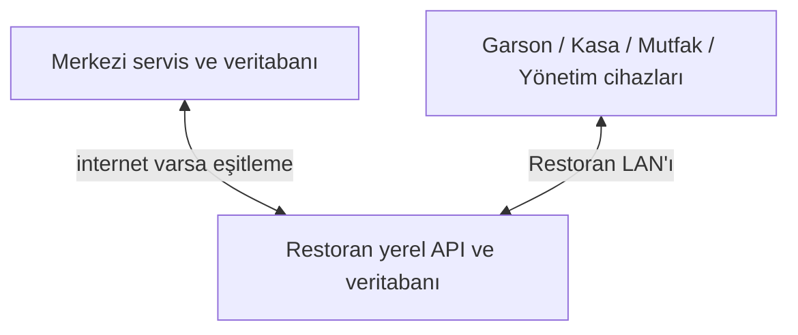

# HIPOS çevrimdışı çalışma ve merkezi eşitleme sözleşmesi

Durum: Ürün gereksinimleri kullanıcı tarafından onaylandı; merkezi eşitleme topolojisi ve protokolü uygulama öncesi ADR bekliyor. Bugünkü kodda offline outbox veya yerelden merkeze replication varmış gibi okunmamalıdır.

## 1. Hedef

İnternet restoran operasyonunun önkoşulu değildir. İnternet yokken restoranın LAN'ına bağlı garson, kasa, mutfak ve yönetim cihazları aynı yerel API üzerinden ortak çalışır. Bağlantı yeniden geldiğinde yerelde kaydedilen işlemler merkezi veritabanına güvenli, gözlenebilir ve tekrar çalıştırılabilir biçimde eşitlenir. Bu bir gerçek restoran çalışma gereksinimidir.

İlk sürümde cihazda açık kullanıcı oturumu yeterlidir; garson için ek PIN/kimlik doğrulama akışı gerekmiyor. Yerel işlemler yine de açık kullanıcı hesabı/oturumu, cihaz ve şube bağlamını taşımalıdır. Oturumun internet olmadan geçerliliğini nasıl koruyacağı seçilecek auth token/session mimarisinde çözülmelidir.

## 2. Ağ modları



| Mod | Kullanıcının beklediği davranış | Kayıt yeri |
|---|---|---|
| İnternet + LAN | Normal ortak operasyon; yeni kayıt kalıcı API'ye yazılır ve merkezi sistemle güncel kalır. | Kesin yazma otoritesi ADR ile belirlenir. |
| İnternet yok, LAN/yerel API var | Tüm cihazlar yerel API'ye erişir; ortak sipariş/masa/ödeme durumunu sürdürür. Bulut bağlantısı yok uyarısı gösterilir. | Yerel sunucu DB; merkezi sync kuyruğu bekler. |
| Yerel API/LAN da erişilemiyor | Cihazların birbirine anlık ulaşması mümkün değildir. Bağımsız cihazda işlem biriktirme bu ilk onaylı gereksinimde henüz tanımlanmamıştır. | Karar verilene kadar desteklendiği iddia edilmez. |

Buradaki “internetsiz çalışma” her cihazda ayrı ayrı localStorage'a sipariş yazıp bunu eşit sanmak değildir. Ortak restoran durumu için yerel sunucu/API erişilebilir olmalıdır.

## 3. Onaylı gereksinimler ve mimari öneri

### Onaylı gereksinimler

- İnternet kesintisi LAN'daki ortak sipariş, masa/adisyon, mutfak ve kasa akışını durdurmaz.
- İnternet gelince kayıtlar merkezi kalıcı veritabanına aktarılmaya devam eder.
- Aynı işlem tekrar denenince çift satış, çift sipariş, çift ödeme veya çift stok etkisi oluşmaz.
- Kullanıcı arayüzü internet/LAN bağlantısını ve merkeze bekleyen eşitlemeyi farklı durumlar olarak gösterir.

### Uygulama öncesi öneri

Restoran içinde bir yerel API + PostgreSQL sunucusu barındırılır ve iş komutları önce orada kalıcı olur. Aynı API'nin outbox'ı değiştirilemez iş olaylarını/komut sonuçlarını merkeze sırayla gönderir. Merkezi sistem event kimliği ve kaynak sürümünü idempotent işler, ACK/durum döner. İnternet varken de tek ve kararlı istemci adresi için cihazlar önce yerel API'ye yazar; yerel API online iken merkeze eşitlemeyi sürdürür. Bu, internet gidince endpoint değiştirmeden ortak çalışmayı korur.

Bu öneri; çoklu master yazma ve iki DB arasında doğrudan “son yazan kazanır” replication kullanmamayı hedefler. İş kurallarıyla anlaşmazlık çıktığında sipariş/ödeme verisini sessizce üstüne yazmak kabul edilmez. Eşitleme merkezi kaydın mülkiyetini, offline uniqueness ve şema sürümü kurallarını ayrıca tanımlar.

## 4. Komut ve sync kaydı için asgari alanlar

Her iş komutu veya outbox olayı en az şu alanları taşır:

```text
eventId / commandId       UUID; tekrar denemelerde değişmez
tenant: firmId, branchId  API tarafından yetkilendirilir
actor: userId             gerçek oturum aktörü
deviceId, stationId       şube içindeki kayıt noktası
aggregateType, aggregateId Order/Check/Payment/... kimliği
aggregateVersion          sıralama ve yarış kontrolü
eventType, schemaVersion  sürümlü semantik
occurredAtUtc             cihaz zamanı tanısal; otorite için sunucu zamanı ayrıca
payload, payloadHash      kişisel veri ve boyut minimizasyonu
syncState                 pending/sending/acked/retry/blocked/conflict
attemptCount, nextAttemptAtUtc, lastErrorCode
```

Kimlikler bağlantı yokken oluşturulabilir ve bulutta çakışmayacak formatta olmalıdır (UUIDv7/random UUID veya güvenilir id allocation). Merkezi API, payload hash'i farklı olan aynı `eventId` tekrarını idempotent başarı saymaz; `IDEMPOTENCY_CONFLICT` döndürür. Ödeme provider referansı ve dış terminal sonucu ayrıca saklanır.

Outbox yazımı iş verisiyle aynı yerel DB transaction'ında olmalıdır: ya ikisi birlikte commit olur ya hiçbiri. Worker gönderimden önce kaydı silmez. ACK alınınca durum güncellenir; hata sınıfına göre backoff ve uyarı uygulanır. Geçici ağ hatası kayıt kaybettirmez; şema/iş kuralı çatışması sonsuz denemeye bırakılmaz, açıkça bloke edilir ve operatör aksiyonu ister.

## 5. Veri tutarlılığı kuralları

- **Satış/sipariş:** Aynı `commandId` yalnız bir iş sonucu oluşturur. Mutfak ekranı aynı olay tekrarında ikinci bilet göstermez.
- **Ödeme:** Yerel sunucu kart terminalinden kesin sonucu bilmeden ödeme başarılı sayılmaz. Bağlantı/timeout sonrası `unknown` durumunda provider reference ile sorgu yapılır; otomatik yeni tahsilat başlatılmaz.
- **Masa/adisyon:** Aynı anda LAN'daki iki cihaz ortak API'ye erişiyorsa server-side optimistic concurrency / unique active check uygulanır. Eski `expectedVersion` `409 VERSION_CONFLICT` döndürür ve yeni durum yüklenir.
- **Ürün/fiyat:** Sipariş satırı seçilen ürün/fiyat snapshot'ını taşır. İnternetsizken cache snapshot sürümü ve geçerlilik zamanı gösterilir. Yerel sunucuda yeni fiyat yayınlama yetkisi ayrıca belirlenir.
- **Saat sırası:** Cihazın UTC saati kayıt açıklaması olabilir ancak finansal sıralama için tek başına otorite değildir. Yerel sunucu commit sıra/UTC zamanı verir; merkezi eşitleme kaynak sequence'ini korur.
- **İptal/iade/düzeltme:** Önceki olay silinmez/değiştirilmez; sebep ve orijinal referanslı yeni telafi olayıdır.
- **Purge/retention:** Eşitlenmemiş olay yerel retention temizliğinden muaf olmalıdır. Silme/anonimleştirme politikası finans kayıtlarını ve yasal saklama ihtiyacını bozmamalıdır.

## 6. UI bağlantı/senkronizasyon durumları

Bağlantı göstergesi en az üç bağımsız bilgiyi tutmalıdır:

1. Yerel API'ye erişiliyor mu?
2. Merkezi servise internet üzerinden erişiliyor mu?
3. Eşitlenmemiş kayıt sayısı ve en eski bekleyen kayıt yaşı nedir?

Örnek durumlar: `Online ve eşit`, `Restoran ağı: çevrimiçi · İnternet yok`, `Merkeze 8 işlem bekliyor`, `Yerel sunucuya erişilemiyor`, `Eşitleme durdu · işlem desteği gerekli`. Başarılı sipariş yerel DB'ye commit edilmişse kullanıcıya “yerelde kaydedildi, merkeze eşitleniyor” denebilir; cihazda yalnız RAM/cache'te ise başarılı kayıt gibi gösterilmez.

## 7. Oturum ve offline auth

Ürün kararı: garson için ayrı PIN yok; cihazda açık HIPOS oturumu var. Teknik sözleşme yine şu maddeleri kapsamalı:

- Yerel API internet yokken oturumu hangi kanıtla doğrular (signed JWT/JWKS cache, local identity gateway veya server-managed session)?
- Token/oturum süresi internet yokken hangi sınırla geçerlidir ve iptal/rol değişikliği LAN'a nasıl ulaşır?
- Tarayıcıda credential saklanmaz; mevcut auth belgesi güvenli cookie + CSRF adayını tanımlar. Local service için aynı-origin/proxy veya güvenli cihaz token'ı tercihine ADR gerekir.
- İlk sürümde garson PIN'i yapılmaz. Paylaşılan cihaz oturumu kişi bazlı denetim iddiasında bulunamaz; kullanıcı oturum açan hesap audit edilir.
- Yerel sunucu cihazları ve merkeze sync service ayrı servis kimliği/secret ile yetkilendirilir; geliştirici test header'ı üretime geçmez.

Bu seçim auth mühendisi ile operasyon mühendisi tarafından birlikte yapılmalıdır. Güvenli açık oturum ile internetsiz yetki kontrolü arasında süre/iptal politikası belirlenmeden kodda “offline auth hazır” işareti konmaz.

## 8. Recovery ve işletim

- Yerel DB günlük yedeklenir ve restore denemesi kabul senaryosu olur.
- Sunucu yeniden başlarsa bekleyen outbox, kalıcı DB'den kaldığı yerden devam eder.
- Aynı event'in ACK cevabı kaybolursa tekrar gönderim merkezde ikinci kayıt üretmez.
- Merkez bakımdayken restoran yerelde çalışmayı sürdürür; bekleyen sync göstergesi ve disk/outbox kapasitesi ölçülür.
- Yerel DB dolmaya yaklaşırsa yeni işlem sessizce kabul edilmez; operatöre görünür alarm/operasyon prosedürü tanımlanır.
- Sürüm uyuşmazlığında eski yerel API'nin bilmediği event sessizce atılmaz; sync bloklanır ve uyumlu yükseltme prosedürü gerekir.
- Sağlık ölçümleri: local API, DB, internet, outbox backlog, en eski bekleyen event, son ACK, tekrar sayısı, blocked event sayısı.

## 9. Offline kabul senaryoları

1. Normal online sipariş yerel/merkez yazma modeline göre kalıcıdır ve tüm ekranlarda görünür.
2. İnternet bağlantısı kesilir; yeni garson siparişi LAN üzerinden oluşturur; kasa ve mutfak ekranı aynı siparişi görür.
3. İnternet yokken yerel API restart edilir; sipariş ve bekleyen sync kaydı kaybolmaz.
4. İnternet geri gelir; event'ler sıralı ve idempotent eşitlenir; merkezde tam bir kayıt bulunur.
5. ACK cevabı kaybolur; aynı event tekrar gönderilir ve merkezde duplicate oluşmaz.
6. Aynı masada eşzamanlı değişiklikte stale version reddedilir; kullanıcı en güncel adisyonu görür.
7. Terminal sonucu timeout olduğunda ödeme `unknown` kalır; tekrar tahsilat öncesi status lookup gerekir.
8. Yerel disk/outbox kapasitesi sınırına yaklaşırsa alarm üretir; kayıt kaybı sessizce yaşanmaz.
9. Şema/validation hatalı olay `blocked` olur ve retry kuyruğunu sonsuza dek durdurmaz.
10. Yerel sunucu/LAN yokken kullanıcıya bu kapsamın henüz desteklenmediği açıkça belirtilir; ürün sessizce localStorage kuyruğu ile ortaklık varmış gibi davranmaz.

## 10. ADR bekleyen kararlar

1. Merkezi veritabanı ve yerel DB'nin otorite rolü; online yazma yolu.
2. Yerel sunucu donanımı/OS/container dağıtımı, DB yedeği, yükseltme ve LAN keşfi.
3. Sync protokolü (outbox API, event endpoint, batch/ACK) ve event ordering partition key'i.
4. Auth token/session'in yerel servisle internet olmadan doğrulanması ve rol iptal SLA'sı.
5. Uygulamanın başta hangi operasyonları yerel sunucuda çalıştıracağı; POS ödeme/mali cihaz sağlayıcılarının internet bağımlılığı.
6. Server/LAN tamamen yokken cihaz içi offline desteğin ürün kapsamı.
7. Conflict resolution operatör ekranı ve destek/audit akışı.
