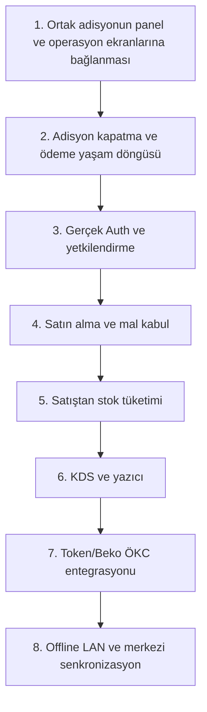

# HIPOS — Mevcut Durum ve Modüler Yol Haritası

> **Doküman Durumu:** Canlı Yol Haritası · Sürüm: v2.5 (21 Ekim 2026)
>
> **Dokümantasyon Hiyerarşisi:**
> * **Güncel kod durumu için:** [docs/01-mimari-ve-altyapi/BACKEND_MIMARISI_VE_MODUL_BAGIMLILIKLARI.md](../01-mimari-ve-altyapi/BACKEND_MIMARISI_VE_MODUL_BAGIMLILIKLARI.md)
> * **Güncel teslim ve yol haritası için:** [docs/00-devir-rehberi/DURUM_VE_YOL_HARITASI.md](DURUM_VE_YOL_HARITASI.md)
> * **Devir ve onboarding için:** [docs/00-devir-rehberi/DEVIR_REHBERI.md](DEVIR_REHBERI.md)
> * **Tarihsel kararlar için:** [docs/05-gecmis-ve-arsiv/](../05-gecmis-ve-arsiv/)

---

## 1. Ürün Hedefi ve Çalışma Kapsamı

HIPOS; gerçek bir restoranın yönetim (ERP), mutfak (KDS), salon servis (Waiter) ve kasa (POS) operasyonlarını **tek bir işletme ve veri omurgasında** birleştirmeyi hedefler.

> Bu maddeler ürün hedefidir; çalışan özelliklerin listesi değildir. Kalıcı MVP dilimleri ve henüz eksik olan gerçek POS/ödeme, Auth, KDS ve çevrimdışı senkronizasyon durumu aşağıdaki modül matrisinde ayrılmıştır.

* **Yönetim Paneli (`apps/admin`):** Ürün, menü, fiyat, personel, masa, hammadde, reçete, stok, cari ve giderleri yönetir.
* **Kasa ve Hızlı Satış (`apps/pos`):** Kasiyerlerin PIN ile girdiği, adisyon tahsil ettiği (nakit, kredi kartı banka seçimi, yemek kartı, cari), kasa avansı eklediği ve gün sonu Z-Raporu aldığı dokunmatik ekrandır.
* **Salon Servis Ekranı (`apps/pos/src/OperationalApps.tsx` - `/waiter`):** Garsonun masaları görüp sipariş aldığı el terminalidir.
* **Mutfak Ekranı (`apps/pos/src/OperationalApps.tsx` - `/kitchen`):** Aşçıların siparişleri istasyon bazlı gördüğü ve hazırlık durumunu yönettiği ekrandır.
* **Çevrimdışı Çalışma (LAN Hub):** Restoranın interneti kopsa bile yerel ağdaki Mini PC üzerinden operasyonun saniyesi saniyesine kesintisiz devam etmesi, internet geldiğinde buluta eşitlenmesidir.

---

## 2. MODÜL MODÜL MEVCUT DURUM VE YAPILACAKLAR (İş Alanları)

Bu bölüm, her bir fonksiyonel modülde **şu an kodda neyin gerçekten çalıştığını**, **neyin henüz eksik olduğunu** ve **modül backlog'unu** özetler. Tek güncel teslim sırası Bölüm 5'tedir; modül backlog maddeleri tüm gelecek kapsamı korur, ayrı bir öncelik sırası tanımlamaz.

Mevcut kalıcı MVP dilimleri katalog/menü, cari, stok-reçete-sayım, manuel kasa, gider kaydı ve ortak adisyon/sipariş çekirdeğidir. `apps/pos` test ekranı ve ödeme simülatörü geliştirme araçlarıdır; gerçek POS veya gerçek ödeme anlamına gelmez.

---

### [Modül 1] Kasa & Hızlı Satış Modülü (Cashier / POS)

| Kriter | Detay |
|---|---|
| **Veritabanı Şeması** | `cash` şeması (`cash.registers`, `cash.shifts`, `cash.movements`, `cash.audit`) |
| **İlgili EF Core Context** | [CashDbContext.cs:L6-L65](../../apps/api/Hipos.Api/Cash/CashDbContext.cs#L6-L65) |
| **Ön Yüz Ekranı** | [CashManagementPage.tsx:L7-L60](../../apps/admin/src/features/cash/CashManagementPage.tsx#L7-L60) |
| **Kılavuz Doküman** | 👉 [Modül 1 Şartnamesi](MODUL_01_KASA_VE_POS.md) · [Kasa ve POS Operasyon Sözleşmesi](../02-kasa-ve-operasyon/KASA_POS_VE_OPERASYON_SOZLESMESI.md) · [Kasa Test Kılavuzu](../04-test-ve-rehberler/KASA_MANUEL_TEST.md) |

* **Şu An Ne Yapılmış? (Mevcut Durum):**
  - Tek bir kasa için manuel vardiya açma/kapatma ve elle nakit giriş/çıkış defteri PostgreSQL API'sine tam bağlıdır.
  - İdempotent `MAIN` kasa provisioning mekanizması ve hareket düzeltme (reversal) zinciri mevcuttur.
* **Ne Eksik? (Henüz Yapılmamış Olanlar):**
  - Satış ve adisyon kapamaları kasaya otomatik yansımamaktadır (çift defter sorunu).
  - Parçalı ödeme (Nakit + Kart + Cari + Yemek Kartı) altyapısı yoktur.
  - Çoklu kasa (Ana Kasa, Bar vb.) ve kasiyer PIN ile kasa seçimi yoktur.
  - Gün sonu Z-Raporu, kupür sayımı (200x, 100x...) ve hasılat teslim tutanağı (Safe Drop) yoktur.
* **Modül backlog'u (teslim sırası için §5'e bakın):**
  1. `sales.check_payments` tablosunun eklenmesi ve parçalı ödeme tiplerinin desteklenmesi.
  2. Kasiyerlerin 4 haneli PIN ile istasyon/kasa seçerek oturum açması.
  3. Adisyon kapatıldığında nakit tutarın otomatik `cash.movements`'a işlenmesi.
  4. Gün sonu açık masa kilit denetimi, kupür sayımı ve Z-Raporu dökümü.

---

### [Modül 2] Masa Servisi ve Ortak Adisyon Modülü (Service & Checks)

| Kriter | Detay |
|---|---|
| **Veritabanı Şeması** | `service` ve `sales` şemaları (`service.tables`, `service.employees`, `sales.checks`, `sales.orders`) |
| **İlgili EF Core Context** | [ServiceDbContext.cs:L6-L30](../../apps/api/Hipos.Api/Service/ServiceDbContext.cs#L6-L30), [SalesDbContext.cs:L6-L56](../../apps/api/Hipos.Api/Sales/SalesDbContext.cs#L6-L56) |
| **Ön Yüz Ekranı** | [ServiceTablesPage.tsx:L1-L60](../../apps/admin/src/features/branches/ServiceTablesPage.tsx#L1-L60), [OperationalApps.tsx:L38-L120](../../apps/pos/src/OperationalApps.tsx#L38-L120) (`/waiter`) |
| **Kılavuz Doküman** | 👉 [Modül 2 Şartnamesi](MODUL_02_MASA_VE_ADISYON.md) · [Adisyon, Sipariş ve Masa Yaşam Döngüsü](../02-kasa-ve-operasyon/ADISYON_VE_MASA_YASAM_DONGUSU.md) · [Ortak Adisyon](../02-kasa-ve-operasyon/ORTAK_ADISYON_SOZLESMESI.md) |

* **Şu An Ne Yapılmış? (Mevcut Durum):**
  - 24 masa, garson çalışanları ve açık masa-adisyon bağlantıları PostgreSQL'e bağlıdır.
  - Garson ekranından (`/waiter`) masaya sipariş girildiğinde ortak adisyon oluşturulmakta ve kalemler API'ye yazılmaktadır.
* **Ne Eksik? (Henüz Yapılmamış Olanlar):**
  - Adisyon kapatma (`closed`) akışı yoktur; ödeme yapıldığında masa boşalmamaktadır.
  - Masa taşıma (`Masa 4 -> Masa 9`) ve masa birleştirme (`Masa 1 + Masa 2`) yoktur.
  - Kalem iptali, ikram, indirim ve müdür onay şifresi (`check_voids`) yoktur.
  - Ürün seçenekleri ve varyasyonları (modifiers) sipariş kalemine eklenememektedir.
* **Modül backlog'u (teslim sırası için §5'e bakın):**
  1. Masa taşıma ve birleştirme endpoint'lerinin ve UI akışının yazılması.
  2. Adisyon bölme (hesabı ikiye bölme) yeteneği.
  3. Adisyon ödendiği anda masanın durumunun otomatik `empty` (yeşil) durumuna geçmesi.

---

### [Modül 3] Mutfak (KDS) & Servis Kuyruğu Modülü (Kitchen)

| Kriter | Detay |
|---|---|
| **Veritabanı Şeması** | `kitchen` görev/audit/istasyon şeması; kaynak sipariş için `sales`, masa ve garson bağı için `service` |
| **İlgili EF Core Context** | [KitchenDbContext.cs](../../apps/api/Hipos.Api/Kitchen/KitchenDbContext.cs) · [SalesDbContext.cs](../../apps/api/Hipos.Api/Sales/SalesDbContext.cs) |
| **Ön Yüz Ekranı** | [OperationalApps.tsx:L38-L120](../../apps/pos/src/OperationalApps.tsx#L38-L120) (`/kitchen`) |
| **Kılavuz Doküman** | 👉 [Modül 3 Şartnamesi](MODUL_03_MUTFAK_VE_KDS.md) · [Mutfak Ekranı (KDS) ve Yazıcı Kılavuzu](../02-kasa-ve-operasyon/MUTFAK_KDS_VE_YAZICI.md) |

* **Şu An Ne Yapılmış? (Mevcut Durum):**
  - Garson siparişindeki her kalem transaction içinde kalıcı `kitchen.tasks` görevine dönüşür; aynı adisyona sonradan eklenen sipariş yeni görev üretir.
  - `/kitchen` ekranı görevleri 3 saniyede bir yeniler; dokunmatik durum geçişleri, gecikme görünümü, servise hazır ve son servis edilen bölümleri çalışır.
  - İlk kategori-istasyon yönlendirmesi ve Fırın/Sıcak Mutfak/Bar/Soğuk Mutfak/Atanmamış filtreleri çalışır.
  - Tekil istek, sürüm kontrolü ve audit kaydı uygulanmıştır; iptal verisi ve ekran görünümü hazırdır.
  <!-- 23 Ekim 2026: Modülün salt-okunur prototip olduğu yönündeki eksik durum bilgisi, yapılan KDS işleriyle güncellendi. -->
* **Ne Eksik? (Henüz Yapılmamış Olanlar):**
  - `Hazır` durumunun garson ekranına anlık bildirimi ve teslim alma akışı yoktur.
  - Satış/adisyon kalem iptali ve müdür PIN onayı mutfak görevine bağlı değildir.
  - İstasyon/kategori eşleştirmelerini yönetecek panel yoktur; yalnız başlangıç eşleştirmeleri vardır.
  - Gerçek kullanıcı/PIN yetkilendirmesi ve offline/sync kuyruğu yoktur.
  - Sipariş onaylandığında mutfaktaki termal bilet yazıcısından (ESC/POS 9100) otomatik fiş basılmamaktadır.
  <!-- 23 Ekim 2026: Çalışan durum makinesi ve ilk istasyon ayrımı eksik listesinden çıkarıldı; devam eden sorunlar silinmeden ayrıntılandırıldı. -->
* **Modül backlog'u (teslim sırası için §5'e bakın):**
  1. Garsona hazır bildirimi ve satış/adisyon iptal entegrasyonu.
  2. Gerçek PIN/rol yetkisi, yönetilebilir istasyonlar ve offline işlem kuyruğu.
  3. Yerel ağdaki termal yazıcıya TCP 9100 üzerinden otomatik mutfak fişi basım servisi ve yazıcı kuyruğu.

---

### [Modül 4] Ürün Kataloğu & Menü Yönetimi Modülü (Catalog & Menus)

| Kriter | Detay |
|---|---|
| **Veritabanı Şeması** | `catalog` şeması (`catalog.products`, `catalog.categories`, `catalog.menus`, `catalog.price_versions`) |
| **İlgili EF Core Context** | [CatalogDbContext.cs:L6-L50](../../apps/api/Hipos.Api/Catalog/CatalogDbContext.cs#L6-L50) |
| **Ön Yüz Ekranı** | [MenusPage.tsx:L1-L60](../../apps/admin/src/features/catalog/MenusPage.tsx#L1-L60), [CatalogPages.tsx:L1-L60](../../apps/admin/src/features/catalog/CatalogPages.tsx#L1-L60) |
| **Kılavuz Doküman** | 👉 [Modül 4 Şartnamesi](MODUL_04_KATALOG_VE_MENU.md) · [Katalog Backend Sözleşmesi](../03-is-alanlari-ve-yonetim/KATALOG_BACKEND_SOZLESMESI.md) · [Menü Yönetimi MVP](../03-is-alanlari-ve-yonetim/MENU_YONETIMI_MVP.md) |

* **Şu An Ne Yapılmış? (Mevcut Durum):**
  - Kategoriler, ürün taslağı, fiyat sürümü ve POS yayını PostgreSQL'e tam bağlıdır.
  - Menü oluşturma, kategori ve ürün sıralama, tek aktif menü seçimi API üzerinden çalışmaktadır.
* **Ne Eksik? (Henüz Yapılmamış Olanlar):**
  - Ürün seçenekleri/ekstraları (Modifiers: "Büyük Boy +20 TL", "Az Pişmiş") tanımlanamamaktadır.
  - QR Menü dış yayını henüz yoktur.
* **Modül backlog'u (teslim sırası için §5'e bakın):**
  1. Ürünlere opsiyon grubu (Modifiers) şemasının eklenmesi.
  2. Şube menülerinin masalara özel QR kod çıktısı üretmesi.

---

### [Modül 5] Stok, Depo & Reçete Modülü (Inventory & Recipes)

| Kriter | Detay |
|---|---|
| **Veritabanı Şeması** | `inventory` şeması (depo, hammadde, reçete, hareket, sayım, mal kabul ve fire kayıtları) |
| **İlgili EF Core Context** | [InventoryDbContext.cs:L6-L50](../../apps/api/Hipos.Api/Inventory/InventoryDbContext.cs#L6-L50) |
| **Ön Yüz Ekranı** | [InventoryHttpPage.tsx](../../apps/admin/src/features/inventory/InventoryHttpPage.tsx) · [ReceivingPage.tsx](../../apps/admin/src/features/inventory/ReceivingPage.tsx) · [WastePage.tsx](../../apps/admin/src/features/inventory/WastePage.tsx) |
| **Kılavuz Doküman** | 👉 [Modül 5 Şartnamesi](MODUL_05_STOK_VE_RECETE.md) · [Reçeteli Stok ve Satın Alma](../03-is-alanlari-ve-yonetim/RECETELI_STOK_VE_SATINALMA.md) · [Stok Test Kılavuzu](../04-test-ve-rehberler/STOK_REÇETE_SAYIM_MANUEL_TEST.md) |

* **Şu An Ne Yapılmış? (Mevcut Durum):**
  - Hammadde listesi, kritik stok uyarıları, reçete tanımları ve fiziksel sayım onay kilitleri PostgreSQL'e bağlıdır.
  - Mal kabul taslağı ve onayı çalışır; onay stok girişini ve tedarikçi borcunu atomik olarak oluşturur. Tedarikçiye iade ayrı ters kayıtla çalışır.
  - Gerekçeli fire/zayi kaydı stoğu `waste_loss` hareketiyle düşürür. Fire ekranında fiyat veya maliyet bilgisi istenmez.
  - Eksik teslim düzeltmesinin backend ve geçmiş kayıtları korunur; yeni düzeltme formu mal kabul panelinden kaldırılmıştır.
* **Ne Eksik? (Henüz Yapılmamış Olanlar):**
  - Satış yapıldığında hammadde stoktan otomatik düşmemektedir (reçete tüketim motoru yoktur).
  - Satın alma talebi/siparişi ve mal kabulün siparişle eşleştirilmesi yoktur.
  - Gerçek şef PIN onayı ve reçeteli ürün zayisi yoktur.
  - Fiyatlandırma, stok maliyeti ve parasal zayi raporu ayrı modül kararına ertelenmiştir.
* **Modül backlog'u (teslim sırası için §5'e bakın):**
  1. Adisyon kapandığında reçetedeki gramajları stok hareketlerinden otomatik düşen `recipe_consumption` motoru.
  2. Gerçek kimlik/yetkilendirme tamamlandığında fire ve kritik stok işlemlerine rol/PIN denetimi bağlanması.
  3. Satın alma talebi ve siparişiyle mal kabul eşleştirmesi.
  4. Fiyatlandırma ve maliyet alanının ayrı sözleşmeyle tasarlanması.

---

### [Modül 6] Cari Hesaplar & Gider Yönetimi Modülü (Finance & Cari)

| Kriter | Detay |
|---|---|
| **Veritabanı Şeması** | `cari` ve `finance` şemaları (`cari.parties`, `cari.movements`, `finance.expenses`) |
| **İlgili EF Core Context** | [CariDbContext.cs:L6-L30](../../apps/api/Hipos.Api/Cari/CariDbContext.cs#L6-L30), [ExpenseDbContext.cs:L6-L30](../../apps/api/Hipos.Api/Expenses/ExpenseDbContext.cs#L6-L30) |
| **Ön Yüz Ekranı** | [CarilerHttpPage.tsx:L1-L60](../../apps/admin/src/features/demo/CarilerHttpPage.tsx#L1-L60), [ExpenseManagementPage.tsx:L1-L60](../../apps/admin/src/features/expenses/ExpenseManagementPage.tsx#L1-L60) |
| **Kılavuz Doküman** | 👉 [Modül 6 Şartnamesi](MODUL_06_CARI_VE_GIDER.md) · [Cari Hesaplar MVP](../03-is-alanlari-ve-yonetim/CARI_HESAPLAR_MVP.md) · [Gider Yönetimi MVP](../03-is-alanlari-ve-yonetim/GIDER_YONETIMI_MVP.md) |

* **Şu An Ne Yapılmış? (Mevcut Durum):**
  - Müşteri/tedarikçi kartları, borç/alacak/tahsilat hareketleri ve tarih aralıklı ekstre PostgreSQL'e bağlıdır.
  - Firma gider kategorileri ve şube gider defteri çalışmaktadır.
* **Ne Eksik? (Henüz Yapılmamış Olanlar):**
  - Masada hesap "Cari/Veresiye" kapatıldığında müşterinin cari bakiyesine borç yazılamamaktadır.
  - Toptancıya kasadan nakit tediye ödemesi yapıldığında hem kasadan düşüp hem cari borcu azaltan atomik akış yoktur.
* **Modül backlog'u (teslim sırası için §5'e bakın):**
  1. Kasa parçalı ödemesinde `[Cari Hesaba Yaz]` seçeneğinin cari hareket üretmesi.
  2. Toptancıya kasadan ödeme yaparken kasa seçimi ve cari borç kapama entegrasyonu.

---

## 3. TEKNİK OMURGA VE ALTYAPI DURUMU

Tüm iş modüllerinin arkasındaki mimari omurganın durumu şöyledir:

---

### [Altyapı A] Kimlik, Oturum, Rol ve Şube İzolasyonu (Auth / Multi-Tenancy)
* **Mevcut Kod Durumu:** `X-Demo-Actor` HTTP başlığı ile sahte aktör kullanılmaktadır. Veritabanında `auth` şeması ve kullanıcı tablosu yoktur.
* **Hedef:** PostgreSQL `auth` şeması, BCrypt parola hash'leme, JWT/Cookie oturum middleware'i ve terminaller için 4 haneli kasiyer/garson PIN doğrulaması.
* 📖 **Mimari Kılavuz:** 👉 [Kimlik, Oturum ve Yetkilendirme Kılavuzu](../01-mimari-ve-altyapi/KIMLIK_OTURUM_VE_YETKI.md) · **[Modül 7 Şartnamesi](MODUL_07_KIMLIK_VE_AUTH.md)**

---

### [Altyapı B] Çevrimdışı Çalışma, Yerel LAN ve Bulut Senkronizasyonu (Offline Sync)
* **Mevcut Kod Durumu:** Sistem doğrudan tek bir veritabanına bağlanır; internet koptuğunda çalışmayı sağlayacak outbox kuyruğu yoktur.
* **Hedef:** Restorandaki Mini PC üzerinde çalışan yerel PostgreSQL, `sync.outbox` tablosu ve internet geldiğinde kuyruktaki olayları merkezi buluta asenkron aktaran `SyncWorker` servisi.
* 📖 **Mimari Kılavuz:** 👉 [Çevrimdışı Çalışma ve Senkronizasyon Kılavuzu](../01-mimari-ve-altyapi/CEVRIMDISI_VE_SENKRONIZASYON.md)

---

### [Altyapı C] Donanım, ÖKC Mali Cihaz & Çevre Birimleri (Hardware Integration)
* **Mevcut Kod Durumu:** Ödeme simülatörü (`apps/pos`) sanal olarak çalışmaktadır; gerçek POS veya yazıcı bağlantısı yoktur.
* **Hedef:** Beko/Token GMP3 entegrasyonu ile temassız ödeme ve mali fiş onayı, USB barkod okuyucu dinleyicisi ve nakit ödemede para çekmecesini fırlatan RJ11 darbe sinyali.
* 📖 **Mimari Kılavuz:** 👉 [Donanım ve Mali Cihaz Kılavuzu](../01-mimari-ve-altyapi/DONANIM_VE_MALI_CIHAZLAR.md)

---

## 4. Bu Durum Neyi HENÜZ Kanıtlamaz? (Kritik Uyarılar)

1. **`X-Demo-Actor` Bir Güvenlik Mekanizması Değildir:** Geliştirme kolaylığı için konulmuştur; API internete açıldığı an taklit edilebilir.
2. **Kasa Defteri Henüz Otomatik Değildir:** Adisyon satışları kasaya otomatik akmadığı için kasa bakiyesi şu an sadece elle girilen avansları ve nakit hareketleri tutar.
3. **Mutfak Çekirdeğinin Üretim Bağları Eksiktir:** Kalıcı durum makinesi ve hazırlık butonları çalışır; garson bildirimi, satış iptali, gerçek auth, offline kuyruk ve yazıcı çıktıları henüz bağlı değildir.
<!-- 23 Ekim 2026: Eski salt-okunur uyarısındaki eksik bilgi eklendi; devam eden üretim riskleri korunmuştur. -->
4. **Offline Sync Henüz Canlı Değildir:** Bugün çalışan LAN demosu, aynı Wi-Fi ağındaki cihazların aynı yerel IP'ye bağlanmasından ibarettir; gerçek çift taraflı Outbox senkronizasyonu değildir.

---

## 5. Güncel Sıralı Geliştirme Yol Haritası (8 Öncelikli Adım)

> [!NOTE]
> **Tarihsel Not:** Eski dokümantasyonda yer alan `Kasa → Masa → Auth → KDS → Katalog → Stok...` sırası tarihsel plan olarak kalmıştır ve artık güncel öncelik değildir. Katalog, Cari, Inventory, Manuel Kasa, Gider, Ortak Adisyon ve kalıcı KDS çekirdeği mevcut MVP dilimleridir. Gerçek POS ve ödeme, Auth, KDS’nin garson/iptal/yazıcı üretim bağları ve Offline LAN/senkronizasyon henüz uygulanmamıştır. Bu bölüm belgedeki tek güncel teslim sırasıdır.
<!-- 23 Ekim 2026: Yol haritası özetine tamamlanan KDS çekirdeği eklendi; eksik üretim entegrasyonları korunmuştur. -->
>
> Bu sekiz adım ana teslim sırasını belirtir; modül şartnamelerinde yer alan tüm gelecek özelliklerin yerine geçmez. Ayrıntılı hedef ekranlar, alt akışlar ve kabul ölçütleri kendi modül belgelerinde korunur.

1. **Ortak adisyonun panel ve operasyon ekranlarına bağlanması:** `sales.checks`, `sales.orders` ve `service.tables` kayıtlarının yönetim paneli ile garson/operasyon ekranlarında ortak ve tutarlı gösterilmesi.
2. **Adisyon kapatma ve ödeme yaşam döngüsü:** Parçalı tahsilat, adisyonu `paid`/`closed` durumuna geçirme, ödeme kaydının kasa hareketiyle ilişkilendirilmesi ve masa bağının boşaltılması.
3. **Gerçek Auth ve yetkilendirme:** `X-Demo-Actor` yerine gerçek kullanıcı oturumu, rol/yetki denetimi ve terminaller için personel PIN doğrulaması.
4. **Satın alma ve mal kabul:** Satın alma belgesi ve irsaliye üzerinden stoğa giriş ile tedarikçi cari borcunun tutarlı kaydı.
5. **Satıştan stok tüketimi:** Adisyon kapandığında satılan ürünlerin reçetesindeki hammaddeleri `inventory.movements` üzerinden otomatik düşme.
6. **KDS ve yazıcı:** Mutfak sipariş durumlarını yönetme, istasyon ve gecikme görünümü, termal yazıcıya otomatik bilet gönderme.
7. **Token/Beko ÖKC entegrasyonu:** Gerekli sağlayıcı ve cihaz süreci tamamlandığında mali cihazla gerçek tahsilat ve mali fiş akışı.
8. **Offline LAN ve merkezi senkronizasyon:** Yerel sunucu, dayanıklı olay kuyruğu ve bağlantı geri geldiğinde merkezi sisteme senkronizasyon.

---

## 6. Teknik Kalite Kapıları ve Test Kriterleri

Geliştirilen her yeni özellik şu 5 kalite kapısından geçmek zorundadır:
1. **İdempotency:** Tekrarlanan hiçbir istek veritabanında çift kayıt, çift bilet veya mükerrer tahsilat üretmemelidir (`requestId` zorunluluğu).
2. **Denetim İzi (Audit Log):** Para hareketi, hesap kapama, indirim veya iptal yapan kullanıcının kimliği ve zamanı asla silinemez bir audit tablosuna yazılmalıdır.
3. **Şema İzolasyonu:** Hiçbir servis başka bir iş alanının tablosuna doğrudan SQL güncellemesi atamaz; işlemler sadece tanımlı domain servisleri ve event'ler üzerinden akar.
4. **Görsel Durum Dürüstlüğü:** Mock veri ile gerçek veri ekranda asla karıştırılmamalı, örnek veriler açıkça *"Örnek Gösterim"* etiketi taşımalıdır.
5. **Otomatik Testler:** Değişiklikler Node testleri (`npm test`), API testleri (`test:api`) ve PostgreSQL geçici veritabanı testlerinden (`npm run test:db`) hatasız geçmelidir.
