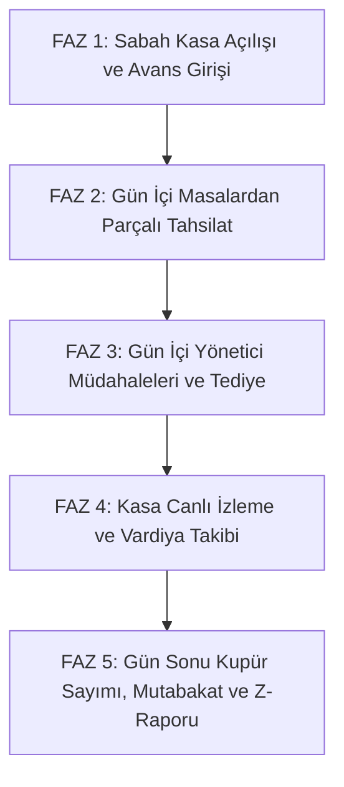

# Modül 1 Devir Şartnamesi — Kasa, POS ve Parçalı Tahsilat Mimarisi (A'dan Z'ye)

> **Doküman Durumu:** Kesinleşmiş Modül Devir ve Uygulama Şartnamesi · Sürüm: v3.1
> **Kapsam:** Saha İhtiyaçları, Yönetici Görüşme Notları, Ekran Davranışları, Veri Modeli ve Geliştirici Yol Haritası
>
> **Mevcut Durum Özeti:**
> * **Manuel kasa MVP’si:** çalışıyor (`cash` şeması, `CashManagementPage.tsx`, tek kasa vardiya/defter)
> * **Gerçek POS/parçalı ödeme/Z raporu:** planlandı (`sales.check_payments`, dokunmatik POS, çift deftersiz akış henüz yok)
>
> **PostgreSQL Şeması:** `cash` (Mevcut) + `sales.check_payments` (Sırada)
> **Yönetim Paneli:** Var (`CashManagementPage.tsx`)
> **API:** Var (`CashDbContext.cs`)
> **Test:** Var (`KASA_MANUEL_TEST.md`, `postgres.test.mjs`)
> **Üretime Hazır mı?:** Hayır (Yalnızca Manuel Kasa hazır; POS ve parçalı tahsilat geliştirme aşamasında)
>
> **Dokümantasyon Hiyerarşisi:**
> * **Güncel kod durumu için:** [docs/01-mimari-ve-altyapi/BACKEND_MIMARISI_VE_MODUL_BAGIMLILIKLARI.md](../01-mimari-ve-altyapi/BACKEND_MIMARISI_VE_MODUL_BAGIMLILIKLARI.md)
> * **Güncel teslim ve yol haritası için:** [docs/00-devir-rehberi/DURUM_VE_YOL_HARITASI.md](DURUM_VE_YOL_HARITASI.md)
> * **Devir ve onboarding için:** [docs/00-devir-rehberi/DEVIR_REHBERI.md](DEVIR_REHBERI.md)
> * **Tarihsel kararlar için:** [docs/05-gecmis-ve-arsiv/](../05-gecmis-ve-arsiv/)
>
> **Sıra Notu:** Bu şartnamedeki modül içi adımlar ve hedefler modül backlog'unu ayrıntılandırır. Repo genelindeki güncel teslim sırası yalnız [Durum ve Yol Haritası](DURUM_VE_YOL_HARITASI.md) belgesindedir; bu backlog gelecekteki kapsamı daraltmaz.

---

### 📌 Hızlı Gerçeklik Özeti
* **Manuel Kasa MVP'si (Bugün Kodda Gerçekten Çalışanlar):**
  - Tek kasa (`MAIN`) için manuel vardiya açma/kapatma
  - Elle nakit avans girişi (`manual_in`) ve kasadan harcama çıkışı (`manual_out`)
  - Hareketlerden bakiye hesabı ve idempotent provisioning
  - Fiziksel sayım tutarı girişi ve fark analizi
  - Hatalı işlemler için gerekçeli ters kayıt (`reversal`) zinciri
* **Gerçek POS ve Parçalı Ödeme (Henüz Kodlanmamış / Planlanan Backlog):**
  - Gerçek banka POS entegrasyonu ve parçalı ödeme (Nakit + Banka POS + Cari + Yemek Kartı)
  - Masada hesap kapandığında nakitin otomatik kasaya akması (çift defteri kaldırma)
  - Gün sonu Z-Raporu sihirbazı ve 200x, 100x kupür sayımı
  - Kasadan toptancıya tediye ödemesi (`supplier_payout`)
  - Kasiyerlerin 4 haneli PIN ile kasa seçerek oturum açması

---

## 🎯 1. Modülün Amacı Nedir?

Bu modülün hedefi; adisyon ve hızlı satışları gerçek POS ile tahsil etmek, parçalı ödemeyi ve otomatik kasa hareketlerini desteklemek, cari/tediye akışlarını bağlamak ve gün sonunda Z-Raporu üretmektir. Bunlar mevcut manuel kasa MVP'sinin kapsamı dışındadır ve henüz uygulanmamıştır.

Kısacası: **Restoranın para çekmecesini, tahsilat omurgasını ve ciro güvenliğini canlıya hazır hale getireceksiniz.**

---

## 📂 2. Hangi Dosyalar ve Kod Bloklarıyla Çalışacaksın?

Sizin çalışma alanınız temel olarak 3 yerdedir (ilgili kod satırına gitmek için linklere tıklayabilirsiniz):

1. **Kasa & Yönetim Ön Yüzü (UI):**
   * [CashManagementPage.tsx:L7-L60](../../apps/admin/src/features/cash/CashManagementPage.tsx#L7-L60) — Müdürün gördüğü tek kasa vardiyası (`Shift`), hareketler (`Movement`), açılış nakdi ve manuel giriş/çıkış ekranı.
   * [OperationalApps.tsx:L38-L120](../../apps/pos/src/OperationalApps.tsx#L38-L120) — Garson ve kasiyerin masaları görüp sipariş girdiği dokunmatik ekran.
   * [PaymentSimulatorPanel.tsx:L1-L60](../../apps/pos/src/PaymentSimulatorPanel.tsx#L1-L60) — Tahsilat ve kart deneme paneli.
   * [catalog.ts:L93-L105](../../apps/admin/src/data/catalog.ts#L93-L105) — Sol menüdeki `Kasalar` navigasyon başlığı ve alt sekmeleri.
   * [routes.tsx:L222-L226](../../apps/admin/src/app/routes.tsx#L222-L226) — Kasa menüsü tıklandığında `CashManagementPage`'e yönlendiren router kodu.
2. **Kasa & Satış Backend'i (.NET API):**
   * [CashDbContext.cs:L6-L65](../../apps/api/Hipos.Api/Cash/CashDbContext.cs#L6-L65) — Kasalar (`CashRegisterRow`), vardiyalar (`CashShiftRow`) ve para hareketleri (`CashMovementRow`).
   * [SalesDbContext.cs:L6-L56](../../apps/api/Hipos.Api/Sales/SalesDbContext.cs#L6-L56) — Adisyonlar (`SalesCheckRow`), siparişler (`SalesOrderRow`) ve ödeme denemeleri (`PaymentAttemptRow`).
3. **Mevcut Testler:**
   * [KASA_MANUEL_TEST.md](../04-test-ve-rehberler/KASA_MANUEL_TEST.md) — Kasa ve vardiya elle test rehberi.
   * [postgres.test.mjs:L2050-L2100](../../apps/api/Hipos.Api.Tests/postgres.test.mjs#L2050-L2100) — PostgreSQL uçtan uca kasa ve adisyon testleri.

---

## 🏢 3. Yönetici ve Saha Notları (Gerçek Restoran İhtiyaçları)

Restoran yöneticileriyle yapılan görüşmelerde kesinleşen 5 operasyonel aşama:

> Aşağıdaki adımlar hedeflenen tam POS/kasa davranışını tarif eder; mevcut çalışan dilim yalnızca yukarıda belirtilen manuel kasa MVP'sidir.



### 1. Faz: Sabah Kasa Açılışı (Opening Float)
* Kasa sabah ilk açıldığında çekmecede bozuk para bulunması zorunludur.
* Yetkili personel (Müdür veya Kasiyer) kasayı açarken sisteme **başlangıç bozuk para avansını** (Örn: `1.500,00 TL`) girer.
* Kasiyer 4 haneli PIN kodunu girerek o kasanın oturumunu üzerine alır. Kasa açılmadan o terminalden adisyon tahsilatı yapılamaz.

### 2. Faz: Gün İçi Parçalı Tahsilat (Split Payment)
* Masadaki 2.400 TL hesabı ödemek isteyen kalabalık bir grup hesabı farklı yöntemlerle bölebilmelidir:
  * Örn: `1.000 TL Nakit` + `800 TL Ziraat Kart` + `400 TL Multinet` + `200 TL Cari Hesaba Borç`.
* **Kalan Bakiye:** Her tahsilat adımında kalan tutar ekranda canlı düşer (`2.400 -> 1.400 -> 600 -> 200 -> 0 TL`).
* **Otomatik Kasa Entegrasyonu (Çift Defteri Bitirme):** Nakit tahsilat yapıldığı milisaniyede, tutar o kasanın aktif vardiyasına (`cash.movements`) `cash_sale` hareketi olarak otomatik yazılır. Kasiyer veya müdür gün sonunda ayrıca *"Şu kadar nakit satıldı"* diye elle kayıt girmez!

### 3. Faz: Gün İçi Yönetici Müdahaleleri (Manager Interventions)
* **Kasaya Bozuk Para Takviyesi (`cash_float_in`):** Gün içinde 5 TL, 10 TL, 20 TL gibi bozuk paralar bittiğinde, yönetici çekmeceye takviye yapar. Bu tutar **satış cirosuna karışmaz**, avans takviyesi olarak izlenir.
* **Kasadan Hasılat Teslim Alma (`safe_drop`):** Yoğun saatlerde çekmecede 30.000 - 50.000 TL gibi yüksek nakit biriktiğinde güvenlik riski doğar. Yönetici kasadan 30.000 TL teslim alıp çelik kasaya kaldırır.
* **Tedarikçiye Kasadan Ödeme (Tediye / Cari Kapama):** Dükkana et toptancısı veya manav geldiğinde fatura nakit ödenmek istenirse; yönetici ekranda hangi kasada ne kadar nakit olduğunu görür. İlgili kasayı seçip `3.500 TL` nakit çıkışı yapar. Bu işlem hem kasadan nakit düşer, hem de tedarikçinin Cari borcunu anında kapatır.
* **Kasalar Arası Transfer:** Bahçe kasasında nakit bittiğinde Ana Kasadan Bahçe Kasasına para aktarımı yapılır.

### 4. Faz: Çoklu Kasa & Kasada Kim Var?
* Bir restoranda birden fazla kasa terminali bulunabilir (Örn: `Kasa 1 - Ana Giriş Kasası`, `Kasa 2 - Bahçe/Bar Kasası`, `Kasa 3 - Paket Servis`).
* Her terminalde o an hangi kasiyerin oturduğu açıktır:
  `🟢 KASA 1 (ANA GİRİŞ) · 👤 Melis Kaya · ⏱️ 09:15'ten beri açık · 💵 Çekmecede: 14.850,00 TL`
* Tüm tahsilatlar ve iptaller o kasiyerin kimliğiyle audit kütüğüne yazılır.

### 5. Faz: Gün Sonu, Kupür Sayımı ve Z-Raporu
* **Açık Masa Kilidi:** Kasa kapatılmadan önce sistem açık adisyon kontrolü yapar. Salonda açık masa varsa yönetici uyarılır.
* **Fiziksel Kupür Sayımı:** Kasiyer çekmecedeki paraları tek tek sayarak adet girer: 200 TL x 25, 100 TL x 40, 50 TL x 30...
* **Fark Hesabı:** Sistemde teorik olması gereken para ile sayılan para karşılaştırılır:
  $$\text{Fark} = \text{Sayılan Nakit} - \text{Sistemdeki Beklenen Nakit}$$
* **Hasılat ve Devir Ayrımı:** Yarına devredecek bozuk para avansı (Örn: 1.000 TL) ayrılır; günün hasılatı çelik kasaya teslim tutanağına bağlanır.
* **Z-Raporu Dökümü:** Brüt ciro, KDV oranları (%1, %10, %20), ödeme kanalları toplamı (Nakit, Ziraat POS, Vakıf POS, Sodexo, Multinet, Cari) ekranda ve termal yazıcıda dökülür.

---

## 🖥️ 4. Ekran Ekran Detaylı Davranış ve Özellikler

### 📱 EKRAN 1: Dokunmatik Kasa ve Parçalı Tahsilat Ekranı (Hedef Ekran — `apps/pos` içine geliştirilecek)
* **Sol Panel (Sipariş Özeti):** Masadaki ürünler, genel toplam ve dinamik kalan bakiye kutusu (`Kalan: 0,00 TL` olunca buton yeşile döner).
* **Orta Panel (Yapılan Ödemeler):** Eklenen her parçalı ödeme satır satır görünür (`[✓] 14:22 · 1.000 TL Nakit [ ✕ İptal Et ]`).
* **Sağ Panel (Numpad ve Ödeme Yöntemleri):**
  * Hızlı tutar butonları: `[ Tam Tutar ]`, `[ 100 ₺ ]`, `[ 200 ₺ ]`, `[ 500 ₺ ]`, `[ 1.000 ₺ ]`.
  * `[ 💵 Nakit ]` -> Alınan nakit girildiğinde para üstü kocaman yeşil yazıyla gösterilir.
  * `[ 💳 Kredi Kartı / Banka POS ]` -> `[ Ziraat POS ]`, `[ VakıfBank POS ]`, `[ Garanti POS ]`.
  * `[ 🎫 Yemek Kartı ]` -> `[ Sodexo ]`, `[ Multinet ]`, `[ Ticket ]`.
  * `[ 📑 Cariye Yaz (Veresiye) ]` -> Müşteri arama modalını açar.
* **Kapanış:** Kalan bakiye sıfırlandığında `[ 🎉 Adisyonu Kapat ve Fiş Bas ]` butonu aktifleşir; adisyon `closed` olur, masa boşalır ve para çekmecesi fırlar.

### 🖥️ EKRAN 2: Yönetici Manuel Kasa MVP'si (Mevcut Çalışan Ekran — `CashManagementPage.tsx`)
* Tek şubedeki `MAIN` kasasının özetini, vardiya geçmişini ve değiştirilemez nakit hareket defterini gösterir.
* Vardiya açılış nakdi, elle nakit giriş/çıkış, fiziksel kapanış sayımı ve gerekçeli ters kayıt desteklenir.
* Ekrandaki nakit satış kategorisi de elle girilir; POS/adisyon tahsilatı bu kaydı otomatik oluşturmaz. Kart tahsilatı, gerçek POS ve ödeme simülatörü bu kasa bakiyesini değiştirmez.

### 🧾 Hedef Kasa Genişletmeleri (Henüz Yapılmayanlar)
* **Çoklu kasa ve canlı takip:** Kasa 1, Kasa 2 ve diğer kayıtları açık/kapalı durumu, kasiyer oturumu, çekmece bakiyesi ve nakit/kart satış toplamlarıyla yan yana gösterme.
* **Yönetici işlemleri:** Avans/bozuk para takviyesi, hasılat teslim alma (`safe_drop`), kasalar arası transfer ve tedarikçiye nakit tediye.
* **Hareket denetimi:** İşlem türü, tutar, kasiyer, açıklama ve gerekçeli ters kayıt zincirini gösterme.
* **Gün sonu:** Açık adisyon kilidi, kupür sayımı, beklenen/sayılan nakit mutabakatı, devreden avans ile teslim hasılatı ayrımı ve ödeme kanalları/KDV toplamlarını içeren Z-Raporu.
* Gerçek POS, parçalı ödeme ve gerçek ödeme sağlayıcısı bağlantısı. Ödeme simülatörü yalnız test içindir.

### 📑 EKRAN 3: Müşteri Cari / Veresiye Arama Modalı (Hedef Modal — Geliştirilecek)
* Ad, soyad veya telefonla anlık filtreleme.
* Müşterinin mevcut borç bakiyesi ve veresiye limit kontrolü.
* "Hesabı Cari Bakiyeye Yaz" onayıyla adisyondan düşme ve borçlandırma.

### 🏁 EKRAN 4: Gün Sonu Z-Raporu ve Sayım Sihirbazı Modalı (Hedef Modal — Geliştirilecek)
* 1. Adım: Salondaki açık adisyon denetimi.
* 2. Adım: Dokunmatik kupür sayım ekranı (200, 100, 50, 20, 10, 5 TL ve madeni paralar).
* 3. Adım: Beklenen nakit vs Sayılan nakit karşılaştırması ve fark raporu.
* 4. Adım: Yarına bırakılacak avans (örn. 1.000 TL) ile teslim hasılat ayrımı.
* 5. Adım: Z-Raporu basımı ve vardiya kapatma.

---

## 💾 5. Veritabanı ve API Mimarisi

### PostgreSQL Tablo Modelleri
```sql
-- 1. Çoklu Kasa Tanımları
CREATE TABLE cash.registers (
    id UUID PRIMARY KEY DEFAULT gen_random_uuid(),
    firm_id UUID NOT NULL,
    branch_id UUID NOT NULL,
    code VARCHAR(50) NOT NULL,            -- "KASA-01", "BAR-KASA"
    name VARCHAR(100) NOT NULL,           -- "Ana Giriş Kasası"
    location VARCHAR(100) NULL,
    provider_mode VARCHAR(30) DEFAULT 'manual',
    is_active BOOLEAN NOT NULL DEFAULT true,
    created_at TIMESTAMPTZ NOT NULL DEFAULT clock_timestamp(),
    version INT NOT NULL DEFAULT 1
);

-- 2. Kasa Vardiyaları ve Kasiyer Eşleşmesi
CREATE TABLE cash.shifts (
    id UUID PRIMARY KEY DEFAULT gen_random_uuid(),
    register_id UUID NOT NULL REFERENCES cash.registers(id),
    firm_id UUID NOT NULL,
    branch_id UUID NOT NULL,
    opened_by UUID NOT NULL,
    opened_by_name VARCHAR(100) NOT NULL,
    opened_at TIMESTAMPTZ NOT NULL DEFAULT clock_timestamp(),
    opening_cash_minor BIGINT NOT NULL,   -- Sabah kasaya konan bozuk para
    status VARCHAR(20) NOT NULL DEFAULT 'open',
    closed_by UUID NULL,
    closed_by_name VARCHAR(100) NULL,
    closed_at TIMESTAMPTZ NULL,
    expected_cash_minor BIGINT NULL,
    counted_cash_minor BIGINT NULL,
    difference_minor BIGINT NULL,
    retained_float_minor BIGINT NULL,      -- Yarına devreden bozuk para
    dropped_revenue_minor BIGINT NULL,     -- Teslim edilen nakit hasılat
    close_note TEXT NULL,
    version INT NOT NULL DEFAULT 1
);

-- 3. Parçalı Ödeme Kalemleri
CREATE TABLE sales.check_payments (
    id UUID PRIMARY KEY DEFAULT gen_random_uuid(),
    check_id UUID NOT NULL REFERENCES sales.checks(id),
    shift_id UUID NOT NULL REFERENCES cash.shifts(id),
    register_id UUID NOT NULL REFERENCES cash.registers(id),
    firm_id UUID NOT NULL,
    branch_id UUID NOT NULL,
    amount_minor BIGINT NOT NULL,
    currency VARCHAR(10) NOT NULL DEFAULT 'TRY',
    method VARCHAR(30) NOT NULL,           -- 'cash', 'card', 'meal_card', 'cari', 'bank_transfer'
    sub_method VARCHAR(50) NULL,           -- 'ziraat_pos', 'vakif_pos', 'sodexo', 'multinet'
    cari_id UUID NULL,
    bank_account_id VARCHAR(50) NULL,
    actor VARCHAR(100) NOT NULL,
    created_at TIMESTAMPTZ NOT NULL DEFAULT clock_timestamp()
);

-- 4. Kasa Hareket Defteri Genişletmesi
ALTER TABLE cash.movements
    ADD COLUMN IF NOT EXISTS shift_id UUID NULL REFERENCES cash.shifts(id),
    ADD COLUMN IF NOT EXISTS payment_id UUID NULL REFERENCES sales.check_payments(id),
    ADD COLUMN IF NOT EXISTS supplier_cari_id VARCHAR(100) NULL;

-- 5. Kupür Sayım Detayı
CREATE TABLE cash.denomination_counts (
    id UUID PRIMARY KEY DEFAULT gen_random_uuid(),
    shift_id UUID NOT NULL REFERENCES cash.shifts(id),
    nominal_value_minor BIGINT NOT NULL,   -- 20000 (200 TL), 10000 (100 TL)...
    piece_count INT NOT NULL,
    total_minor BIGINT NOT NULL
);
```

### Backend REST API Uç Noktaları
* `GET /api/v1/firms/{f}/branches/{b}/cash/registers` — Kasaları ve anlık durumlarını listele.
* `POST /api/v1/firms/{f}/branches/{b}/cash/registers` — Yeni kasa tanımla.
* `POST /api/v1/firms/{f}/branches/{b}/cash/shifts/open` — Kasada vardiya aç (`openingCashMinor`).
* `POST /api/v1/firms/{f}/branches/{b}/sales/checks/{id}/payments` — Adisyona parçalı ödeme ekle (Nakitse kasaya otomatik `cash_sale` yaz, kalan sıfırlanırsa `closed` yap).
* `DELETE /api/v1/firms/{f}/branches/{b}/sales/checks/{id}/payments/{paymentId}` — Hatalı ödeme kalemini iptal et.
* `POST /api/v1/firms/{f}/branches/{b}/cash/movements/float-in` — Kasaya bozuk para takviyesi ekle.
* `POST /api/v1/firms/{f}/branches/{b}/cash/movements/safe-drop` — Kasadan hasılat teslim al.
* `POST /api/v1/firms/{f}/branches/{b}/cash/movements/supplier-payout` — Kasadan toptancıya tediye yap (Cari borç kapat).
* `POST /api/v1/firms/{f}/branches/{b}/cash/shifts/{id}/z-report` — Kupür sayımını al, farkı hesapla, avansı devret ve vardiyayı kapat.

---

## 🎯 6. Geliştirici Adım Adım Yol Haritası (5 Adım)

1. **Adım:** Çoklu Kasa (`cash.registers`) ve PIN ile Kasa/Kasiyer Seçimi.
2. **Adım:** Parçalı Ödeme Tablosu (`sales.check_payments`) ve API Endpoint'leri.
3. **Adım:** Nakit Ödemenin Kasaya Otomatik Akması (`cash.movements` `cash_sale`).
4. **Adım:** Yönetici Avans Ekleme, Hasılat Çekme ve Tedarikçi Tediye İşlemleri.
5. **Adım:** Gün Sonu Z-Raporu, Kupür Sayımı ve Açık Masa Kilit Kontrolü.

---

## ✅ 7. Kabul Kriterleri (Devir Doğrulama Testi)

1. Bir masada 1.000 TL hesap varken; 400 TL Nakit + 600 TL Ziraat POS ile iki parçada kapatılabilmeli, masanın bakiyesi sıfırlanıp kapanmalıdır.
2. 400 TL nakit ödendiği anda Kasa 1'in nakit çekmecesine otomatik olarak +400 TL `cash_sale` hareketi eklenmeli; yönetici Kasa ekranında bunu anında görmelidir.
3. Yönetici "Kasap Ahmet'e 3.000 TL öde" dediğinde Kasa 1'den 3.000 TL nakit düşmeli ve Kasap Ahmet'in cari borcu 3.000 TL azalmalıdır.
4. Kasiyer akşam kupür sayımı yaptığında (20x200, 10x100 vb.) sistem farkı hesaplamalı; açık masa varsa kapatılmadan önce uyarmalıdır.
5. `npm test` ve `npm run test:api` testleri hatasız geçmelidir.

---

## 📖 8. Ayrıntılı Referans Belgeleri (Nereye Bakmalısın?)

* 📘 **Kasa & POS İlk Sözleşmesi:** 👉 [KASA_POS_VE_OPERASYON_SOZLESMESI.md](../02-kasa-ve-operasyon/KASA_POS_VE_OPERASYON_SOZLESMESI.md)
* 📘 **Adisyon ve Masa Döngüsü:** 👉 [ADISYON_VE_MASA_YASAM_DONGUSU.md](../02-kasa-ve-operasyon/ADISYON_VE_MASA_YASAM_DONGUSU.md)
* 🧪 **Kasa Manuel Test Senaryoları:** 👉 [KASA_MANUEL_TEST.md](../04-test-ve-rehberler/KASA_MANUEL_TEST.md)
* 🏛️ **Backend Mimarisi ve Şemalar:** 👉 [BACKEND_MIMARISI_VE_MODUL_BAGIMLILIKLARI.md](../01-mimari-ve-altyapi/BACKEND_MIMARISI_VE_MODUL_BAGIMLILIKLARI.md)
