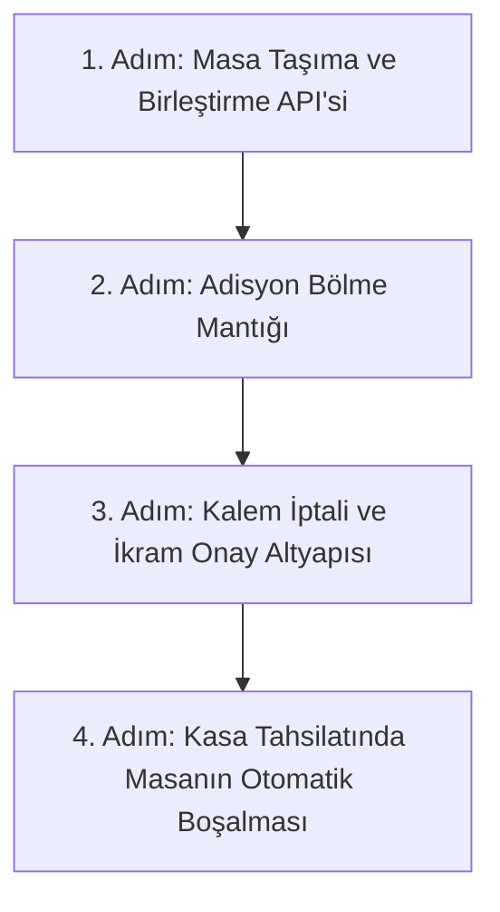

# Modül 2 Devir Şartnamesi — Masa Servisi, Salon Planı ve Ortak Adisyon (A'dan Z'ye)

> **Doküman Durumu:** Kesinleşmiş Modül Devir ve Uygulama Şartnamesi · Sürüm: v3.0
> **Kapsam:** Masa Yaşam Döngüsü, Garson El Terminali, Masa Taşıma/Birleştirme, Adisyon Bölme ve İkram/İskonto
> **Modül Durumu:** İlk Çekirdek (Çalışıyor) · Gelişmiş Masa Yönetimi (Hedef / Sırada)
> **PostgreSQL Şeması:** `service` ve `sales`
> **Yönetim Paneli:** Kısmi (Masa planı ve adisyon izleme var)
> **API:** Var (`ServiceDbContext.cs`, `SalesDbContext.cs`)
> **Test:** Var (`MASA_SERVISI_TEST.md`)
> **Üretime Hazır mı?:** Hayır (gerçek tahsilat/kasa entegrasyonu ve üretim ortamı kabul testleri eksiktir)
> **Dokümantasyon Hiyerarşisi:**
> * **Güncel kod durumu için:** [docs/01-mimari-ve-altyapi/BACKEND_MIMARISI_VE_MODUL_BAGIMLILIKLARI.md](../01-mimari-ve-altyapi/BACKEND_MIMARISI_VE_MODUL_BAGIMLILIKLARI.md)
> * **Güncel teslim ve yol haritası için:** [docs/00-devir-rehberi/DURUM_VE_YOL_HARITASI.md](DURUM_VE_YOL_HARITASI.md)
> * **Devir ve onboarding için:** [docs/00-devir-rehberi/DEVIR_REHBERI.md](DEVIR_REHBERI.md)
> * **Tarihsel kararlar için:** [docs/05-gecmis-ve-arsiv/](../05-gecmis-ve-arsiv/)
>
> **Sıra Notu:** Bu şartnamedeki modül içi adımlar ve hedefler modül backlog'unu ayrıntılandırır. Repo genelindeki güncel teslim sırası yalnız [Durum ve Yol Haritası](DURUM_VE_YOL_HARITASI.md) belgesindedir; bu backlog gelecekteki kapsamı daraltmaz.

---

### 📌 Hızlı Gerçeklik Özeti
* **Bugün Kodda Gerçekten Çalışanlar:**
  - 24 örnek masa, garson atamaları ve açık masa-adisyon bağlantıları
  - Garson ekranından (`/waiter`) masaya sipariş girilmesi ve ortak adisyon açılması
  - Adisyona birden fazla sipariş eklenmesi ve API'ye kaydedilmesi
  - Garson masa detayında açık adisyon, taşıma, birleştirme ve miktar bazlı adisyon bölme akışları
  - Sipariş kaleminde not ve demo hazırlama tercihlerinin mutfak görünümüne taşınması
* **Kısmen Hazır / Bekleyenler:**
  - Garson ekranında yüzde/sabit adisyon indirimi ile gerekçeli miktar bazlı ikram/kalem iptali API'ye kaydedilir. Her kayıt actor, gerekçe ve zaman bilgisiyle denetim izi taşır. Yönetici onayı yalnız `Development` ortamında test amacıyla atlanır; diğer ortamlarda onaysız işlem reddedilir. Gerçek kimlik doğrulama/PIN onayı yönetim ekranı aşamasında tamamlanacaktır.
  - Ücret etkili ürün modifier seçenekleri Modül 4 kapsamındadır; mevcut garson seçenekleri demo amaçlı ve ücretsizdir.
  - Development simüle ödeme akışında adisyonun tam tahsilat sonrası kapanması, bağlı masanın boşaltılması ve fiziksel masa grubunun son açık adisyon ödendiğinde kapatılması uygulanmıştır. Migration uygulanıp API yeniden başlatılmalıdır.
  - Gerçek kasa/POS tahsilatı ve ödeme hareketinin kasa kaydıyla ilişkilendirilmesi henüz yoktur; garson ekranı ödeme almaz, tahsilat sonucunu gösterir.

---

## 🎯 1. Modülün Amacı Nedir?

Bu modül; garson sipariş girişi, masa taşıma/birleştirme, adisyon bölme ve gerekçeli indirim/ikram kayıtlarını ortak adisyon çekirdeğine bağlar. Simüle tahsilat tamamlandığında adisyon kapanır; açık hesap kalmamışsa masa veya fiziksel masa grubu boşaltılır. Gerçek ödeme/kasa entegrasyonu ve yönetici onayı henüz tamamlanmamıştır.

Kısacası: **Restoran salonunun ve masadaki açık hesapların (adisyonların) kalbidir.**

---

## 📂 2. Hangi Dosyalar ve Kod Bloklarıyla Çalışacaksın?

Sizin çalışma alanınız temel olarak şuralardır (doğrudan kod satırına gitmek için linklere tıklayabilirsiniz):

1. **Ön Yüz (Frontend):**
   * [OperationalApps.tsx:L38-L120](../../apps/pos/src/OperationalApps.tsx#L38-L120) — Garsonun masaları gördüğü, tıkladığı ve sipariş eklediği dokunmatik `/waiter` arayüzü.
   * [ServiceTablesPage.tsx:L1-L60](../../apps/admin/src/features/branches/ServiceTablesPage.tsx#L1-L60) — Müdürün gördüğü şube masa planı ve garson atamaları.
   * [SalesPage.tsx:L1-L60](../../apps/admin/src/features/sales/SalesPage.tsx#L1-L60) — Açık ve kapalı adisyonların listelendiği yönetim ekranı.
2. **Backend (.NET API):**
   * [ServiceDbContext.cs:L6-L30](../../apps/api/Hipos.Api/Service/ServiceDbContext.cs#L6-L30) — Masalar (`ServiceTableRow`) ve Garsonlar (`ServiceWaiterRow`).
   * [SalesDbContext.cs:L6-L56](../../apps/api/Hipos.Api/Sales/SalesDbContext.cs#L6-L56) — Adisyonlar (`SalesCheckRow`), Siparişler (`SalesOrderRow`) ve Sipariş Kalemleri (`SalesOrderLineRow`).
3. **Mevcut Testler:**
   * [docs/04-test-ve-rehberler/MASA_SERVISI_TEST.md](../04-test-ve-rehberler/MASA_SERVISI_TEST.md) — Masa servisi ve garson sipariş elle test rehberi.

---

## ✅ 3. Şu An Neler Zaten Hazır? (Neyi Baştan Yazmayacaksın?)

* PostgreSQL `service` şemasında 24 örnek masa ve garson kayıtları hazırdır.
* Garson ekranından (`/waiter`) masaya tıklandığında menü açılmakta ve sipariş sepete eklenip API'ye gönderilebilmektedir.
* Adisyonlar (`sales.checks`) ve siparişler (`sales.orders`) PostgreSQL `sales` şemasına yazılmaktadır.

---

## 🖥️ 4. Ekran Ekran Detaylı Davranış ve Özellikler

### 📱 EKRAN 1: Garson Sipariş Girişi (Mevcut Çalışan Ekran — `OperationalApps.tsx` `/waiter`)
* Garson aktif masayı ve personel kaydını seçer, katalog ürünleri siparişe ekler ve siparişi API'ye gönderir.
* Menü kategorileri ürün sayılarıyla açılır-kapanır; aynı anda en fazla bir kategori açıktır. Arama tüm ürünlerde çalışır ve sonuçları doğrudan gösterir. Sepet kategoriler kapalıyken de görünür; gönderilmemiş satırların not ve tercihleri **Düzenle** ile değiştirilebilir.
* API siparişi ortak `sales.checks` / `sales.orders` çekirdeğine yazar; aynı sipariş mutfak polling önizlemesinde okunabilir.
* Her sipariş kaleminde ayrı hazırlama tercihi ve 500 karaktere kadar not saklanabilir; bunlar adisyon ve mutfak görünümüne taşınır. Bu not/tercih alanı fiyat değiştirmez. Fiyat farkı oluşturan seçenek grupları Modül 4 modifier sözleşmesine tabidir.
* Ürün notu ve demo hazırlama tercihleri sipariş kaleminde tutulur; ücret etkili katalog modifier'ları henüz gerçek katalog API'sine bağlı değildir.
* Hesap isteme ve rezervasyon durumları bu adımla kalıcı Service masa durumlarına ve garson ekranına eklenmiştir. Kalem iptali adisyon kaydına ek olarak mutfak sipariş anlık görüntüsüne iptal bildirimi satırı yazar. Development simüle tahsilatında tam ödenen adisyon kapanır; masadaki/gruptaki diğer açık adisyonlar da bitince salon masaları boşaltılır. Gerçek kasa/POS tahsilatı henüz yoktur.

### 🗺️ Salon Masa Planı ve Durumları

* Masa katı yönetim panelindeki Masa Planı ekranından **Alt kat**, **Üst kat** veya **Kat seçilmedi** olarak belirlenir. Kayıt şubeye bağlıdır; mevcut ve yeni masalar otomatik bir kata atanmaz. Garson ekranı seçilmiş katları ayrı başlık ve çizgilerle, atanmamış masaları ayrı gösterir.
* Kat güncellemesi yönetici kapsamı, `branches.tables` ve güncel masa sürümü gerektirir. `PUT /service/tables/{tableId}/floor` `{ floor: "lower" | "upper" | null, expectedVersion }` kabul eder; masa ve adisyon kimliklerini değiştirmez. `AddTableFloor` Service migration'ı uygulanmalıdır.

* **Boş masa:** Açık adisyon yok; hedef akışta seçilince yeni ortak adisyon başlatılır.
* **Dolu masa / açık hesap:** Açık adisyon ve tutar görünür.
* **Hesap istendi:** Müşteri hesabı istemiştir; Service veritabanına yazılır, tahsilat tamamlanana veya istek kaldırılana kadar masa dolu kalır.
* **Rezerve masa:** Boş masa detayındaki **Rezerve et** butonuyla açılan pencerede ad soyad (en fazla 120 karakter), tarih ve saat girilir. Gün adı seçilen tarihten gösterilir. Bilgiler Service veritabanına kaydedilir; mevcut rezervasyon kısa bir özetle gösterilir ve **Düzenle** ile değiştirilebilir. İleri tarih ve saat için ayrılır; bu sırada yeni sipariş ve masa taşıma hedefi olarak kullanılamaz. Rezervasyon iptal edilince masa boşa döner.
* Salon görünümünde hesap istenen masa sarı renkte **Hesap istendi** etiketiyle gösterilir. Fiziksel masa gruplarında bu durum ana masadan tüm üyelere yansır; grup bilgisi kartta korunur. Üstteki sayaç bu durumdaki fiziksel masaları sayar. Salon listesi salona dönüldüğünde ve ekran açıkken 5 saniyede bir yenilenir.
* Durumlar `/waiter` ekranında farklı renk/etiketlerle gösterilir. Hesap isteği açık adisyon üzerinden, rezervasyon ise boş masa ayrıntısından yönetilir.

### 🔄 EKRAN 2: Masa Taşıma ve Masa Birleştirme (Garson Ekranında Uygulandı)
* **Masa Taşıma (Transfer):** Müşteri rüzgar veya klima yüzünden yer değiştirdiğinde:
  * Kaynak Masa: `Masa 4` (1.200 TL açık hesap).
  * Hedef Masa: `Masa 9` (Boş masa).
  * `[ Masayı Taşı ]` tıklandığında: Adisyon ve tüm siparişler Masa 9'a aktarılır. Masa 4 yeşile (boş) döner, Masa 9 maviye (dolu) döner.
* **Masa Birleştirme (Merge):** İki grup masalarını birleştirdiğinde:
  * `Masa 1` (800 TL) + `Masa 2` (650 TL).
  * İki adisyon konsolide edilir; ana masa Masa 1 olur (Toplam: 1.450 TL). Masa 2 boşa çıkarılır.

### Masa grubu — birlikte kullanılan fiziksel masalar (23 Ekim 2026)

* **Masa Grubu Oluştur:** Ana masa boş veya açık hesaplı olabilir. En az bir, en çok 20 boş ve grupta olmayan ek masa seçilir; kişi sayısı 1–999 olarak kaydedilir. Masa kapasitesi alanı olmadığı için otomatik kapasite kontrolü yapılmaz.
* Örnek: 10 kişi için Masa 1 ana masa, Masa 2 ve Masa 3 ek masa seçilir. Üç masa da sipariş verilmeden önce kullanımda görünür. Herhangi birine dokununca ana masanın ortak sipariş ekranı açılır.
* Siparişler ana masanın açık adisyonuna eklenir; ek masalarda bağımsız adisyon açılamaz. Miktar/satır bazlı adisyon bölme kullanılabilir; bölünen adisyonlar ana masa üzerinde kalır. Mutfak fişinde birlikte kullanılan masa adları gösterilir.
* **Grubu Ayır:** Ek masaları serbest bırakır; siparişleri/adisyonları ana masada korur. Ödeme almaz ve adisyon kapatmaz. Grup geçmişi silinmez.
* Aktif grubun masaları taşınamaz, başka adisyonla birleştirilemez veya silinemez; önce grup ayrılır. Gönderilmemiş sepet varken grup işlemleri kapalıdır.
* Mevcut **Masa Birleştir** düğmesi adisyonları konsolide eder ve kaynak masayı boşaltır. Dolu ek masalar birlikte kullanılacaksa önce adisyonlar birleştirilir, ardından boşalan masalarla fiziksel grup oluşturulur.
* API: `POST /service/table-groups` (`requestId`, `primaryTableId`, `memberTableIds`, `guestCount`), `POST /service/table-groups/{groupId}/close` (`expectedVersion`). Yollar mevcut firma/şube kökü altındadır. Masa okumasındaki `group` alanı ana masayı, üye masaları, kişi sayısını ve grup sürümünü taşır; `assignment` tüm üyelerde ortak hesabı gösterir. Oluşturma isteğinin tekrarında ikinci grup oluşmaz; farklı içerik reddedilir. Şube yetkisi ve `branches.tables` kapısı uygulanır.
* Kalıcılık: Service migration `20261023115032_AddPhysicalTableGroups`; yeni `service.table_groups` tablosu ve `service.tables.table_group_id` nullable bağı. Mevcut adisyon/sipariş satırlarını dönüştürmez veya silmez.

### ✂️ EKRAN 3: Adisyon Bölme (Garson Ekranında Uygulandı)
* Aynı masada oturan iki arkadaş hesabı ayrı ayrı ödemek istediğinde:
  * Sol Sütun: Orijinal Adisyon (`Masa 4 - Hesap A`).
  * Sağ Sütun: Yeni Adisyon (`Masa 4 - Hesap B`).
  * Garson sipariş kalemlerini sağa sürükler veya tıklar (Örn: 2 Pizza A'da, 1 Makarna + 2 Kola B'de kalır).
  * Sistem aynı masa altında iki ayrı alt-adisyon oluşturur; kasa her birini bağımsız tahsil edebilir.

### 🏷️ EKRAN 4: İndirim, İkram ve Kalem İptali (Development test API'si uygulandı)
* **Kalem İptali (Void):** Müşteri gelmeyen içeceği iptal etmek istediğinde:
  * Garson kalem yanındaki `[ İptal ]` butonuna basar.
  * İptal gerekçesi seçilir: `"Müşteri vazgeçti"`, `"Yanlış sipariş"`, `"Kalite/soğuk şikayeti"`.
  * Kayıt gerekçe, işlemi yapan kişi ve zamanla saklanır; tutar adisyon bakiyesinden düşer. Başarılı iptalde siparişin `kitchenItems` listesine `❌ İPTAL BİLDİRİMİ` satırı ve gerekçe eklenir. KDS'nin mevcut sipariş polling'i bu satırı gösterir; kalem adisyonun sipariş satırından silinmez ve mutfak ekranındaki durum akışı ayrı Modül 3 işidir.
* **İkram / İskonto:** Garson ekranından yüzde veya sabit tutarlı adisyon indirimi ya da seçili ürüne miktar bazlı ikram kaydedilebilir.
* **Onay sınırı:** Onaysız uygulama yalnızca `Development` ortamında `development_bypass` iziyle çalışır. Production ve diğer ortamlarda yönetici onayı bulunmadığından API `MANAGER_APPROVAL_REQUIRED` döndürür. Gerçek yönetici kimliği/PIN akışı henüz yoktur.
* İndirim/ikram eklenmiş adisyon şu an bölünemez ve başka adisyonla birleştirilemez; bu koruma indirimlerin yanlış dağıtılmasını önler.

### 🟢 EKRAN 5: Adisyon Kapatma, Masa Boşaltma ve Draining (Ödeme Entegrasyonu Bekliyor)
* Kasa ekranında (`Modül 1`) masanın adisyonu sıfırlanıp tahsil edildiği saniyede:
  * Masa durumu veritabanında `empty` yapılır.
  * Garson ekranında masanın rengi anında mavi/sarıdan yeşile (boş) döner.
* Tam adisyon iptali, gerekçeli kalem iptali, ikram ve indirim onayları da bu yaşam döngüsü kapsamında audit iziyle tamamlanmalıdır.
* Şube yeteneği kapatıldığında açık kalan adisyonları güvenle tahliye eden draining kuralı çalıştırılır.

---

## 🚀 5. Senden Ne Bekleniyor? (Adım Adım Yol Haritası)



1. **1. Adım: Masa Taşıma ve Birleştirme Endpoint'leri:**
   * `POST /api/v1/firms/{f}/branches/{b}/service/tables/{id}/transfer`
   * `POST /api/v1/firms/{f}/branches/{b}/service/tables/{id}/merge`
   * Transfer açık adisyonu ve siparişlerini hedef boş masaya bağlar. Birleştirme kaynak siparişleri hedef masanın mevcut açık adisyonına ekler; ödeme girişimi bulunmayan kaynak adisyonları `merged` durumunda hedef adisyon kimliğiyle saklar. Her iki işlem de idempotent `requestId`, sürüm kontrolü, transaction ve audit kullanır.
2. **2. Adım: Adisyon Bölme Altyapısı:**
   * Bir adisyondaki kalemlerin yeni bir `check_id`'ye transfer edilmesi.
3. **3. Adım: Kalem İptali ve İndirim (`sales.check_voids`):**
   * Gerekçeli iptal, ikram ve müdür PIN kontrolü.
4. **4. Adım: Otomatik Masa Kapanışı:**
   * Adisyon durumu `closed` olduğunda masanın aktif adisyon bağının koparılması ve renginin yeşile dönmesi.

---

## 💾 6. Veritabanı ve Şema Modelleri

```sql
-- Kalem İptali ve İkram Denetim Tablosu
CREATE TABLE sales.check_voids (
    id UUID PRIMARY KEY DEFAULT gen_random_uuid(),
    check_id UUID NOT NULL REFERENCES sales.checks(id),
    order_line_id UUID NOT NULL,
    product_id UUID NOT NULL,
    quantity INT NOT NULL,
    amount_minor BIGINT NOT NULL,
    action_type VARCHAR(30) NOT NULL,    -- 'void' (iptal), 'comp' (ikram), 'discount' (indirim)
    reason VARCHAR(255) NOT NULL,        -- 'Müşteri vazgeçti', 'Soğuk geldi'
    authorized_by VARCHAR(100) NOT NULL, -- Onaylayan müdür
    created_at TIMESTAMPTZ NOT NULL DEFAULT clock_timestamp()
);

-- Masa Taşıma ve Birleştirme Geçmişi
CREATE TABLE service.table_transfers (
    id UUID PRIMARY KEY DEFAULT gen_random_uuid(),
    firm_id UUID NOT NULL,
    branch_id UUID NOT NULL,
    from_table_id VARCHAR(50) NOT NULL,
    to_table_id VARCHAR(50) NOT NULL,
    check_id UUID NOT NULL REFERENCES sales.checks(id),
    transfer_type VARCHAR(20) NOT NULL,  -- 'move' (taşıma), 'merge' (birleştirme)
    actor VARCHAR(100) NOT NULL,
    created_at TIMESTAMPTZ NOT NULL DEFAULT clock_timestamp()
);
```

---

## ✅ 7. Kabul Kriterleri (Devir Doğrulama Testi)

1. Masa 4'teki 1.200 TL'lik adisyon Masa 9'a taşındığında, Masa 4 anında yeşile dönmeli, Masa 9 üzerinde 1.200 TL ile açılmalıdır.
2. Adisyondan bir kalem iptal edildiğinde gerekçe girilmeden işlem tamamlanamamalı ve tutar genel toplamdan düşmelidir.
3. Kasa ekranında adisyon ödendiği an masanın durumu otomatik olarak `empty` olmalıdır.
4. `npm test` ve `npm run test:api` testleri hatasız geçmelidir.

---

## 📖 8. Ayrıntılı Referans Belgeleri

* 📘 **Adisyon ve Masa Yaşam Döngüsü:** 👉 [ADISYON_VE_MASA_YASAM_DONGUSU.md](../02-kasa-ve-operasyon/ADISYON_VE_MASA_YASAM_DONGUSU.md)
* 📘 **Ortak Adisyon Sözleşmesi:** 👉 [ORTAK_ADISYON_SOZLESMESI.md](../02-kasa-ve-operasyon/ORTAK_ADISYON_SOZLESMESI.md)
* 🧪 **Masa Servisi Test Kılavuzu:** 👉 [MASA_SERVISI_TEST.md](../04-test-ve-rehberler/MASA_SERVISI_TEST.md)
