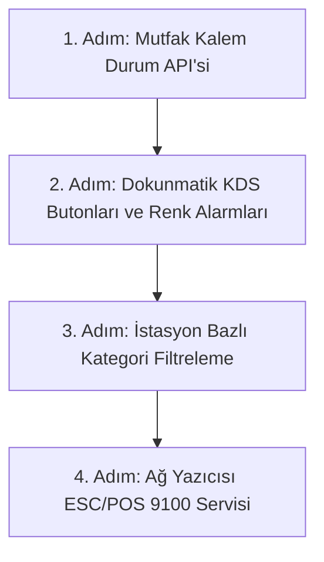

# Modül 3 Devir Şartnamesi — Mutfak (KDS) & Servis Kuyruğu (A'dan Z'ye)

> **Doküman Durumu:** Kesinleşmiş Modül Devir ve Uygulama Şartnamesi · Sürüm: v3.0
> **Kapsam:** KDS Ekranı, Durum Makinesi, Gecikme Alarmları, İstasyon Filtreleme ve ESC/POS Termal Fiş Basımı
> **Modül Durumu:** Geliştirme Önizlemesi (Prototip) · Gerçek KDS ve Yazıcı (Hedef / Sırada)
> **PostgreSQL Şeması:** Yok (Şu an salt-okunur `sales.orders` listeleniyor)
> **Yönetim Paneli / POS Ekranı:** Kısmi (`apps/pos` `/kitchen` polling önizlemesi)
> **API:** Yok (Durum güncelleme ve KDS domain endpoint'i henüz yazılmadı)
> **Test:** Yok (Yalnızca genel sipariş testleri var)
> **Üretime Hazır mı?:** Hayır (Mutfak durum makinesi ve termal yazıcı servisi eksiktir)
> **Dokümantasyon Hiyerarşisi:**
> * **Güncel kod durumu için:** [docs/01-mimari-ve-altyapi/BACKEND_MIMARISI_VE_MODUL_BAGIMLILIKLARI.md](../01-mimari-ve-altyapi/BACKEND_MIMARISI_VE_MODUL_BAGIMLILIKLARI.md)
> * **Güncel teslim ve yol haritası için:** [docs/00-devir-rehberi/DURUM_VE_YOL_HARITASI.md](DURUM_VE_YOL_HARITASI.md)
> * **Devir ve onboarding için:** [docs/00-devir-rehberi/DEVIR_REHBERI.md](DEVIR_REHBERI.md)
> * **Tarihsel kararlar için:** [docs/05-gecmis-ve-arsiv/](../05-gecmis-ve-arsiv/)
>
> **Sıra Notu:** Bu şartnamedeki modül içi adımlar ve hedefler modül backlog'unu ayrıntılandırır. Repo genelindeki güncel teslim sırası yalnız [Durum ve Yol Haritası](DURUM_VE_YOL_HARITASI.md) belgesindedir; bu backlog gelecekteki kapsamı daraltmaz.

---

### 📌 Hızlı Gerçeklik Özeti
* **Bugün Kodda Gerçekten Çalışanlar (Mevcut Durum):**
  - Geliştirme amaçlı `/kitchen` ekranı (`OperationalApps.tsx`)
  - 3 saniyede bir polling yaparak açık siparişleri listeleyen salt-okunur prototip
  - Garsonun girdiği sipariş kalemlerinin ekranda listelenmesi
* **Henüz Kodlanmamış / Hedeflenen Backlog (Eksikler):**
  - Gerçek KDS iş modeli ve durum güncelleme API'si (`POST /api/v1/kitchen/orders/{id}/status`)
  - Dokunmatik durum butonları (`Hazırlanıyor`, `Hazır`, `Servise Çıkar`)
  - İstasyon ayrımı (Sıcak Mutfak, Fırın, Bar) ve kategori filtreleme
  - Gecikme renk sayaçları (10 dk yeşil, 20 dk sarı, 30+ dk kırmızı alarm)
  - ESC/POS TCP 9100 ağ yazıcısı yerel servisi ve otomatik bilet dökümü
  - Yazıcı bağlantı ve kuyruk yönetimi

---

## 🎯 1. Modülün Amacı Nedir?

Bu modülün amacı; salondaki garsonların veya kasadaki personelin girdiği yemek siparişlerinin mutfaktaki aşçılara anında **dokunmatik KDS (Kitchen Display System) tablet ekranında** iletilmesini, siparişlerin istasyonlara (Sıcak Mutfak, Fırın, Bar) göre ayrışmasını, sipariş durumlarının (Bekliyor -> Hazırlanıyor -> Hazır) yönetilmesini, geciken siparişlerde renkli alarmlar verilmesini ve ağdaki termal yazıcıya (ESC/POS) otomatik mutfak fişi basılmasını sağlamaktır.

Kısacası: **Restoranın mutfak operasyonunun ve aşçı-garson iletişiminin dijital omurgasıdır.**

---

## 📂 2. Hangi Dosyalar ve Kod Bloklarıyla Çalışacaksın?

Sizin çalışma alanınız temel olarak şuralardır (ilgili kod satırına gitmek için linklere tıklayabilirsiniz):

1. **Ön Yüz (Frontend):**
   * [OperationalApps.tsx:L38-L120](../../apps/pos/src/OperationalApps.tsx#L38-L120) — Aşçıların siparişleri gördüğü `/kitchen` dokunmatik arayüzü.
   * [operational.css:L1-L60](../../apps/pos/src/operational.css#L1-L60) — Mutfak ekranının dokunmatik kart stilleri ve renk temaları.
2. **Backend (.NET API):**
   * [SalesDbContext.cs:L6-L56](../../apps/api/Hipos.Api/Sales/SalesDbContext.cs#L6-L56) — Siparişler (`SalesOrderRow`) ve Sipariş Kalemleri (`SalesOrderLineRow`).
   * Yeni Servis: `apps/api/Hipos.Api/Kitchen/` — Mutfak durum makinesi ve yazıcı kuyruk yöneticisi.
3. **Mevcut Testler:**
   * [postgres.test.mjs:L2050-L2100](../../apps/api/Hipos.Api.Tests/postgres.test.mjs#L2050-L2100) — Sipariş kabul testleri.

---

## ✅ 3. Şu An Neler Zaten Hazır? (Neyi Baştan Yazmayacaksın?)

* Garson ekranından girilen siparişler PostgreSQL `sales.orders` tablosuna kaydedilmektedir.
* `/kitchen` ekranı 3 saniyede bir polling yaparak açık siparişleri listeleyebilmektedir.
* Adisyon bölme, sipariş ilk gönderildiğindeki mutfak kalem/miktar anlık görüntüsünü değiştirmez ve mutfağa yeni bilet oluşturmaz; bölünmüş siparişler yeni hazırlık işi olarak gösterilmez.

---

## 🖥️ 4. Ekran Ekran Detaylı Davranış ve Özellikler

### 📱 EKRAN 1: Dokunmatik Mutfak KDS Ekranı (Mevcut Polling Ekranı: `OperationalApps.tsx` `/kitchen` — Butonlar ve Sayaçlar Geliştirilecek)
* **İstasyon Filtreleme Sekmeleri (Üst Çubuk - Geliştirilecek):**
  * `[ Tüm Siparişler ]` · `[ 🍳 Sıcak Mutfak ]` · `[ 🍕 Taş Fırın ]` · `[ 🍹 Bar / İçecek ]` · `[ 🥗 Soğuk / Meze ]`.
  * Aşçı sadece kendi bölümüne ait yemekleri görür (Örn: Fırıncı sadece Lahmacun ve Pideleri görür).
* **Dokunmatik Sipariş Bilet Kartları:**
  * **Kart Başlığı:** Masa Numarası (`Masa 4`), Garson Adı (`Ahmet Y.`), Sipariş Başlangıç Saati (`14:25`) ve Geçen Süre Sayacı (`⏱️ 12 dk`).
  * **Sipariş Kalemleri:** Ürün Adı, Porsiyon Adedi ve Özel Notlar (Örn: `2x Margherita Pizza - Not: Az pişmiş olsun`, `1x Kola`).
  * **Gecikme Renk Sayaçları (Geliştirilecek):**
    * 0 - 10 dakika: 🟢 **Yeşil Kart** (Süre normal).
    * 10 - 20 dakika: 🟡 **Sarı Kart** (Gecikme uyarısı).
    * 20+ dakika: 🔴 **Kırmızı Yanıp Sönen Alarm Kartı** (Acil servis uyarısı).
  * **Dokunmatik Durum Butonları (Kart Altı - Geliştirilecek):**
    * 1. Adım: `[ Hazırlanıyor ⏱️ ]` -> Aşçı siparişi tezgaha aldığında tıklar; garson ekranında *"Yemeğiniz hazırlanıyor"* rozeti çıkar.
    * 2. Adım: `[ Hazır / Servise Çıkar 🔔 ]` -> Yemek bittiğinde tıklar; garson terminaline bildirim gider ve kart mutfak ekranından arşive kaldırılır.

### 🖨️ EKRAN 2: Otomatik Termal Bilet Fişi Basımı (ESC/POS 9100) (Hedef Donanım Servisi — Geliştirilecek)
* Garson masada siparişi onayladığı saniyede:
  * Ağdaki termal fiş yazıcısına (TCP port 9100) raw ESC/POS komutu gönderilir.
  * Mutfak bilet fişi otomatik basılır ve kağıt giyotinle kesilir:
    ```
    ========================================
             MUTFAK SİPARİŞ BİLETİ
    Masa: 4          Garson: Ahmet Yılmaz
    Saat: 14:25      Sipariş No: #ORD-88421
    ----------------------------------------
    [ 2 ] Margherita Pizza
          >> NOT: Az pişmiş olsun
    [ 1 ] Penne Arrabbiata
          >> NOT: Ekstra acılı
    ========================================
    ```

---

## 🚀 5. Senden Ne Bekleniyor? (Adım Adım Yol Haritası)



1. **1. Adım: Mutfak Durum Güncelleme API'si:**
   * `POST /api/v1/firms/{f}/branches/{b}/kitchen/orders/{id}/status`
   * Durumlar: `pending` -> `preparing` -> `ready` -> `served`.
2. **2. Adım: KDS Arayüzü Geliştirmesi:**
   * `/kitchen` ekranına dokunmatik büyük butonlar ve geçen süre sayaçları ekleme.
3. **3. Adım: İstasyon Filtreleme:**
   * Ürün kategorisine göre istasyon eşleşmesi (`Fırın`, `Bar`, `Sıcak Mutfak`).
4. **4. Adım: ESC/POS Ağ Yazıcısı Entegrasyonu:**
   * Yerel ağdaki termal yazıcıya socket ile bilet basan arka plan servisi.

---

## 💾 6. Veritabanı ve Şema Modelleri

```sql
-- Mutfak İstasyonları
CREATE TABLE kitchen.stations (
    id UUID PRIMARY KEY DEFAULT gen_random_uuid(),
    branch_id UUID NOT NULL,
    name VARCHAR(50) NOT NULL,            -- "Taş Fırın", "Bar", "Sıcak Mutfak"
    printer_ip VARCHAR(50) NULL,          -- "192.168.1.200"
    printer_port INT NOT NULL DEFAULT 9100,
    is_active BOOLEAN NOT NULL DEFAULT true
);

-- Sipariş Kalem Mutfak Durumu
ALTER TABLE sales.order_lines
    ADD COLUMN IF NOT EXISTS kitchen_status VARCHAR(20) NOT NULL DEFAULT 'pending', -- 'pending', 'preparing', 'ready', 'served'
    ADD COLUMN IF NOT EXISTS station_id UUID NULL,
    ADD COLUMN IF NOT EXISTS prepared_at TIMESTAMPTZ NULL;
```

---

## ✅ 7. Kabul Kriterleri (Devir Doğrulama Testi)

1. Aşçı ekranda `[ Hazır ]` butonuna bastığında sipariş kartı KDS ekranından kaybolmalı ve garson ekranında masanın üzerinde *"Yemek Hazır"* bildirimi çıkmalıdır.
2. 20 dakikayı geçen sipariş kartları kırmızı renkle yanıp sönerek dikkat çekmelidir.
3. Ağ yazıcısına sipariş bilet komutu gönderildiğinde yazıcıdan fiş hatasız dökülmelidir.
4. `npm test` ve `npm run test:api` testleri hatasız geçmelidir.

---

## 📖 8. Ayrıntılı Referans Belgeleri

* 📘 **Mutfak Ekranı (KDS) ve Yazıcı Kılavuzu:** 👉 [MUTFAK_KDS_VE_YAZICI.md](../02-kasa-ve-operasyon/MUTFAK_KDS_VE_YAZICI.md)
* 🏛️ **Backend Mimarisi ve Şemalar:** 👉 [BACKEND_MIMARISI_VE_MODUL_BAGIMLILIKLARI.md](../01-mimari-ve-altyapi/BACKEND_MIMARISI_VE_MODUL_BAGIMLILIKLARI.md)
