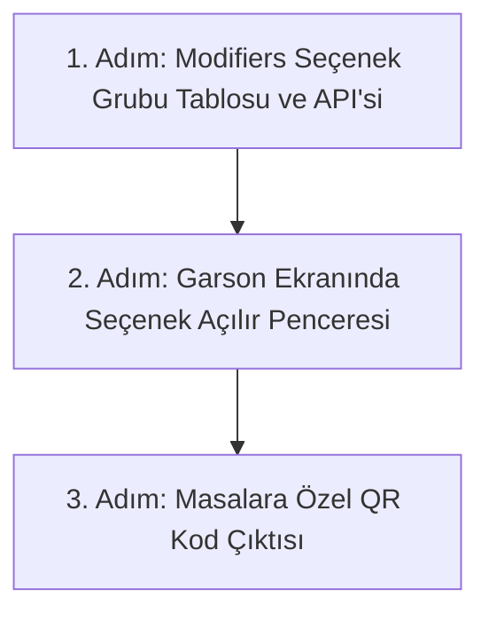

# Modül 4 Devir Şartnamesi — Ürün Kataloğu & Menü Yönetimi (A'dan Z'ye)

> **Doküman Durumu:** Kesinleşmiş Modül Devir ve Uygulama Şartnamesi · Sürüm: v3.0
> **Kapsam:** Ürün Kartları, Menü Editörü, Fiyat Sürümleri, Seçenek/Varyasyon Grupları (Modifiers) ve QR Menü
> **Modül Durumu:** Kalıcı MVP (Çalışıyor) · Seçenek Grupları & QR Menü (Hedef / Sırada)
> **PostgreSQL Şeması:** `catalog`
> **Yönetim Paneli:** Var (`CatalogPages.tsx`, `MenusPage.tsx`)
> **API:** Var (`CatalogDbContext.cs`)
> **Test:** Var (`MenusPage.test.tsx`, `postgres.test.mjs`)
> **Üretime Hazır mı?:** Hayır (Ürün seçenek grupları ve masaya özel QR menü yayını eksiktir)
> **Dokümantasyon Hiyerarşisi:**
> * **Güncel kod durumu için:** [docs/01-mimari-ve-altyapi/BACKEND_MIMARISI_VE_MODUL_BAGIMLILIKLARI.md](../01-mimari-ve-altyapi/BACKEND_MIMARISI_VE_MODUL_BAGIMLILIKLARI.md)
> * **Güncel teslim ve yol haritası için:** [docs/00-devir-rehberi/DURUM_VE_YOL_HARITASI.md](DURUM_VE_YOL_HARITASI.md)
> * **Devir ve onboarding için:** [docs/00-devir-rehberi/DEVIR_REHBERI.md](DEVIR_REHBERI.md)
> * **Tarihsel kararlar için:** [docs/05-gecmis-ve-arsiv/](../05-gecmis-ve-arsiv/)
>
> **Sıra Notu:** Bu şartnamedeki modül içi adımlar ve hedefler modül backlog'unu ayrıntılandırır. Repo genelindeki güncel teslim sırası yalnız [Durum ve Yol Haritası](DURUM_VE_YOL_HARITASI.md) belgesindedir; bu backlog gelecekteki kapsamı daraltmaz.

---

### 📌 Hızlı Gerçeklik Özeti
* **Bugün Kodda Gerçekten Çalışanlar:**
  - Kategoriler, ürün kartları ve temel fiyat tanımları
  - Fiyat sürümleme mekanizması (eski satışları bozmadan yeni fiyat yayını)
  - Şube menü editörü, bölümler ve ürün sıralama
  - Şubede tek aktif menü seçimi ve POS kanalına ürün yayını
* **Henüz Kodlanmamış / Hedeflenen Backlog (Eksikler):**
  - Ürün seçenekleri / ekstraları (Modifiers: "Büyük Boy +20 TL", "Duble Peynir")
  - Masalara özel karekodlu QR Menü dış yayını

---

## 🎯 1. Modülün Amacı Nedir?

Bu modülün amacı; restoranda satılan tüm yiyecek ve içeceklerin tek bir merkezden tanımlanmasını, kategori ve bölümlere ayrılmasını (Başlangıçlar, Pideler, İçecekler), fiyat değişikliklerinin sürümlenerek geçmiş satışları bozmadan yayımlanmasını, ürün seçeneklerinin (Modifiers: Porsiyon büyüklüğü, soslar, pişme derecesi) yönetilmesini ve masalara özel karekodlu QR Menü çıktısı üretilmesini sağlamaktır.

Kısacası: **Restoranın ne sattığını, kaça sattığını ve menünün nasıl sunulduğunu belirleyen ürün beynidir.**

---

## 📂 2. Hangi Dosyalar ve Kod Bloklarıyla Çalışacaksın?

Sizin çalışma alanınız temel olarak şuralardır (ilgili kod satırına gitmek için linklere tıklayabilirsiniz):

1. **Ön Yüz (Frontend):**
   * [CatalogPages.tsx:L1-L60](../../apps/admin/src/features/catalog/CatalogPages.tsx#L1-L60) — Ürün kartları listesi, yeni ürün formu ve fiyat düzenleme.
   * [MenusPage.tsx:L1-L60](../../apps/admin/src/features/catalog/MenusPage.tsx#L1-L60) — Şube menü editörü, bölümler ve ürün sıralama.
   * [catalog.ts:L34-L54](../../apps/admin/src/data/catalog.ts#L34-L54) — Sol menüdeki `Ürünler ve Menü` navigasyon ağacı.
2. **Backend (.NET API):**
   * [CatalogDbContext.cs:L6-L50](../../apps/api/Hipos.Api/Catalog/CatalogDbContext.cs#L6-L50) — `CatalogProductRow`, `CatalogCategoryRow`, `CatalogMenuRow` ve fiyat sürümleri.
3. **Mevcut Testler:**
   * [MenuProvider.test.ts](../../apps/admin/src/features/catalog/MenuProvider.test.ts) — Menü sağlayıcı birim testleri.
   * [HttpCatalogProvider.test.ts](../../apps/admin/src/features/catalog/HttpCatalogProvider.test.ts) — Katalog HTTP sağlayıcı testleri.

---

## ✅ 3. Şu An Neler Zaten Hazır? (Neyi Baştan Yazmayacaksın?)

* PostgreSQL `catalog` şeması çalışıyor: Kategoriler, ürünler, fiyat sürümleri ve menüler API'ye tam bağlı.
* Yönetim panelinden yeni menü oluşturma, ürün sıralama ve POS için tek aktif menü seçimi çalışıyor.

---

## 🖥️ 4. Ekran Ekran Detaylı Davranış ve Özellikler

### 📋 EKRAN 1: Ürün Yönetimi ve Fiyat Sürümleri (Mevcut Çalışan Ekran — `CatalogPages.tsx`)
* **Ürün Kartı Detayı:**
  * Ürün Adı, Açıklaması, Barkod / SKU kodu.
  * Kategori Seçimi (Örn: `Pizzalar`).
  * Alerjenler (Gluten, Laktoz vb. etiketler).
  * Temel Fiyat (Örn: `350,00 ₺`).
* **Fiyat Sürümleme Mantığı:**
  * Yönetici fiyatı 350 TL'den 400 TL'ye çıkardığında eski tamamlanmış adisyonlar 350 TL kalır; yeni açılan siparişler 400 TL üzerinden başlar.

### 🍽️ EKRAN 2: Menü Editörü ve Bölümler (Mevcut Çalışan Ekran — `MenusPage.tsx`)
* Şube Menüleri: `Kadıköy Ana Menü`, `Öğle Menüsü`, `Gece Menüsü`.
* Menü Bölümleri (Sections):
  * `1. Bölüm: Taş Fırın Pideleri` -> [Ürünleri Ekle ve Sırala]
  * `2. Bölüm: Soğuk İçecekler` -> [Ürünleri Ekle ve Sırala]
* **Tek Aktif Menü Anahtarı:** Bir şubede sadece tek bir menü *"Aktif"* olarak işaretlenebilir; POS ekranı bu aktif menüyü indirir.

### ⚙️ EKRAN 3: Ürün Seçenek Grupları (Modifiers) (Hedef Özellik — Geliştirilecek)
* Müşterinin ürünü özelleştirmesi için seçenek grupları tanımlanır:
  * **Porsiyon Grubu (Tekli Seçim - Zorunlu):**
    * Küçük Boy (+0 TL)
    * Orta Boy (+30 TL)
    * Büyük Boy (+60 TL)
  * **Ekstra Malzemeler (Çoklu Seçim - İsteğe Bağlı):**
    * Duble Peynir (+25 TL)
    * Ekstra Mantar (+15 TL)
    * Acı Sos (+10 TL)
* Garson sipariş alırken ekranda bu seçenekler açılır ve seçilen ekstralar sipariş kalemine eklenir.

### 📱 EKRAN 4: Masaya Özel QR Menü Yayını (Hedef Özellik — Geliştirilecek)
* Masanın üzerine konulacak karekodun çıktısı:
  * `https://menu.hipos.com/kadikoy/masa-4`
  * Müşteri telefonundan tarattığında aktif menü mobil uyumlu web arayüzünde açılır.

---

## 🚀 5. Senden Ne Bekleniyor? (Adım Adım Yol Haritası)



1. **1. Adım: Seçenek Grupları (Modifiers) Veri Modeli:**
   * `catalog.option_groups` ve `catalog.option_items` tablolarının eklenmesi.
2. **2. Adım: Sipariş Kalemine Seçeneklerin Bağlanması:**
   * Garson pizzayı seçtiğinde boyut ve ekstra seçeneklerinin sepete işlenmesi.
3. **3. Adım: Masaya Özel QR Kod:**
   * Şube ve masa bazlı QR kod PDF çıktısı üretici.

---

## 💾 6. Veritabanı ve Şema Modelleri

```sql
-- Ürün Seçenek Grupları (Modifiers)
CREATE TABLE catalog.option_groups (
    id UUID PRIMARY KEY DEFAULT gen_random_uuid(),
    firm_id UUID NOT NULL,
    name VARCHAR(100) NOT NULL,          -- "Boyut Seçimi", "Ekstra Malzeme"
    is_required BOOLEAN NOT NULL DEFAULT false,
    min_selections INT NOT NULL DEFAULT 0,
    max_selections INT NOT NULL DEFAULT 1,
    is_active BOOLEAN NOT NULL DEFAULT true
);

-- Seçenek Kalemleri
CREATE TABLE catalog.option_items (
    id UUID PRIMARY KEY DEFAULT gen_random_uuid(),
    group_id UUID NOT NULL REFERENCES catalog.option_groups(id),
    name VARCHAR(100) NOT NULL,          -- "Büyük Boy", "Duble Peynir"
    price_delta_minor BIGINT NOT NULL DEFAULT 0, -- +3000 (30 TL)
    is_active BOOLEAN NOT NULL DEFAULT true
);
```

---

## ✅ 7. Kabul Kriterleri (Devir Doğrulama Testi)

1. Bir pizzaya "Büyük Boy (+40 TL)" seçeneği eklendiğinde sipariş toplamı otomatik 40 TL artmalıdır.
2. Yönetici bir ürünün fiyatını değiştirdiğinde eski adisyonlar etkilenmemeli, yeni siparişler yeni fiyattan açılmalıdır.
3. `npm test` ve `npm run test:api` testleri hatasız geçmelidir.

---

## 📖 8. Ayrıntılı Referans Belgeleri

* 📘 **Katalog Backend Sözleşmesi:** 👉 [KATALOG_BACKEND_SOZLESMESI.md](../03-is-alanlari-ve-yonetim/KATALOG_BACKEND_SOZLESMESI.md)
* 📘 **Menü Yönetimi MVP:** 👉 [MENU_YONETIMI_MVP.md](../03-is-alanlari-ve-yonetim/MENU_YONETIMI_MVP.md)
