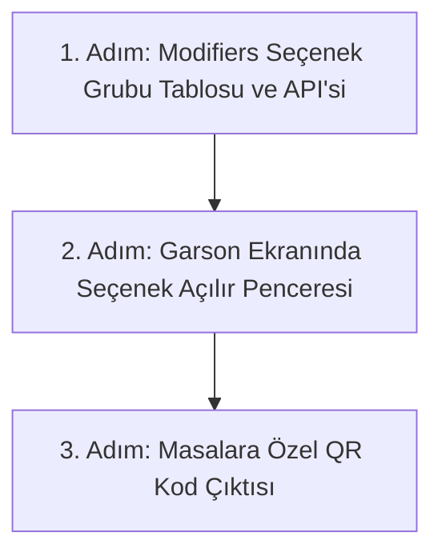

# Modül 4 Devir Şartnamesi — Ürün Kataloğu & Menü Yönetimi (A'dan Z'ye)

> **Doküman Durumu:** Kesinleşmiş Modül Devir ve Uygulama Şartnamesi · Sürüm: v3.0
> **Kapsam:** Ürün Kartları, Menü Editörü, Fiyat Sürümleri, Seçenek/Varyasyon Grupları (Modifiers) ve QR Menü
> **Modül Durumu:** Kalıcı MVP (Çalışıyor) · Seçenek grubu ve sipariş backend'i (uygulandı; ekran entegrasyonu sırada) · QR Menü (hedef)
> **PostgreSQL Şeması:** `catalog`
> **Yönetim Paneli:** Var (`CatalogPages.tsx`, `MenusPage.tsx`)
> **API:** Var (`CatalogDbContext.cs`)
> **Test:** Var (`MenusPage.test.tsx`, `postgres.test.mjs`)
> **Üretime Hazır mı?:** Hayır (Seçenek yönetim/sipariş ekranı entegrasyonu ve masaya özel QR menü yayını eksiktir)
> **Dokümantasyon Hiyerarşisi:**
> * **Güncel kod durumu için:** [docs/01-mimari-ve-altyapi/BACKEND_MIMARISI_VE_MODUL_BAGIMLILIKLARI.md](../01-mimari-ve-altyapi/BACKEND_MIMARISI_VE_MODUL_BAGIMLILIKLARI.md)
> * **Güncel teslim ve yol haritası için:** [docs/00-devir-rehberi/DURUM_VE_YOL_HARITASI.md](DURUM_VE_YOL_HARITASI.md)
> * **Devir ve onboarding için:** [docs/00-devir-rehberi/DEVIR_REHBERI.md](DEVIR_REHBERI.md)
> * **Tarihsel kararlar için:** [docs/05-gecmis-ve-arsiv/](../05-gecmis-ve-arsiv/)
>
> **Sıra Notu:** Bu şartnamedeki modül içi adımlar ve hedefler modül backlog'unu ayrıntılandırır. Repo genelindeki güncel teslim sırası yalnız [Durum ve Yol Haritası](DURUM_VE_YOL_HARITASI.md) belgesindedir; bu backlog gelecekteki kapsamı daraltmaz.

---

### 📌 Hızlı Gerçeklik Özeti
* **Bugün Kodda Gerçekten Çalışanlar:**
  - Kategoriler, ürün kartları ve temel fiyat tanımları
  - Fiyat sürümleme mekanizması (eski satışları bozmadan yeni fiyat yayını)
  - Şube menü editörü, bölümler ve ürün sıralama
  - Şubede tek aktif menü seçimi ve POS kanalına ürün yayını
* **Henüz Kodlanmamış / Hedeflenen Backlog (Eksikler):**
  - Seçenek grubu yönetim API'si, sipariş sırasında güncel katalogdan doğrulama/fiyatlama ve sipariş anı fiyat snapshot'ı eklendi; yönetim paneli ve sipariş ekranı entegrasyonu bekliyor.
  - Masalara özel karekodlu QR Menü dış yayını

---

## 🎯 1. Modülün Amacı Nedir?

Bu modülün amacı; restoranda satılan tüm yiyecek ve içeceklerin tek bir merkezden tanımlanmasını, kategori ve bölümlere ayrılmasını (Başlangıçlar, Pideler, İçecekler), fiyat değişikliklerinin sürümlenerek geçmiş satışları bozmadan yayımlanmasını, ürün seçeneklerinin (Modifiers: Porsiyon büyüklüğü, soslar, pişme derecesi) yönetilmesini ve masalara özel karekodlu QR Menü çıktısı üretilmesini sağlamaktır.

Kısacası: **Restoranın ne sattığını, kaça sattığını ve menünün nasıl sunulduğunu belirleyen ürün beynidir.**

---

## 📂 2. Hangi Dosyalar ve Kod Bloklarıyla Çalışacaksın?

Sizin çalışma alanınız temel olarak şuralardır (ilgili kod satırına gitmek için linklere tıklayabilirsiniz):

1. **Ön Yüz (Frontend):**
   * [CatalogPages.tsx:L1-L60](../../apps/admin/src/features/catalog/CatalogPages.tsx#L1-L60) — Ürün kartları listesi, yeni ürün formu ve fiyat düzenleme.
   * [MenusPage.tsx:L1-L60](../../apps/admin/src/features/catalog/MenusPage.tsx#L1-L60) — Şube menü editörü, bölümler ve ürün sıralama.
   * [catalog.ts:L34-L54](../../apps/admin/src/data/catalog.ts#L34-L54) — Sol menüdeki `Ürünler ve Menü` navigasyon ağacı.
2. **Backend (.NET API):**
   * [CatalogDbContext.cs:L6-L50](../../apps/api/Hipos.Api/Catalog/CatalogDbContext.cs#L6-L50) — `CatalogProductRow`, `CatalogCategoryRow`, `CatalogMenuRow` ve fiyat sürümleri.
3. **Mevcut Testler:**
   * [MenuProvider.test.ts](../../apps/admin/src/features/catalog/MenuProvider.test.ts) — Menü sağlayıcı birim testleri.
   * [HttpCatalogProvider.test.ts](../../apps/admin/src/features/catalog/HttpCatalogProvider.test.ts) — Katalog HTTP sağlayıcı testleri.

---

## ✅ 3. Şu An Neler Zaten Hazır? (Neyi Baştan Yazmayacaksın?)

* PostgreSQL `catalog` şeması çalışıyor: Kategoriler, ürünler, fiyat sürümleri ve menüler API'ye tam bağlı.
* Yönetim panelinden yeni menü oluşturma, ürün sıralama ve POS için tek aktif menü seçimi çalışıyor.

---

## 🖥️ 4. Ekran Ekran Detaylı Davranış ve Özellikler

### 📋 EKRAN 1: Ürün Yönetimi ve Fiyat Sürümleri (Mevcut Çalışan Ekran — `CatalogPages.tsx`)
* **Ürün Kartı Detayı:**
  * Ürün Adı, Açıklaması, Barkod / SKU kodu.
  * Kategori Seçimi (Örn: `Pizzalar`).
  * Alerjenler (Gluten, Laktoz vb. etiketler).
  * Temel Fiyat (Örn: `350,00 ₺`).
* **Fiyat Sürümleme Mantığı:**
  * Yönetici fiyatı 350 TL'den 400 TL'ye çıkardığında eski tamamlanmış adisyonlar 350 TL kalır; yeni açılan siparişler 400 TL üzerinden başlar.

### 🍽️ EKRAN 2: Menü Editörü ve Bölümler (Mevcut Çalışan Ekran — `MenusPage.tsx`)
* Şube Menüleri: `Kadıköy Ana Menü`, `Öğle Menüsü`, `Gece Menüsü`.
* Menü Bölümleri (Sections):
  * `1. Bölüm: Taş Fırın Pideleri` -> [Ürünleri Ekle ve Sırala]
  * `2. Bölüm: Soğuk İçecekler` -> [Ürünleri Ekle ve Sırala]
* **Tek Aktif Menü Anahtarı:** Bir şubede sadece tek bir menü *"Aktif"* olarak işaretlenebilir; POS ekranı bu aktif menüyü indirir.

### ⚙️ EKRAN 3: Ürün Seçenek Grupları (Modifiers) (Backend var; ekran entegrasyonu bekliyor)
* Seçenek grupları firmada tanımlanır ve birden fazla üründe tekrar kullanılabilir. Bir ürüne birden fazla grup bağlanabilir; grubu olmayan ürün de geçerlidir. Örneğin “Boyut” grubu yalnızca boyut seçeneği sunulan ürünlere bağlanır.
* Grup seçim sınırları ürün-grup bağlantısında tutulur. Böylece aynı grup bir üründe zorunlu, başka bir üründe isteğe bağlı olabilir. `min_selections` ve `max_selections` farklı seçilmiş seçenek sayısını sınırlar; bir seçeneğin adedi bu sayıya dahil değildir. `max_selections` boşsa gruptaki farklı seçeneklerin tümü seçilebilir.
* Seçeneklerde işaretli `price_delta_minor` fiyat farkı bulunur. TRY için tutar kuruş cinsinden saklanır; negatif fark desteklenir. Seçenek bazında adet girişi açılabilir ve azami adet tanımlanabilir. Adet girişi kapalı seçenek bir kez seçilir.
* Ürün pasifse yeni siparişe eklenemez. Pasif grup ve seçenekler ise yeni siparişte seçilebilir; bu alanların `is_active` değeri seçim doğrulamasını engellemez.
* Sipariş sırasında seçenekler güncel katalogdan doğrulanır. Ürün başına fiyat, temel fiyat ile her seçeneğin birim fiyat farkının seçilen adetle çarpılmış toplamıdır. Sonuç sıfırın altındaysa sipariş reddedilir. Temel fiyat ve seçilen seçeneklerin adı, adedi ve birim fiyat farkı sipariş anındaki değerleriyle sipariş kaleminde saklanır.

### 📱 EKRAN 4: Masaya Özel QR Menü Yayını (Hedef Özellik — Geliştirilecek)
* Masanın üzerine konulacak karekodun çıktısı:
  * `https://menu.hipos.com/kadikoy/masa-4`
  * Müşteri telefonundan tarattığında aktif menü mobil uyumlu web arayüzünde açılır.

---

## 🚀 5. Senden Ne Bekleniyor? (Adım Adım Yol Haritası)

1. **1. Adım: Seçenek Grupları (Modifiers) Veri Modeli:**
   * Tamamlandı: `catalog.option_groups`, `catalog.option_items`, `catalog.product_option_groups` tabloları ve firma kapsamlı okuma/yazma API'si. Grup tekrar kullanımı, seçim sınırları, seçenek adedi, sürümleme ve denetim desteklenir.
2. **2. Adım: Sipariş Kalemine Seçeneklerin Bağlanması:**
   * Sipariş API'sinin güncel katalogdan seçenek kimliği/adedi doğrulaması, fiyatı sunucuda hesaplaması ve sipariş anı görüntüsünü kalemde saklaması. Yönetim paneli, garson ekranı ve QR menü bu veri modeli/API adımının kapsamı değildir.
3. **3. Adım: Masaya Özel QR Kod:**
   * Şube ve masa bazlı QR kod PDF çıktısı üretici.

---

## 💾 6. Veritabanı ve Şema Tasarımı (EF modeli ve migration mevcut)

Hedef model üç iş tablosu ve bir denetim tablosundan oluşur. EF modeli, `AddCatalogProductOptions` ve `AddCatalogOptionManagementAudit` migration'ları ile grup yönetim API'si eklendi; migration'lar yerel geliştirme PostgreSQL veritabanına uygulandı. Sipariş doğrulaması henüz bu tabloları kullanmaz:

| Yapı | Sorumluluk ve alanlar |
| --- | --- |
| `catalog.option_groups` | Firma kapsamındaki tekrar kullanılabilir grup: kimlik, `firm_id`, ad, `is_active` ve sıralama. |
| `catalog.option_items` | Gruba bağlı seçenek: kimlik, `group_id`, ad, işaretli `price_delta_minor BIGINT`, `quantity_enabled`, `max_quantity`, `is_active` ve sıralama. `max_quantity` en az 1 olmalı; adet girişi kapalıysa seçenek adedi 1'dir. |
| `catalog.product_option_groups` | Ürün-grup bağlantısı: `product_id`, `option_group_id`, `min_selections`, boş bırakılabilen `max_selections` ve ürün üzerindeki sıralama. Aynı ürün-grup çifti tek kez bulunur. `min_selections >= 0`; üst sınır varsa alt sınırdan küçük olamaz. |
| `catalog.option_management_audit` | Grup, seçenek ve ürün-grup komutlarının `request_id`, aktör, işlem, fingerprint, sürüm ve JSON anlık görüntüsünü tutar. |

Seçim alt/üst sınırları bağlantıda tutulur; sayım farklı seçenek kimlikleri üzerinden yapılır. Seçenek adedi, grubun farklı seçenek sınırını değiştirmez. `max_selections` boşsa farklı seçenek adedi için ayrıca grup üst sınırı uygulanmaz. Grup veya seçenek pasif olsa da sipariş seçimi doğrulamasında kullanılabilir. Ürün pasifliği sipariş kuralı olarak ayrıca uygulanır.

Ürünün mevcut `option_groups` metin dizisi bu normalize modelin kaynağı değildir. Bu yeni model için eski değerler taşınmayacaktır; alanın kaldırılması, eski kod tüketicileri yeni ilişkilere geçirildikten sonraki ileri migration'da yapılmalıdır.

---

## ✅ 7. Kabul Kriterleri (Devir Doğrulama Testi)

1. Bir ürün birden fazla tekrar kullanılabilir gruba bağlanabilir; grup bağlanmamış ürün geçerlidir ve aynı grup birden fazla üründe kullanılabilir.
2. Grubun seçim alt/üst sınırları farklı seçilmiş seçenek sayısına uygulanır; adetli seçenek miktarı bu sınırlara dahil edilmez.
3. Adetli seçeneğin fiyat farkı seçenek adediyle çarpılır. Temel fiyat + seçenek farkları sıfırın altına inerse yeni sipariş reddedilir; sıfır fiyat kabul edilir.
4. Sipariş kalemi temel fiyatı, seçenek adlarını, adetlerini ve sipariş anındaki birim fiyat farklarını saklar; katalogdaki sonraki değişiklikler geçmiş sipariş görüntüsünü değiştirmez.
5. Pasif ürünle yeni sipariş reddedilir. Pasif grup veya seçenek, diğer ürün ve seçim kuralları sağlanıyorsa seçilebilir.

---

## 📖 8. Ayrıntılı Referans Belgeleri

* 📘 **Katalog Backend Sözleşmesi:** 👉 [KATALOG_BACKEND_SOZLESMESI.md](../03-is-alanlari-ve-yonetim/KATALOG_BACKEND_SOZLESMESI.md)
* 📘 **Menü Yönetimi MVP:** 👉 [MENU_YONETIMI_MVP.md](../03-is-alanlari-ve-yonetim/MENU_YONETIMI_MVP.md)
