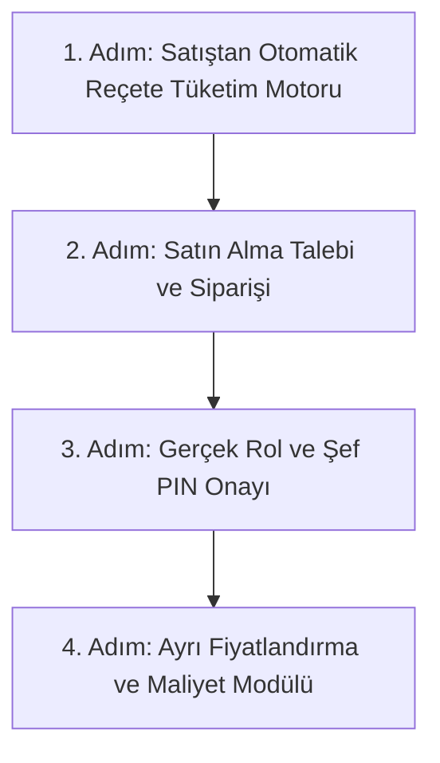

# Modül 5 Devir Şartnamesi — Stok, Depo & Reçeteli Üretim (A'dan Z'ye)

> **Doküman Durumu:** Kesinleşmiş Modül Devir ve Uygulama Şartnamesi · Sürüm: v3.0
> **Kapsam:** Hammadde Kartları, Reçeteli Otomatik Stok Tüketimi, Mal Kabul İrsaliyesi, Sayım Taslağı ve Fire Takibi
> **Modül Durumu:** Kalıcı MVP (Çalışıyor) · Mal Kabul, Tedarikçi İadesi ve Fire/Zayi (Çalışıyor) · Eksik Teslim Düzeltmesi (Backend/Geçmiş Korunuyor, Yeni UI Yok) · Otomatik Tüketim (Hedef / Sırada)
> **PostgreSQL Şeması:** `inventory`
> **Yönetim Paneli:** Var (`InventoryHttpPage.tsx`)
> **API:** Var (`InventoryDbContext.cs`)
> **Test:** Var (`STOK_REÇETE_SAYIM_MANUEL_TEST.md`, `postgres.test.mjs`)
> **Üretime Hazır mı?:** Hayır (Otomatik reçeteli stok düşümü, gerçek kullanıcı/PIN yetkisi ve çevrimdışı eşitleme eksiktir)
> **Ana Devir Rehberi:** [DEVIR_REHBERI.md](DEVIR_REHBERI.md) · **Yol Haritası:** [DURUM_VE_YOL_HARITASI.md](DURUM_VE_YOL_HARITASI.md)

> **Dokümantasyon Hiyerarşisi:**
> * **Güncel kod durumu için:** [docs/01-mimari-ve-altyapi/BACKEND_MIMARISI_VE_MODUL_BAGIMLILIKLARI.md](../01-mimari-ve-altyapi/BACKEND_MIMARISI_VE_MODUL_BAGIMLILIKLARI.md)
> * **Güncel teslim ve yol haritası için:** [docs/00-devir-rehberi/DURUM_VE_YOL_HARITASI.md](DURUM_VE_YOL_HARITASI.md)
> * **Devir ve onboarding için:** [docs/00-devir-rehberi/DEVIR_REHBERI.md](DEVIR_REHBERI.md)
> * **Tarihsel kararlar için:** [docs/05-gecmis-ve-arsiv/](../05-gecmis-ve-arsiv/)
>
> **Sıra Notu:** Bu şartnamedeki modül içi adımlar ve hedefler modül backlog'unu ayrıntılandırır. Repo genelindeki güncel teslim sırası yalnız [Durum ve Yol Haritası](DURUM_VE_YOL_HARITASI.md) belgesindedir; bu backlog gelecekteki kapsamı daraltmaz.

---

### 📌 Gerçeklik ve Uygulama Durumu Özeti

| Alan / Özellik | Durum | Açıklama |
| :--- | :--- | :--- |
| **Reçete sürümü** | **Çalışıyor** | Ürün bazlı hammadde gramajları ve sürümleme kalıcıdır |
| **Stok hareketi** | **Çalışıyor** | `inventory.movements` manuel giriş/çıkış ve bakiye hesabı çalışır |
| **Sayım ve düzeltme** | **Çalışıyor** | Taslak sayım, fark analizi ve tekil düzeltme hareketi çalışır |
| **Satıştan otomatik tüketim** | **Yok** | Adisyon kapanışında reçete patlatıp stok düşme henüz bağlanmadı |
| **Satın alma / mal kabul** | **Çalışıyor** | Taslak ve onay ile tedarikçiye iade kalıcıdır; eksik teslim düzeltmesinin backend/geçmişi korunur, yeni form panelde yoktur |
| **Fire kaydı** | **Çalışıyor** | Gerekçeli fire kaydı stoktan `waste_loss` hareketiyle düşer; gerçek şef PIN onayı auth modülünü bekler |
| **Maliyet hesabı** | **Ertelendi** | Fiyatlandırma ve stok maliyeti ayrı modülde tasarlanacaktır |

---

## 🎯 1. Modülün Amacı Nedir?

Bu modül; hammadde, reçete, stok hareketi, sayım, mal kabul, tedarikçiye iade ve fire/zayi akışlarını kapsar. Satıştan otomatik tüketim (`recipe_consumption`), satın alma talebi/siparişi ve ayrı fiyatlandırma/maliyet alanı henüz tamamlanmamıştır.

Kısacası: **Restoranın hammadde maliyetini, depo güvenliğini ve stok kaçaklarını önleyen envanter motorudur.**

---

## 📂 2. Hangi Dosyalar ve Kod Bloklarıyla Çalışacaksın?

Sizin çalışma alanınız temel olarak şuralardır (ilgili kod satırına gitmek için linklere tıklayabilirsiniz):

1. **Ön Yüz (Frontend):**
   * [InventoryHttpPage.tsx:L1-L60](../../apps/admin/src/features/inventory/InventoryHttpPage.tsx#L1-L60) — Depo stokları, kritik eşik uyarıları, sayım taslakları ve reçete ekranları.
   * [DemoBusinessPages.tsx:L1-L60](../../apps/admin/src/features/demo/DemoBusinessPages.tsx#L1-L60) — Reçete ve stok demo görünümleri.
2. **Backend (.NET API):**
   * [InventoryDbContext.cs:L6-L50](../../apps/api/Hipos.Api/Inventory/InventoryDbContext.cs#L6-L50) — Depolar (`InventoryWarehouseRow`), hammaddeler (`InventoryIngredientRow`), reçeteler (`InventoryRecipeRow`), hareketler (`InventoryMovementRow`) ve sayımlar (`InventoryCountDraftRow`).
3. **Mevcut Testler:**
   * [docs/04-test-ve-rehberler/STOK_REÇETE_SAYIM_MANUEL_TEST.md](../04-test-ve-rehberler/STOK_REÇETE_SAYIM_MANUEL_TEST.md) — PostgreSQL entegrasyon ve kabul testleri.

---

## ✅ 3. Şu An Neler Zaten Hazır? (Neyi Baştan Yazmayacaksın?)

* PostgreSQL `inventory` şemasında 9 hammadde, 4 reçete ve Kadıköy Ana Depo hazırdır.
* Sayım taslağı oluşturma, fiziksel sayım miktarı girme, sistemle karşılaştırma ve **yönetici onayıyla tek bir düzeltme hareketi üretme** mekanizması çalışmaktadır.
* Sayım açıkken hareket kilidi koyma ve negatif stok koruması mevcuttur.

---

## 🖥️ 4. Ekran Ekran Detaylı Davranış ve Özellikler

### 📦 EKRAN 1: Depo ve Kritik Stok İzleme Panosu (Mevcut Çalışan Ekran — `InventoryHttpPage.tsx`)
* Depodaki mevcut hammaddeler: Adı, Birimi (kg, litre, adet), Sistem Miktarı, Kritik Eşik.
* **Kritik Eşik Alarmları:**
  * Eğer Mozzarella 2 kg'ın altına düşmüşse kırmızı uyarı rozeti: `⚠️ Kritik Stok: Mozzarella (1.400 g kaldı)`.
* Satın alma talebi henüz yoktur; mal kabul ve tedarikçi iadesi ayrı mal kabul ekranında çalışır. Önceden oluşturulmuş eksik teslim düzeltmeleri backend ve denetim geçmişinde korunur; yeni düzeltme formu panelden kaldırılmıştır.

### 🍕 EKRAN 2: Reçeteli Otomatik Stok Düşümü (Satış Olayı Entegrasyonu) (Hedef Arka Plan Servisi — Geliştirilecek)
* Sistemde tanımlı Margherita Pizza Reçetesi:
  * 150 g Pizza Unu
  * 100 g Mozzarella Peyniri
  * 80 g Domates Sosu
  * 5 g Zeytinyağı
* **Otomatik Tüketim Akışı:** Kasa modülü (`Modül 1`) masanın adisyonunu tahsil edip `closed` yaptığı milisaniyede:
  * Arka planda `recipe_consumption` servisi tetiklenir.
  * Depodan ilgili gramajlar düşülerek `inventory.movements` tablosuna otomatik tüketim hareketi yazılır.

### 🚚 EKRAN 3: Mal Kabul ve Alış İrsaliyesi Ekranı (Çalışıyor — `ReceivingPage.tsx`)
* Belge taslak kaydedilir; taslak stok veya cari bakiyeyi değiştirmez.
* Onay stok girişini ve tedarikçi borcunu tek işlemde oluşturur. Açık sayım onayı engeller; tekrar onay çift kayıt üretmez.
* Tedarikçiye iade, özgün mal kabul satırına bağlı stok ve cari ters hareketi oluşturur.
* Eksik teslim düzeltmesinin backend ve denetim geçmişi korunur; yeni düzeltme formu ekranda gösterilmez.
* Kritik stok uyarısından satın alma talebi başlatma ve bu talebi sipariş/irsaliye ile ilişkilendirme gelecek kapsamdır.
* Toptancıdan kamyonla 10 çuval un (500 kg) geldiğinde:
  * Yönetici veya depo sorumlusu faturayı / irsaliyeyi açar.
  * Tedarikçi seçilir: `ABC Gıda Toptan A.Ş.`.
  * Giren Hammadde: `500 kg Pizza Unu` · Birim Fiyat: `22,50 TL/kg`.
  * `[ Mal Kabulü Onayla ]` tıklandığında: Depo stoğu anında 500 kg artar ve tedarikçinin Cari hesabına borç faturası işlenir.

### 🗑️ EKRAN 4: Gerekçeli Fire / Zayi Kayıt Ekranı (Çalışıyor)
* Mutfakta yere dökülen süt, bozulan et veya yanan pizza için:
  * Hammadde: `Dana Kıyma (1.5 kg)`.
  * Fire Türü: `Bozulma / Son Kullanma Tarihi Geçti`.
  * Açıklama: `"Dolap arızası sebebiyle bozuldu"`.
  * Kayıt mevcut yönetici aktörüyle stoktan düşülür ve denetim izi oluşturur.
  * Fire/zayi ekranı fiyat veya maliyet bilgisi istemez; fiyatlandırma ve maliyet raporu ayrı modüle ertelenmiştir.
  * Gerçek şef PIN onayı auth modülünü; reçeteli ürün zayisi ise ürün/reçete giriş türünü bekler.

### 📋 EKRAN 5: Depo Fiziksel Sayım ve Onay Ekranı (Mevcut Çalışan Ekran — `InventoryHttpPage.tsx` sayım görünümü)
* Sayım Taslağı Açma -> Fiziksel miktarları sayıp girme -> Fark Analizi (`Sayılan - Sistem`) -> Yönetici onayıyla tek hareketle stoku eşitleme.

---

## 🚀 5. Senden Ne Bekleniyor? (Adım Adım Yol Haritası)



1. **1. Adım: `recipe_consumption` Tüketim Motoru:**
   * Adisyon kapandığında reçeteleri patlatıp stok hareket defterine otomatik çıkış yazan servis.
2. **2. Adım: Mal Kabul İrsaliyesi Ekranı:**
   * Toptancıdan gelen malları depoya ekleyen ve Cari borç kaydı oluşturan entegre ekran.
3. **3. Adım: Fire / Zayi Takibi:**
   * Gerekçeli fire kayıt tablosu ve arayüzü.

---

## 💾 6. Veritabanı ve Şema Modelleri

```sql
-- Satıştan Otomatik Stok Tüketim Hareketi
-- inventory.movements tablosuna check_id bağı
ALTER TABLE inventory.movements
    ADD COLUMN IF NOT EXISTS check_id UUID NULL,
    ADD COLUMN IF NOT EXISTS reason_type VARCHAR(30) NOT NULL DEFAULT 'manual'; -- 'manual', 'recipe_consumption', 'waste_loss', 'receiving'

-- Fire / Zayi Kayıtları
CREATE TABLE inventory.waste_logs (
    id UUID PRIMARY KEY DEFAULT gen_random_uuid(),
    branch_id UUID NOT NULL,
    ingredient_id VARCHAR(50) NOT NULL REFERENCES inventory.ingredients(id),
    quantity DECIMAL(12, 3) NOT NULL,
    unit VARCHAR(20) NOT NULL,
    reason VARCHAR(100) NOT NULL,         -- 'Bozulma', 'Dökülme/Kırılma', 'Yanma'
    cost_minor BIGINT NOT NULL,
    reported_by VARCHAR(100) NOT NULL,
    created_at TIMESTAMPTZ NOT NULL DEFAULT clock_timestamp()
);
```

---

## ✅ 7. Kabul Kriterleri (Devir Doğrulama Testi)

1. Bir Margherita Pizza satılıp adisyon kapatıldığında, depodaki Mozzarella stoğu anında 100 g azalmalı ve hareket türü `recipe_consumption` olmalıdır.
2. Mal kabul ekranından 50 kg un girildiğinde stok 50 kg artmalı ve tedarikçinin cari hesabına borç yansımalıdır.
3. `npm test` ve `npm run test:api` testleri hatasız geçmelidir.

---

## 📖 8. Ayrıntılı Referans Belgeleri

* 📘 **Reçeteli Stok ve Satın Alma:** 👉 [RECETELI_STOK_VE_SATINALMA.md](../03-is-alanlari-ve-yonetim/RECETELI_STOK_VE_SATINALMA.md)
* 📘 **Envanter ve Stok Sözleşmesi:** 👉 [ENVANTER_STOK_SATINALMA_SOZLESMESI.md](../03-is-alanlari-ve-yonetim/ENVANTER_STOK_SATINALMA_SOZLESMESI.md)
* 🧪 **Stok Test Kılavuzu:** 👉 [STOK_REÇETE_SAYIM_MANUEL_TEST.md](../04-test-ve-rehberler/STOK_REÇETE_SAYIM_MANUEL_TEST.md)
