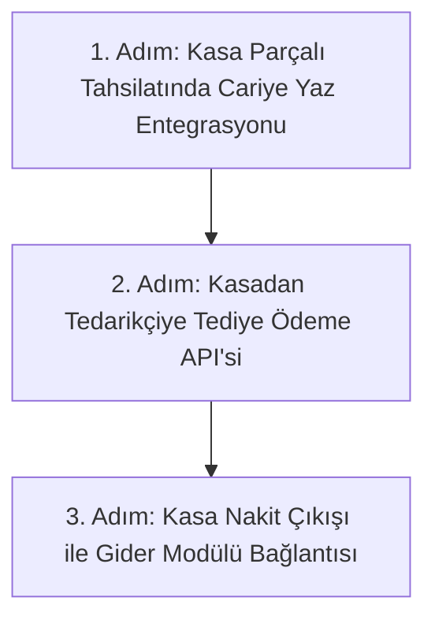

# Modül 6 Devir Şartnamesi — Cari Hesaplar & Gider Yönetimi (A'dan Z'ye)

> **Doküman Durumu:** Kesinleşmiş Modül Devir ve Uygulama Şartnamesi · Sürüm: v3.0
> **Kapsam:** Müşteri Veresiyesi, Tedarikçi Borçları, Kasa Tediye Entegrasyonu, Hesap Ekstresi ve Giderler
> **Modül Durumu:** Kalıcı MVP (Çalışıyor) · Kasa & Otomasyon Bağları (Hedef / Sırada)
> **PostgreSQL Şeması:** `cari` ve `finance`
> **Yönetim Paneli:** Var (`CarilerHttpPage.tsx`, `ExpenseManagementPage.tsx`)
> **API:** Var (`CariDbContext.cs`, `ExpenseDbContext.cs`)
> **Test:** Var (`CARI_MANUEL_TEST.md`, `postgres.test.mjs`)
> **Üretime Hazır mı?:** Hayır (Kasadan veresiye kapatma ve toptancı tediye entegrasyonu eksiktir)
> **Ana Devir Rehberi:** [DEVIR_REHBERI.md](DEVIR_REHBERI.md) · **Yol Haritası:** [DURUM_VE_YOL_HARITASI.md](DURUM_VE_YOL_HARITASI.md)

> **Dokümantasyon Hiyerarşisi:**
> * **Güncel kod durumu için:** [docs/01-mimari-ve-altyapi/BACKEND_MIMARISI_VE_MODUL_BAGIMLILIKLARI.md](../01-mimari-ve-altyapi/BACKEND_MIMARISI_VE_MODUL_BAGIMLILIKLARI.md)
> * **Güncel teslim ve yol haritası için:** [docs/00-devir-rehberi/DURUM_VE_YOL_HARITASI.md](DURUM_VE_YOL_HARITASI.md)
> * **Devir ve onboarding için:** [docs/00-devir-rehberi/DEVIR_REHBERI.md](DEVIR_REHBERI.md)
> * **Tarihsel kararlar için:** [docs/05-gecmis-ve-arsiv/](../05-gecmis-ve-arsiv/)
>
> **Sıra Notu:** Bu şartnamedeki modül içi adımlar ve hedefler modül backlog'unu ayrıntılandırır. Repo genelindeki güncel teslim sırası yalnız [Durum ve Yol Haritası](DURUM_VE_YOL_HARITASI.md) belgesindedir; bu backlog gelecekteki kapsamı daraltmaz.

---

### 📌 Gerçeklik ve Uygulama Durumu Özeti

| Alan / Özellik | Durum | Açıklama |
| :--- | :--- | :--- |
| **Cari kartı / hareketi** | **Kalıcı** | `cari.parties` ve `cari.movements` üzerinde manuel borç/alacak/bakiye çalışır |
| **Gider kaydı** | **Kalıcı** | `finance.expenses` üzerinde kategorili şube gider girişi çalışır |
| **Satıştan cari hareketi** | **Yok** | Kasada veresiye/açık hesap ile adisyondan otomatik cariye yazma henüz yoktur |
| **Satın almadan tedarikçi borcu** | **Yok** | Toptancı irsaliyesinden otomatik tedarikçi borçlandırma henüz yoktur |
| **Giderden kasa hareketi** | **Yok** | Kasadan nakit gider çıktığında `cash.movements` atomik yazılmaz |
| **Giderden cari hareketi** | **Yok** | Giderin cari hesaba/tedarikçiye borç/tediye bağlanması henüz yoktur |
| **Fatura / muhasebe** | **Yok** | Resmi e-Fatura/e-Arşiv, KDV mahsubu veya yasal defter henüz yoktur |

---

## 🎯 1. Modülün Amacı Nedir?

Bu modülün hedefi; mevcut manuel cari hareketleri ve gider defterinin üzerine adisyon/veresiye, tedarikçi tediye ve gider-kasa bağlantılarını kurmaktır. Otomatik satış, kasa, satın alma veya muhasebe bağlantıları şu an uygulanmamıştır.

Kısacası: **Restoranın kimden ne alacağı, kime ne borcu olduğu ve dükkan masraflarının finansal omurgasıdır.**

---

## 📂 2. Hangi Dosyalar ve Kod Bloklarıyla Çalışacaksın?

Sizin çalışma alanınız temel olarak şuralardır (ilgili kod satırına gitmek için linklere tıklayabilirsiniz):

1. **Ön Yüz (Frontend):**
   * [CarilerHttpPage.tsx:L1-L60](../../apps/admin/src/features/demo/CarilerHttpPage.tsx#L1-L60) — Müşteri/tedarikçi kartları, bakiye özeti ve tarih aralıklı ekstre.
   * [ExpenseManagementPage.tsx:L1-L60](../../apps/admin/src/features/expenses/ExpenseManagementPage.tsx#L1-L60) — Şube giderleri ve masraf kategorileri.
   * [catalog.ts:L76-L91](../../apps/admin/src/data/catalog.ts#L76-L91) — Sol menüdeki `Cari ve Müşteriler` başlığı.
2. **Backend (.NET API):**
   * [CariDbContext.cs:L6-L30](../../apps/api/Hipos.Api/Cari/CariDbContext.cs#L6-L30) — Cari kartlar (`CariPartyRow`) ve hareket defteri (`CariMovementRow`).
   * [ExpenseDbContext.cs:L6-L30](../../apps/api/Hipos.Api/Expenses/ExpenseDbContext.cs#L6-L30) — Giderler (`ExpenseRow`) ve Gider Kategorileri (`ExpenseCategoryRow`).
3. **Mevcut Testler:**
   * [docs/04-test-ve-rehberler/CARI_MANUEL_TEST.md](../04-test-ve-rehberler/CARI_MANUEL_TEST.md) — Cari hesaplar manuel test kılavuzu.

---

## ✅ 3. Şu An Neler Zaten Hazır? (Neyi Baştan Yazmayacaksın?)

* PostgreSQL `cari` şemasında müşteri/tedarikçi kartları, borç/alacak hareketleri ve bakiye hesaplama mantığı çalışmaktadır.
* Bakiye elle yazılmaz; hareketlerden (delta) otomatik toplanır.
* `finance.expenses` şemasında gider kategorileri ve masraf kaydetme formu çalışmaktadır.

---

## 🖥️ 4. Ekran Ekran Detaylı Davranış ve Özellikler

### 👥 EKRAN 1: Cari Kartlar ve Bakiye Özeti (Mevcut Çalışan Ekran — `CarilerHttpPage.tsx`)
* **Sekmeler:** `[ Tümü ]` · `[ Müşteriler (Alacaklarımız) ]` · `[ Tedarikçiler (Borçlarımız) ]`.
* **Cari Kartı:**
  * Ünvan / Ad Soyad: `Dr. Serdar Tuncer`
  * Cari Türü: `Müşteri (Veresiye)`
  * Telefon / E-posta: `0532 555 44 33`
  * **Güncel Bakiye:** `2.150,00 ₺ (Alacağımız)`
* **Hesap Ekstresi:** Tarih aralıklı tüm borçlandırma ve tahsilat hareketleri dökümü.
* Veresiye limiti tanımlama/uygulama bu kalıcı cari MVP'sinde henüz yoktur; sonraki açık hesap iş akışında ele alınmalıdır.

### 💳 EKRAN 2: Kasa Adisyonundan Otomatik Veresiye Kaydı (Hedef Entegrasyon — Geliştirilecek)
* Kasiyer adisyon ekranında (`Modül 1`) `[ Cariye Yaz (Veresiye) ]` butonuna bastığında:
  * Müşteri seçilir: `Dr. Serdar Tuncer`.
  * Tutar: `450,00 TL`.
  * Adisyon kapanır, Serdar Tuncer'in cari bakiyesine otomatik olarak `+450 TL` borç hareketi yazılır.

### 🥩 EKRAN 3: Kasadan Toptancıya Nakit Tediye (Hedef Entegrasyon — Geliştirilecek)
* Toptancı dükkana geldiğinde yönetici kasadan nakit ödeme yapar:
  * Tedarikçi: `Özlem Et & Kasap Ticaret` (Borcumuz: 18.500 TL).
  * Hangi Kasa?: `Kasa 1 (Ana Kasa)`.
  * Tutar: `5.000,00 TL` · Makbuz No: `MK-88421`.
  * **Tek Atomik İşlem:** Kasa 1'den -5.000 TL nakit düşer, Özlem Kasap'ın cari borcu 13.500 TL'ye iner.

### 🧾 EKRAN 4: Dükkan Giderleri ve Masraf Girişi (Mevcut Çalışan Ekran — `ExpenseManagementPage.tsx`)
* Seçilen şube ve kategori için gider tarihi, tutar ve açıklama elle girilerek kalıcı gider kaydı oluşturulur.
* Kategori adları mevcut kayıt/seed verisinden gelir; bu işlem kasa hareketi veya cari borç oluşturmaz. Otomatik gider-kasa bağlantısı henüz yoktur.

---

## 🚀 5. Senden Ne Bekleniyor? (Adım Adım Yol Haritası)



1. **1. Adım: Kasa Satışından Otomatik Cari Hareketi:**
   * Adisyonda `method: 'cari'` ödendiğinde müşterinin cari defterine `delta_minor` hareketi açma.
2. **2. Adım: Kasadan Tedarikçiye Tediye:**
   * `POST /api/v1/firms/{f}/branches/{b}/cash/movements/supplier-payout` endpoint'inin hem `cash.movements` hem `cari.movements` yazması.
3. **3. Adım: Kasa ve Gider Entegrasyonu:**
   * Kasadan masraf çıkışı yapıldığında `finance.expenses` tablosuna otomatik kayıt atılması.

---

## 💾 6. Veritabanı ve Şema Modelleri

```sql
-- Cari Hareketine Adisyon ve Kasa Bağı
ALTER TABLE cari.movements
    ADD COLUMN IF NOT EXISTS check_id UUID NULL,
    ADD COLUMN IF NOT EXISTS cash_movement_id UUID NULL,
    ADD COLUMN IF NOT EXISTS receipt_number VARCHAR(100) NULL;
```

---

## ✅ 7. Kabul Kriterleri (Devir Doğrulama Testi)

1. Bir adisyon 500 TL "Cari/Veresiye" olarak kapatıldığında, ilgili müşterinin borç bakiyesi anında 500 TL artmalı ve ekstrede adisyon numarası görünmelidir.
2. Kasadan toptancıya 2.000 TL nakit tediye yapıldığında kasanın nakdi 2.000 TL düşmeli, toptancının cari borcu 2.000 TL azalmalıdır.
3. `npm test` ve `npm run test:api` testleri hatasız geçmelidir.

---

## 📖 8. Ayrıntılı Referans Belgeleri

* 📘 **Cari Hesaplar MVP Sözleşmesi:** 👉 [CARI_HESAPLAR_MVP.md](../03-is-alanlari-ve-yonetim/CARI_HESAPLAR_MVP.md)
* 📘 **Gider Yönetimi MVP:** 👉 [GIDER_YONETIMI_MVP.md](../03-is-alanlari-ve-yonetim/GIDER_YONETIMI_MVP.md)
* 🧪 **Cari Manuel Test Kılavuzu:** 👉 [CARI_MANUEL_TEST.md](../04-test-ve-rehberler/CARI_MANUEL_TEST.md)
