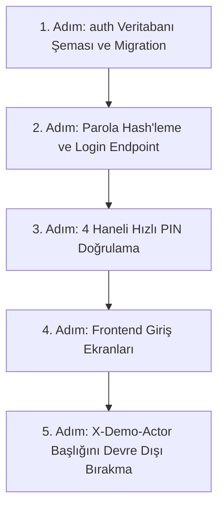

# Modül 7 Devir Şartnamesi — Kimlik, Oturum ve Yetkilendirme (Auth & Security)

> **Doküman Durumu:** Kesinleşmiş Modül Devir ve Uygulama Şartnamesi · Sürüm: v3.0
> **Kapsam:** Güvenlik Mimarisi, RBAC Yetki Matrisi, PIN Doğrulama, JWT/Cookie ve Geliştirici Yol Haritası
> **Modül Durumu:** Planlandı (Geliştirme Aşamasında sahte X-Demo-Actor aktif)
> **PostgreSQL Şeması:** Yok (`auth` şeması henüz kurulmadı)
> **Yönetim Paneli:** Yok (Login ekranı taslak aşamasında)
> **API:** Kısmi (Yalnızca geçici DemoAccess middleware var)
> **Test:** Yok
> **Üretime Hazır mı?:** Hayır (Gerçek parola hash'leme, JWT/Cookie ve PIN doğrulaması eksiktir)
> **Dokümantasyon Hiyerarşisi:**
> * **Güncel kod durumu için:** [docs/01-mimari-ve-altyapi/BACKEND_MIMARISI_VE_MODUL_BAGIMLILIKLARI.md](../01-mimari-ve-altyapi/BACKEND_MIMARISI_VE_MODUL_BAGIMLILIKLARI.md)
> * **Güncel teslim ve yol haritası için:** [docs/00-devir-rehberi/DURUM_VE_YOL_HARITASI.md](DURUM_VE_YOL_HARITASI.md)
> * **Devir ve onboarding için:** [docs/00-devir-rehberi/DEVIR_REHBERI.md](DEVIR_REHBERI.md)
> * **Tarihsel kararlar için:** [docs/05-gecmis-ve-arsiv/](../05-gecmis-ve-arsiv/)
>
> **Sıra Notu:** Bu şartnamedeki modül içi adımlar ve hedefler modül backlog'unu ayrıntılandırır. Repo genelindeki güncel teslim sırası yalnız [Durum ve Yol Haritası](DURUM_VE_YOL_HARITASI.md) belgesindedir; bu backlog gelecekteki kapsamı daraltmaz.

---

> [!WARNING]
> ### ⚠️ Üretim ve Güvenlik Sınırı
> * **Gerçek auth uygulanmadı.**
> * **`X-Demo-Actor` yalnızca Development test aktörüdür.**
> * **Production ortamında güvenlik sağlamaz.**

---

### 📌 Hızlı Gerçeklik Özeti
* **Bugün Kodda Gerçekten Çalışanlar:**
  - Tüm tablolarda `firm_id` ve `branch_id` şube izolasyon kolonları
  - Personel kartları (`service.employees`)
  - Geliştirme ortamında çalışan sahte `X-Demo-Actor` aktör çözümleyicisi
* **Henüz Kodlanmamış / Hedeflenen Backlog (Eksikler):**
  - PostgreSQL `auth` şeması (`auth.users`, `auth.memberships`, `auth.pin_codes`)
  - BCrypt parola hash'leme ve `POST /api/v1/auth/login` endpoint'i
  - Terminaller için 4 haneli hızlı personel PIN doğrulama (`POST /api/v1/auth/pin-verify`)
  - Yönetici paneli Login/Logout sayfası (`LoginPage.tsx`)
  - Dokunmatik terminaller için PIN Pad modalı (`PinPadModal.tsx`)
  - Sahte `X-Demo-Actor` başlığının tamamen kaldırılması

---

## 🎯 1. Görevin Amacı Nedir?

Bu paketin amacı; sistemdeki sahte ve taklit edilebilir `X-Demo-Actor` başlığını kaldırarak, HIPOS'a **gerçek kullanıcı hesabı (e-posta + şifre)**, **güvenli oturum kontrolü (JWT/Cookie)** ve restoran terminalleri için **4 haneli hızlı personel PIN girişi** kazandırmaktır.

Kısacası: **Sistemin kapılarını yetkisiz kişilere kapatıp, gerçek bir restoran ekibinin güvenle giriş yapmasını sağlayacaksınız.**

---

## 📂 2. Hangi Dosyalar ve Kod Bloklarıyla Çalışacaksın?

Sizin çalışma alanınız temel olarak şuralardır (doğrudan ilgili kod satırına gitmek için linklere tıklayabilirsiniz):

1. **Backend (.NET API):**
   * Yeni klasör: `apps/api/Hipos.Api/Auth/` — `AuthDbContext.cs`, Kullanıcı entity'leri, Parola hash'leme ve Login endpoint'leri.
   * [Program.cs:L14-L80](../../apps/api/Hipos.Api/Program.cs#L14-L80) — Authentication/Authorization middleware entegrasyonu ve CORS başlıkları.
   * [DemoAccess.cs:L25-L58](../../apps/api/Hipos.Api/Features/DemoAccess.cs#L25-L58) — Sahte `X-Demo-Actor` çözümleyicisi (burası gerçek JWT ve DB oturumuna bağlanacak).
2. **Ön Yüz (Admin & POS):**
   * Yeni ekran: `apps/admin/src/features/auth/LoginPage.tsx` — Yönetici e-posta/şifre giriş ekranı.
   * [OperationalApps.tsx:L18-L36](../../apps/pos/src/OperationalApps.tsx#L18-L36) — Terminalden API isteklerine eklenen `X-Demo-Actor` başlığının bulunduğu fonksiyon.
   * [main.tsx:L39-L55](../../apps/pos/src/main.tsx#L39-L55) — POS uygulamasının API istek atma fonksiyonu.
   * Yeni ortak bileşen: `apps/pos/src/components/PinPadModal.tsx` — Garson ve kasiyerlerin 4 haneli PIN tuşladığı dokunmatik numpad.

---

## ✅ 3. Şu An Neler Zaten Hazır? (Neyi Baştan Yazmayacaksın?)

* Sistemde şube bazlı veri izolasyonu (`firm_id`, `branch_id`) tüm tablolarda mevcuttur.
* Personel kartları (`service.employees`) zaten tanımlıdır; sizin yapacağınız şey personellere 4 haneli PIN kodu atamaktır.
* Backend'de EF Core 10 ve PostgreSQL altyapısı hazırdır; yeni bir `auth` migration context'i açmanız yeterlidir.

---

## 🚀 4. Senden Ne Bekleniyor? (Adım Adım Yol Haritası)

Görevi 5 anlaşılır adıma böldük:

### 1. Adım: `auth` Veritabanı Şeması
* PostgreSQL üzerinde yeni `auth` şeması kurun:
  * `auth.users` (id, email, password_hash, full_name, phone, is_active)
  * `auth.memberships` (user_id, firm_id, branch_id, role)
  * `auth.pin_codes` (membership_id, pin_hash, is_active)
* EF Core `AuthDbContext` tanımlayıp migration'ı oluşturun.

### 2. Adım: E-Posta / Şifre ile Yönetici Girişi
* Şirket sahibi ve müdürler için giriş endpoint'i: `POST /api/v1/auth/login`.
* Şifreleri **BCrypt** veya Argon2 ile hash'leyin (asla düz metin saklanmaz).
* Başarılı girişte `HttpOnly, Secure` Cookie veya JWT token üretin.
* Girişsiz isteklerde `401 Unauthorized`, başka firmanın verisine erişmeye çalışan isteklerde `403 Forbidden` döndürün.

### 3. Adım: Kasa ve Garsonlar İçin 4 Haneli PIN Girişi
* Yoğun servis anında garson veya kasiyer e-posta/şifre yazamaz.
* Endpoint: `POST /api/v1/auth/pin-verify`.
* Gövde: `{ branchId, employeeId, pin: "1234" }`.
* PIN doğruysa o personele ait 8-12 saatlik istasyon oturum token'ı dönün.

### 4. Adım: Ön Yüz Giriş ve Çıkış Akışları
* Yönetim paneline şık bir Login sayfası ekleyin. Oturum yoksa tüm sayfalar Login'e yönlensin.
* Kasa ve POS ekranlarına dokunmatik PIN ekranı ekleyin.
* Sağ üst köşeye *"Çıkış Yap"* (Logout) butonu koyun.

### 5. Adım: Sahte `X-Demo-Actor`'ü Emekliye Ayırma
* API controller'larında aktör bilgisini artık HTTP başlığından değil, doğrulanmış `HttpContext.User` içerisindeki Claim'lerden okuyun.
* Denetim (audit) loglarına `X-Demo-Actor` yerine gerçek `userId` yazılsın.

---

## 🎯 5. Ne Zaman "Tamamlandı" Sayılacak? (Kabul Kriterleri)

1. Giriş yapmadan `/api/...` endpoint'lerine istek atıldığında `401` dönmeli.
2. A şubesindeki bir kullanıcı B şubesinin verisine erişmeye çalıştığında `403` dönmeli.
3. Kasiyer 4 haneli PIN kodunu girdiğinde 1 saniye içinde oturumu açılmalı.
4. Çıkış yapıldığında token/cookie geçersiz kılınmalı.

---

## 📖 6. Ayrıntılı Referans Belgeleri (Nereye Bakmalısın?)

Mimari ayrıntılar, tablo tasarımları ve RBAC yetki tablosu bu belgededir:
* 📘 **Kimlik, Oturum ve Yetkilendirme Kılavuzu (İnciliniz):** 👉 [KIMLIK_OTURUM_VE_YETKI.md](../01-mimari-ve-altyapi/KIMLIK_OTURUM_VE_YETKI.md)
* 📘 **Kimlik ve Hesap Akışı İlkeleri:** 👉 [KIMLIK_VE_HESAP_AKISI.md](../01-mimari-ve-altyapi/KIMLIK_VE_HESAP_AKISI.md)
* 🏛️ **Backend Mimarisi ve Bağımlılıklar:** 👉 [BACKEND_MIMARISI_VE_MODUL_BAGIMLILIKLARI.md](../01-mimari-ve-altyapi/BACKEND_MIMARISI_VE_MODUL_BAGIMLILIKLARI.md)
