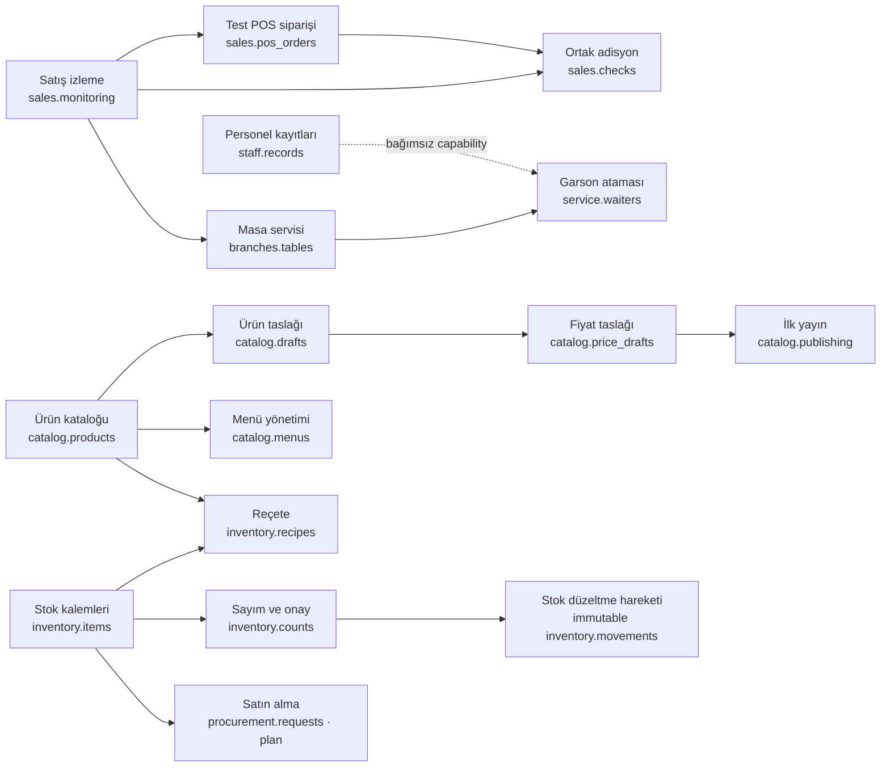

# HIPOS backend mimarisi ve modül bağımlılıkları

Durum tarihi: 19 Ekim 2026. Bu belge mevcut codebase, veritabanı şemaları, capability bağımlılıkları ve uygulanmamış işleri toplar. Eski tasarım metinleri tarihsel ürün kararlarını anlatabilir; kod durumu için bu belge ve [durum/yol haritası](../00-devir-rehberi/DURUM_VE_YOL_HARITASI.md), yeni ürün hedefi için [devir rehberi](../00-devir-rehberi/DEVIR_REHBERI.md) esas alınır.

**19 Ekim 2026 ürün yönü:** Gerçek restoran kasa/POS, garson ve mutfak operasyonu; internet yokken LAN/yerel sunucuda ortak çalışma; bağlantı gelince merkezi eşitleme hedefi kabul edildi. Bu hedef bu belge tarihindeki kod envanterinde uygulanmış sayılmaz. Ürün hedefi ve devir sınırları [Devir Rehberi](../00-devir-rehberi/DEVIR_REHBERI.md), domain davranışı [Kasa/POS operasyon sözleşmesi](../02-kasa-ve-operasyon/KASA_POS_VE_OPERASYON_SOZLESMESI.md), offline protokol gereksinimi [Çevrimdışı çalışma ve senkronizasyon](CEVRIMDISI_VE_SENKRONIZASYON.md) içinde günceldir.

## Ürün odağı

Ürün hedefi gerçek restoranın yönetim ve operasyon akışlarını kapsar: admin, kasa/POS, garson ve mutfak yüzleri. İnternet yokken LAN ve yerel sunucuda ortak iş, internet geri gelince merkezi veritabanına eşitleme isteniyor. Bu offline/central sync hedefi henüz koda uygulanmamıştır. Örnek işletme/seed verisi kurgusaldır; müşteri verisi gibi kullanılmamalıdır. İş hedefi ve öncelikleri [Devir Rehberi](../00-devir-rehberi/DEVIR_REHBERI.md) açıklar.

## Teknoloji ve çalışma şekli

| Katman | Kullanılan teknoloji | Görevi / sınırı |
|---|---|---|
| Yönetim paneli | React 19, TypeScript, Vite 8, React Router 7, lucide-react | Yönetici görünümü, form ve okuma ekranları. Ekran gizleme güvenlik kontrolü değildir. |
| API | .NET 10 / ASP.NET Core 10, C# | Modüler HTTP API. Development/Production ortamında başlatılabilir; mevcut aktör çözümleme `X-Demo-Actor` olduğu için herhangi bir ortamda gerçek müşteri güvenliği sağlamaz. |
| Kalıcılık | EF Core 10.0.12, Npgsql EF Core 10.0.3, PostgreSQL | Her iş alanı kendi şemasını ve migration’ını yönetir. Tek yerel veritabanı kullanılır. |
| Otomatik test | Node.js `node:test`, Vitest 5, Playwright 1.63 | Birim, HTTP, tarayıcı ve geçici PostgreSQL senaryoları. |
| Demo başlangıç verisi | `contracts/demo-single-branch.v1.json`, `scripts/seed-demo.mjs` | Sabit kimlikli ve tekrar çalıştırılabilir kurgusal katalog/cari/servis/stok/reçete/sayım verisi. |

API ve panel için temel çalışma bağımlılıkları Node.js `>=22.12`, npm workspaces, .NET 10 SDK ve PostgreSQL’dir. Paket sürümlerinin kesin kaynağı kök/uygulama `package.json` dosyaları ve `apps/api/Hipos.Api/Hipos.Api.csproj` dosyasıdır. `HIPOS_FEATURE_STORAGE=postgres` seçildiğinde migration'lar ayrı deployment/kurulum adımıyla uygulanır; modül açma-kapama migration çalıştırmaz. `X-Demo-Actor` header'ı API'de ortamdan bağımsız okunur ve taklit edilebilir; üretim kimlik doğrulaması değildir. **Production'da API'yi başlatmak güvenli biçimde müşteri trafiğine açmaya yetmez.**

## Modül sahibi, şema ve bugünkü durum

| Modül | PostgreSQL şeması | Sahip olduğu veri | Durum |
|---|---|---|---|
| Özellik yönetimi | `modules` | Şube bazlı tercih, etkin yeni iş durumu, sürüm ve audit | PostgreSQL’de çalışıyor; kullanıcı/rol kimliği demo. |
| Ürünler ve Menü | `catalog` | Kategori, ürün, fiyat sürümü, yayın anlık görüntüsü, taslak, menü, menüye özel adlandırılmış bölümler ve sıralı ürün bağları | Liste/detay, taslak, fiyat sürümü ve ilk yayın yanında; mevcut ürünleri farklı katalog kategorilerinden seçip özel menü başlığı altında yeniden kullanma, menü sıralama ve aktif menü seçimi API’ye bağlı. Menü yeni ürün/fiyat kopyası üretmez. |
| Satış ve Adisyon | `sales` | `checks`, `orders`, kalemler, fiyat snapshot'ı, simüle payment attempts/audit | Ortak adisyon API'si check açma, sipariş ekleme, liste/detay ve check üzerinden simüle ödeme başlatma/sonuçlandırmayı sağlar. Tam tahsilat simülasyonu adisyonu kapatır; masa/grup boşaltma aynı transaction içinde `PaidCheckTableSettlement` ile Service alanına devredilir. Gerçek tahsilat/refund, mali belge ve operasyonel KDS state machine yoktur. |
| Personel ve Masa Servisi | `service` | Şube kapsamlı personel, masa, personel-adisyon bağı ve audit | `staff.records` personel kartını; `branches.tables`/`service.waiters` masa-servis bağını yönetir. Panel bölüm/görev kartı CRUD ve ayrı çalışan ızgaraları sunar. Bordro, puantaj, POS kimliği yok. |
| Cari | `cari` | Müşteri/tedarikçi kartı ve iletişimi, semantik hareket defteri, ekstre, audit | PostgreSQL'de kalıcı; müşteri ve tedarikçi capability'leri ayrı. Tahsilat/ödeme elle girilen işletme kaydıdır; banka/POS/fatura değildir. |
| Reçete ve stok | `inventory` | Depo, hammadde/eşik, değiştirilemez hareket defteri, reçete sürümleri, sayım snapshot/onayı ve denetim | `InventoryDbContext` migration, API, demo seed ve PostgreSQL kabul testi var. İlk örnek tek şube/tek depo; depo kimliği hareket/sayım kapsamındadır. Satıştan otomatik tüketim ve satın alma belgesi yok. |
| Giderler | `finance` | Sabit firma gider kategorileri, şube manuel giderleri, request idempotency ve audit | `ExpenseDbContext`, kategori seed'i, API ve panel sağlayıcısı vardır. Yalnız TRY manuel kayıt; kasa/cari/muhasebe/e-belgeye otomatik yazım yok. |
| Kasa yönetimi | `cash` | Kasa kaydı, vardiya, değiştirilemez nakit hareketi, fiziksel kapanış sayımı/farkı, manuel reversal zinciri, POS olay kimliği zarfı ve audit | `cash.management` tek şube önizlemesinde PostgreSQL API/panel ile çalışır. Yalnız manuel `manual_in/manual_out` için aynı tutarlı, gerekçeli ve tekil ters kayıt desteklenir; `MAIN / Ana Kasa / manual` provisioning'i transaction/kilit altında idempotenttir, aktif başka kasayı veya uyumsuz MAIN'i korur ve modülü açmaz. Simüle ödeme kasa/cari hareketi üretmez. POS/kart tahsilatı, mali belge, gerçek auth/rol yoktur. [Kasa MVP sözleşmesi](../02-kasa-ve-operasyon/KASA_MVP_SOZLESMESI.md); gelecek kararlar [onboarding ve satış–kasa olay taslağında](../02-kasa-ve-operasyon/KASA_ONBOARDING_VE_SATIS_OLAY_SOZLESMESI.md). |
| Mutfak/KDS domain'i, satın alma, finansal rapor | henüz yok | İstasyon, hazırlık state machine, satın alma/mal kabul ve rapor projeksiyonları | `/kitchen` bir operasyon UI demosudur; KDS domain/API değil. `finance` şemasında gider dilimi vardır, fakat tam finansal muhasebe/rapor yoktur. |

### Capability bağımlılıkları



Grafik işletme tercihi bağımlılıklarını gösterir; kod modüllerinin veri sahipliğinin yerine geçmez. Capability kataloğunun asıl anahtarları [ortak sözleşmededir](../../contracts/feature-catalog.v1.json). `availability: backend_preview`, gerçek kullanıcıya hazır olunduğu anlamına gelmez.

| Kural | Sonuç |
|---|---|
| `branches.tables` kapatılır | Yeni masa işlemi reddedilir; `service.waiters` tercihi de otomatik kapanır. Satış siparişi modülü açık kalabilir. |
| `staff.records` kapatılır | Yeni personel yazma/düzenleme durur; çalışan kartları ve geçmiş atamalar silinmeden okunur. Masa servisine bağımlı değildir. |
| `service.waiters` kapatılır | Yeni garsonlu masa bağı açılmaz; geçmiş adisyon üzerindeki garson adı korunur. |
| Masa servisi kapalıyken | Şu an veritabanındaki masa ve bağ kayıtları silinmez ve API geçmiş olarak okumaya devam eder. Panelin bunları nasıl sunacağı ayrı ürün kararıdır; operasyonel masa planı olarak göstermesi yanıltıcıdır. |
| Masa-adisyon bağı kapatılır | Satış siparişi veya ödeme kaydı kapanmaz/değişmez. Satış adisyonu masa olmadan da açılabilir. |
| `inventory.items` kapatılır | Yeni hammadde, movement ve reçete yazmaları ilgili bağımsız feature gate tarafından reddedilir; geçmiş kayıtlar API'den okunabilir. |
| Açık sayım varken `inventory.items` veya `inventory.counts` kapatılır | `409 INVENTORY_COUNT_OPEN`; tercih açık kalır. Taslak snapshot korunur. Önce sayım onaylanmalı veya denetimli iptalle kapatılmalıdır. |
| Sayım açıkken hareket | Normal API hareketleri `409 COUNT_IN_PROGRESS` ile reddedilir. Snapshot dış bir yazmayla değişmişse onay `409 COUNT_STOCK_CHANGED` döndürür ve düzeltme yazmaz. |
| Sayım onayı | İki capability (`inventory.items` ve `inventory.counts`) açık olmalı. Fark başına tek idempotent `count_adjustment` hareketi üretilir. |
| Kritik stok | Tek kural `onHand < criticalBelow`; eşik uyarıdır, miktar değildir. Dashboard listeyi `/critical-stock` API'sinden alır, kendi hesabını yapmaz. |
| Teorik üretim | Her reçete kaleminde `floor(onHand / recipeQuantity)` ve minimum kapasite gösterilir. Birimler eşleşmiyorsa tahmin yoktur; fire/bozulma/başka ürün tüketimi dahil değildir. |
| Reçete kaydı | Her kaydetme yeni sürüm oluşturur; reçete ürün ve şube kapsamındaki aktif hammaddelere bağlanır. Otomatik tüketim yapmaz. |
| Personel/kitchen raporu | Güvenilir zaman kaydı olmadan çalışan başına süre veya performans hesaplanmaz. |

Tek şube MVP'sinde şube listesindeki kapasite/masa bilgisi ile masa planı tek API kaynağında birleştirilmiş değildir; garson kartından sorumlu masaları listeleme de tamamlanmadı. Bunlar envanterden bağımsız, kabul testli açık işlerdir.

### Açık iş kuralı

Masa servisini kapatma, devam eden açık masa-adisyon bağlarını şu an `draining` yaşam döngüsüne bağlamıyor. Feature store’daki genel `inFlightWorkCount` bu servis atamalarından hesaplanmıyor. Bu nedenle backend tarafında güvenli kapatma tamamlanmış değildir. İstenen hedef: yeni bağları hemen durdurmak, mevcut bağları güvenle bitirmeyi sağlamak, sonra capability’yi tamamen kapatmak; bağlı garson özelliğini de yeni atama için devre dışı tutmak. Masa ve garson kartlarının ana ekrandaki görünürlüğü için karar verilene kadar kayıt silinmemelidir.

## İş alanları arası kurallar

- **Ürün → satış:** Sipariş kalemi ürün adı/fiyatının satış anındaki kopyasını saklar. Sonraki fiyat değişimi eski siparişi değiştirmez.
- **Satış → servis:** Servis modülü siparişi okuyup ayrı `service.assignments` kaydıyla masaya bağlar. Satış tablosunun sahibi satış modülüdür.
- **Servis → garson:** Atama isteğe bağlı garson kimliği taşır; garson çalışma süresi takip edilmez.
- **Satış → ödeme:** Mevcut ödeme simülatörü yalnız durum senaryosu yazar. Banka, nakit tahsilat, kasa veya mali belge oluşturmaz.
- **Kasa → satış/POS:** Kasa ilk sürümde satış modülünden bağımsız manuel nakit vardiyasıdır. Simüle ödeme kasa kaydı üretmez. Gelecekte yalnız bağımsız, imzalı, kesinleşmiş `cash` provider olayı hareket oluşturabilir; ayrıştırılamayan karma olay bekler, kart/bekleyen/belirsiz parçalar kasayı etkilemez. İade eski hareketi değiştirmeyen bağlı telafi hareketidir. İlk entegrasyon tek şube ve etkin MAIN kasayla sınırlıdır. Vardiya yok/geç olay outbox davranışı onaylandı; provider ve işletim ayrıntıları [gelecek sözleşme taslağında](../02-kasa-ve-operasyon/KASA_ONBOARDING_VE_SATIS_OLAY_SOZLESMESI.md). Bunların hiçbiri henüz etkin entegrasyon endpoint'i değildir.
- **Kasa hareket düzeltmesi:** Eski satır değişmez. Manuel giriş/çıkış yalnız zorunlu gerekçeli, aynı tutarda ters kayıtla ve yalnız bir kez düzeltilebilir. Orijinal vardiya kapalıysa yeni ters kayıt aynı kasanın mevcut açık vardiyasına yazılır; açık vardiya yoksa reddedilir. `cash.audit.shift_id` onboarding seviyesindeki audit için nullable'dır.
- **Satış → stok:** Reçete/satış bağlantısı ve otomatik stok tüketim anı kararlaştırılmadı; bu aşamada stok azaltılmaz.
- **Cari → finans/satın alma:** Müşteri alacağı ve tedarikçi borcu manuel cari hareketlerinden ayrı hesaplanır. Otomatik fatura/ödeme bağlantısı yoktur.
- **Cari hareket semantiği:** `customer_charge/customer_collection` müşteri alacağını artırır/azaltır; `supplier_debt/supplier_payment` tedarikçi borcunu artırır/azaltır. Düzeltmeler ayrı hareket türüdür; eski imzalı hareketler `legacy_manual` olarak saklanır. Vade, fatura tahsisi, e-fatura, banka/kasa/POS tahsilatı ve raporlama yoktur.
- **Cari modül kapatma:** `cari.management` kapandığında yeni manuel cari kartı, kart düzenleme ve manuel hareket yazımı durur; mevcut kart, bakiye ve ekstre okunur. Cari türü (müşteri/tedarikçi/ikisi) modül anahtarından bağımsız kart verisidir. Entegrasyon ve satış/satın alma kaynaklarının ileride ayrı yazma kanalı olması gerekir. Capability değişikliği schema migration çalıştırmaz ve kayıt silmez.
- **Modül kapatma:** Tercih yeni iş kabulünü durdurur; tablo silme, geçmiş silme veya migration değildir. Geçmiş okuma davranışı modül sözleşmesinde belirtilmelidir.
- **Açık adisyonların tahliye (draining) davranışı (Eksik / Planlandı):** Mevcut kodda bir şubede `service.tables` veya satış yeteneği kapatıldığında, açıkta kalan adisyonları (`status='open'`) otomatik olarak sonlandıran, masayı boşaltan veya bekleyen siparişleri iptal eden bir *draining* (tahliye) mekanizması bulunmamaktadır. Modül kapatıldığında yeni sipariş/adisyon kabulü durdurulur; fakat açık kalan adisyonlar veritabanında askıda kalmaya devam eder. Üretim seviyesinde bir restoran omurgası için açık adisyonların kontrollü kapatılmasını veya yöneticiden onay alınarak tahliye edilmesini zorunlu kılan güvenli bir draining yaşam döngüsü şarttır.

## API yüzeyleri

Temel endpoint envanteri:

- `GET /api/v1/features/definitions`; `GET/PUT /api/v1/firms/{firmId}/branches/{branchId}/features...`
- `/api/v1/firms/{firmId}/catalog/...`: ürün/kategori okuma, taslak, fiyat sürümü ve ilk yayın.
- `/api/v1/firms/{firmId}/branches/{branchId}/catalog/menus`: menü genel bakışı ve düzenleyici sözlüğü, sürümlü içerik yazma, tek aktif menü seçimi. [Menü sözleşmesi](../03-is-alanlari-ve-yonetim/MENU_YONETIMI_MVP.md).
- `/api/v1/firms/{firmId}/sales/orders...`: legacy/test sipariş listeleme/oluşturma ve simüle ödeme akışı.
- `/api/v1/firms/{firmId}/branches/{branchId}/sales/checks...`: ortak adisyon açma, sipariş ekleme, liste/detay ve adisyona bağlı simüle ödeme. [Ortak Adisyon Sözleşmesi](../02-kasa-ve-operasyon/ORTAK_ADISYON_SOZLESMESI.md).
- `/api/v1/firms/{firmId}/branches/{branchId}/caris...`: cari kart, hareket ve ekstre.
- `/api/v1/firms/{firmId}/branches/{branchId}/service/...`: masa/garson listesi ve oluşturma, atama kapatma, açık adisyonu boş masaya taşıma ve ödemesiz açık adisyonları birleştirme.
- `/api/v1/firms/{firmId}/branches/{branchId}/inventory/...`: hammadde, hareket, reçete sürümü ve sayım/tekil onaylı düzeltme.
- `/api/v1/firms/{firmId}/branches/{branchId}/cash/...`: kasa/shift özeti, hareket ve vardiya geçmişi, varsayılan kasa provisioning'i, vardiya açma, manuel hareket/düzeltme ve fiziksel sayımla kapama. [Kasa MVP sözleşmesi](../02-kasa-ve-operasyon/KASA_MVP_SOZLESMESI.md).
- `/api/v1/firms/{firmId}/branches/{branchId}/expense-categories` ve `/expenses...`: firma kategori okuması; şube kapsamlı manuel gider liste/detay/oluşturma. [Gider MVP sözleşmesi](../03-is-alanlari-ve-yonetim/GIDER_YONETIMI_MVP.md).

İstek kapsamı endpoint'lerde bugünkü DemoAccess aktörü üzerinden doğrulanır; bu bir test/örnek kapsam denetimidir, gerçek kullanıcı üyeliği veya role-based auth değildir. `X-Demo-Actor` Production ortamında da kullanılabilir ve taklit edilebilir; auth uygulanmadan dış müşteri ağına yayınlanmamalıdır. Ayrıntılı rotalar modül belgeleri ve kaynak koddadır; tüm yüzeyi kapsayan canonical OpenAPI artefaktı henüz repoda yoktur.

## Migration ve demo veri kaynağı

EF migration context’leri: `FeatureDbContext` → `modules`, `CatalogDbContext` → `catalog`, `SalesDbContext` → `sales`, `CariDbContext` → `cari`, `ServiceDbContext` → `service`, `InventoryDbContext` → `inventory`, `CashDbContext` → `cash`, `ExpenseDbContext` → `finance`. Bu sekiz migration context'i, aşağıda listelenen sekiz PostgreSQL şemasından ayrı bir kavramdır; sayıları aynı olsa da birini diğerinin sayısı olarak kullanmayın. Sales schema hem ortak check hem order/payment kayıtlarını sahiplenir; Service assignment `check_id` ile sales check'e bağlanır. Inventory ürün kimlikleri kataloğa referans verir. Kasa hareketi kendi firması/şubesi/kasası/vardiyasına composite FK ile bağlanır; sağlayıcı event alanları henüz etkin POS adaptörü değildir. Expense kendi kategorisini ve manuel gider defterini yönetir.

`contracts/demo-single-branch.v1.json` tek şube örnek kimliklerinin kaynağıdır. `contracts/feature-catalog.v1.json` API ve panelin capability kataloğudur (şu an `catalogVersion: 15`, 26 tanım). `npm run demo:check` demo veri sözleşmesini doğrular. `demo:seed`, `demo:seed:cari`, `demo:seed:service`, `demo:seed:inventory`, `demo:seed:cash`, `demo:seed:expenses` yalnız `HIPOS_DEMO_DATABASE_URL` açıkça verilmiş yerel `hipos_features` veritabanına yazar. Expense seed'inden önce `ExpenseDbContext` migration'ı, inventory seed'inden önce catalog/inventory migration'ları ve katalog ürünleri gerekir. Seed komutları var olan satırları değiştirmez.

Kurulum ve komutların güncel kopyası [README](../../README.md) içindedir. Elle masa denemesi [MASA_SERVISI_TEST](../04-test-ve-rehberler/MASA_SERVISI_TEST.md), cari denemesi [CARI_MANUEL_TEST](../04-test-ve-rehberler/CARI_MANUEL_TEST.md), inventory panel denemesi [STOK_REÇETE_SAYIM_MANUEL_TEST](../04-test-ve-rehberler/STOK_REÇETE_SAYIM_MANUEL_TEST.md), kasa panel denemesi [KASA_MANUEL_TEST](../04-test-ve-rehberler/KASA_MANUEL_TEST.md), gider API/panel sözleşmesi [GIDER_YONETIMI_MVP](../03-is-alanlari-ve-yonetim/GIDER_YONETIMI_MVP.md) içindedir. Geliştirme LAN demosu [YARIN_DEMO_KILAVUZU](../04-test-ve-rehberler/YARIN_DEMO_KILAVUZU.md) ile gösterilir; yerelden merkeze offline sync değildir.

## Yönetici başlangıç ekranı

İlk ekran tek şube yöneticisine göre sade tutulur:

1. Açık ve anlaşılır işletme/şube bağlamı.
2. API’ye bağlı özetlerde gerçek veri kaynağı ve kapsamı; örnek veride görünür “Örnek gösterim” etiketi.
3. Kısa yollar: ürün/fiyat, cari hesaplar, stok/sayım, masa planı ve modül ayarları.
4. Az sayıda duyuru: teslim edilen özellik ve sıradaki plan; orta öncelikli ve gerçek operasyon metriğinin yerine geçmez.
5. Kapalı, kurulum bekleyen, örnek ve gelecek işlerin birbirinden anlaşılır sunumu.

Günlük satış, açık adisyon, dolu masa, stok ve cari tutarları ancak kaynak API’den hesaplanabiliyorsa işletme metriği olarak gösterilir. Bilinmiyorsa sıfır veya tahmini sayı koymak yerine “bağlı değil/örnek” durumu gösterilir. Şu anki ana sayfa bu ölçütleri karşılamıyorsa örnek grafikleri/başlıkları gerçek işletme durumuymuş gibi sunmamalıdır.

## Değişiklik yapma yöntemi

Her yeni dilim için koddan önce aşağıdaki kısa sözleşme hazırlanır ve kabul senaryolarına çevrilir:

```text
Yönetici ihtiyacı:
Sahip modül ve veri tabloları:
Gerekli modüller / kapatınca etkilenen modüller:
Kapalıyken yeni iş, devam eden iş ve geçmiş verinin davranışı:
API ve UI durumları:
Güvenlik, firma/şube sınırı ve denetim:
Tamamlandı sayılacağı 3–5 gözlenebilir senaryo:
Demo ve gerçek veri ayrımı:
```

Bir iş “tamamlandı” denmeden en azından gerekli otomatik senaryo, ilgili ekranın gerçek kaynağı ve başarısız/kapalı/boş hali incelenir. Belirsiz ürün kararı, sessizce koda çevrilmez; varsayım açıkça not edilir. Kullanıcıdan uygulama detayı değil, yalnız sonucu değiştiren ürün kararı istenir.

## Güncel olmayan belgelerin kullanımı

- [Ana ürün tanımı](../05-gecmis-ve-arsiv/URUN_TANIMI.md), eski yönetim paneli önceliklerini içerir; gerçek operasyon yüzlerinin güncel kapsamı [Devir Rehberi](../00-devir-rehberi/DEVIR_REHBERI.md) ve ilgili POS/offline sözleşmelerindedir.
- [Teknik mimari](TEKNIK_MIMARI.md) teknoloji kararlarının geçmişini korur; gerçekleşen modül sınırları için bu sayfa esastır.
- [API ve Mock Sözleşmesi](API_VE_MOCK_SOZLESMESI.md) tarihsel başlangıç taslağıdır; gerçek endpoint ve tabloların kaynağı uygulama kodu ve modül sözleşmeleridir. Tam kapsamlı OpenAPI henüz üretilmiyor.
- [Yeni ürün yön taslağı](../05-gecmis-ve-arsiv/YENI_URUN_YONU_TASLAK.md) tartışma kaydıdır; uygulanmış karar gibi okunmamalıdır.

### 23 Ekim 2026 — Fiziksel masa grubu

Garson ekranında kalabalık misafirler için ana masa ve boş ek masaları birlikte kullanımda tutma eklendi. Tüm üyeler ana masanın hesabını açar; mutfak birlikte kullanılan masa adlarını gösterir. Grup ayırma hesabı ana masada korur. Service şeması `table_groups` kaydı ve `tables.table_group_id` bağıyla sahipliği tutar; mevcut adisyon birleştirme davranışı korunur. Sınırlar, API ve yeni Service migration [Modül 2 sözleşmesinde](../00-devir-rehberi/MODUL_02_MASA_VE_ADISYON.md), elle kontroller [masa servisi test rehberinde](../04-test-ve-rehberler/MASA_SERVISI_TEST.md) kayıtlıdır. Gerçek tahsilat/otomatik masa kapatma bu dilime dahil değildir.

### 26 Ekim 2026 — Simüle tahsilat sonrası adisyon ve masa kapanışı

Development ödeme simülasyonunda adisyonun ödenecek bakiyesi tamamen tahsil edildiğinde check `closed` olur. Fiziksel masa grubundaki tüm açık check'ler kapanmadan masa/garson ataması/grup serbest bırakılmaz; son check kapandığında Service alanı kendi context'i üzerinden aynı transaction'da masa ve grubu boşaltır. `CloseChecksAfterPayment` migration'ı uygulanmadan davranış veritabanında etkin değildir. Gerçek kasa/POS hareketi, kasa kaydı ve gerçek tahsilat bu kapsama dahil değildir.
