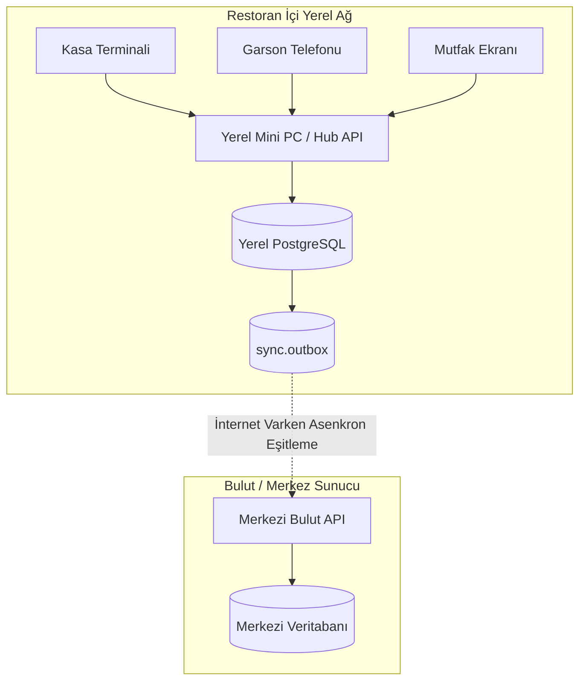

# HIPOS — Çevrimdışı Çalışma ve Merkezi Senkronizasyon (Offline Sync) Kılavuzu

> **Durum:** Öncelikli Geliştirme Alanı · Doküman Sürümü: v1.0
> **İlgili Mimari Referanslar:** [Çevrimdışı Çalışma İlk Sözleşmesi](CEVRIMDISI_CALISMA_VE_SENKRONIZASYON.md) · [Teknik Mimari](TEKNIK_MIMARI.md) · [Ana Devir Rehberi](../00-devir-rehberi/DEVIR_REHBERI.md)

> **Dokümantasyon Hiyerarşisi:**
> * **Güncel kod durumu için:** [docs/01-mimari-ve-altyapi/BACKEND_MIMARISI_VE_MODUL_BAGIMLILIKLARI.md](BACKEND_MIMARISI_VE_MODUL_BAGIMLILIKLARI.md)
> * **Güncel teslim ve yol haritası için:** [docs/00-devir-rehberi/DURUM_VE_YOL_HARITASI.md](../00-devir-rehberi/DURUM_VE_YOL_HARITASI.md)
> * **Devir ve onboarding için:** [docs/00-devir-rehberi/DEVIR_REHBERI.md](../00-devir-rehberi/DEVIR_REHBERI.md)
> * **Tarihsel kararlar için:** [docs/05-gecmis-ve-arsiv/](../05-gecmis-ve-arsiv/)

---

> [!WARNING]
> ### ⚠️ Çevrimdışı ve Senkronizasyon Uygulama Durumu
> * **LAN hedefi:** planlandı
> * **Yerel Mini PC:** uygulanmadı
> * **sync.outbox:** yok
> * **Merkezi eşitleme:** yok
> * **Çakışma çözümü:** yok

---

## 1. Problem Tanımı ve Mevcut Kod Durumu

Bir restoranın internet bağlantısı koptuğunda operasyonun **1 saniye bile durmaması** gerekir. Garson masadan sipariş almaya, mutfak bilet basmaya, kasa hesap tahsil etmeye devam edebilmelidir.
* Şu anki HIPOS kodu tek bir yerel veritabanına doğrudan bağlanmaktadır.
* İnternet kesildiğinde yerel ağda (LAN) işlem kuyruğu biriktirecek bir **Outbox tablosu** yoktur.
* İnternet geri geldiğinde verileri buluta aktaracak bir **senkronizasyon servisi (Sync Worker)** ve **çakışma yönetimi (Conflict Resolution)** kodlanmamıştır.

---

## 2. Sistem Mimarisi ve Çalışma Seviyeleri



1. **Seviye A (İnternet Var):** Yerel sunucu tüm işlemleri yerel DB'ye yazar, arka planda anlık olarak buluta eşitler.
2. **Seviye B (İnternet Kesik, Yerel Ağ Var):** Tüm restoran içi sipariş, adisyon ve kasa işlemleri yerel Mini PC üzerinde kesintisiz devam eder. Kayıtlar `sync.outbox` tablosunda sıraya alınır.
3. **Seviye C (İnternet Geri Geldi):** Yerel Sync servisi uyanır, kuyruktaki tüm olayları idempotency anahtarıyla sırayla buluta gönderir.

---

## 3. Mimari ve Veritabanı Modeli (`sync` Şeması)

Yerel veritabanında kuyruk mekanizması:

```sql
CREATE SCHEMA IF NOT EXISTS sync;

-- Senkronizasyon Outbox Tablosu
CREATE TABLE sync.outbox (
    id UUID PRIMARY KEY DEFAULT gen_random_uuid(),
    firm_id UUID NOT NULL,
    branch_id UUID NOT NULL,
    entity_type VARCHAR(50) NOT NULL, -- "check", "order", "cash_movement", "stock_movement"
    entity_id UUID NOT NULL,
    action VARCHAR(20) NOT NULL, -- "create", "update", "close"
    payload_json JSONB NOT NULL,
    idempotency_key VARCHAR(100) NOT NULL UNIQUE,
    created_at TIMESTAMPTZ NOT NULL DEFAULT clock_timestamp(),
    synced_at TIMESTAMPTZ NULL,
    retry_count INT NOT NULL DEFAULT 0,
    last_error TEXT NULL
);

-- Bulut Tarafında Eşitleme Durumu Takibi
CREATE TABLE sync.branch_sync_status (
    branch_id UUID PRIMARY KEY,
    last_synced_at TIMESTAMPTZ NOT NULL,
    pending_count INT NOT NULL DEFAULT 0,
    status VARCHAR(30) NOT NULL DEFAULT 'healthy' -- healthy, lagging, offline
);
```

---

## 4. Adım Adım Uygulama Yol Haritası

### Adım 1: Outbox Event Interceptor / Filter
* EF Core içinde `SaveChanges` veya transaction tamamlandığında:
  * Eğer işlem gören entity `ISyncable` arayüzünü uyguluyorsa (Adisyon, Sipariş, Kasa Hareketi vb.),
  * Değişiklik aynı transaction içinde JSON olarak `sync.outbox` tablosuna yazılır.

### Adım 2: Yerel Arka Plan Eşitleme Servisi (`SyncBackgroundWorker`)
* .NET `IHostedService` veya `BackgroundService` olarak her 15 saniyede bir çalışır:
  1. `sync.outbox` tablosundaki `synced_at IS NULL` olan en eski 50 kaydı çeker.
  2. İnternet bağlantısını kontrol eder (`GET /api/v1/health` to Cloud).
  3. Kayıtları topluca buluta POST eder: `POST /api/v1/sync/batch`.
  4. Buluttan `200 OK` yanıtı gelince yereldeki kayıtların `synced_at = clock_timestamp()` alanını günceller.

### Adım 3: Çakışma Çözümleme Kuralları (Conflict Resolution)
* **Adisyon ve Ödemeler (Append-Only):** Kasa hareketleri ve adisyonlar değiştirilemez olduğu için çakışma riski düşüktür; her benzersiz `idempotency_key` bulutta tek bir kayda denk gelir.
* **Masa Durumu:** Yerel sunucu her zaman **fiziksel restoranın anlık durumunda hakemdir (Source of Truth)**. Bulut masa durumunu yerelden gelen son duruma göre günceller.
* **Ürün & Menü Değişiklikleri:** Merkezden şubeye tek yönlü (downstream) akar. Şube menü değiştiremez, sadece merkezin yayınladığı menüyü indirir.

### Adım 4: Kullanıcı Arayüzünde Senkronizasyon Durum Rozeti
* `apps/pos` ve `apps/admin` ekranlarının üst çubuğunda canlı durum göstergesi:
  * 🟢 **Bulut Bağlı:** Tüm işlemler eşitlendi.
  * 🟡 **Yerel Modda (X Bekleyen Kayıt):** İnternet yok, yerelde çalışıyor; işlemler kuyrukta bekliyor.
  * 🔴 **Bağlantı Hatası:** Yerel sunucuya da ulaşılamıyor (kablo/Wi-Fi kopuk).

---

## 5. Kabul Kriterleri (Devir Doğrulama Testi)

1. Restoranın internet kablosu çekildiğinde Kasa ve Garson ekranı hata vermeden sipariş almaya ve adisyon açmaya devam edebilmeli.
2. Çevrimdışı iken 10 adet sipariş ve 5 adet ödeme kaydedildiğinde bu 15 işlem `sync.outbox` tablosunda birikmeli.
3. İnternet kablosu geri takıldığında en geç 30 saniye içinde bulut veritabanında bu 15 işlem eksiksiz ve çiftleme olmadan belirmelidir.
