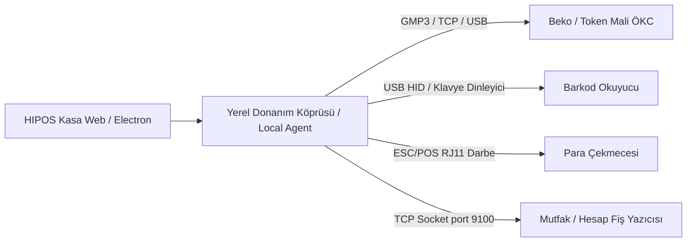

# HIPOS — Donanım ve Mali Cihaz Entegrasyonları (ÖKC & Peripherals) Kılavuzu

> **Durum:** Öncelikli Geliştirme Alanı · Doküman Sürümü: v1.0
> **İlgili Mimari Referanslar:** [Entegrasyon Envanteri](ENTEGRASYON_ENVANTERI_VE_TOKEN_SURECI.md) · [Teknik Mimari](TEKNIK_MIMARI.md) · [Ana Devir Rehberi](../00-devir-rehberi/DEVIR_REHBERI.md)

> **Dokümantasyon Hiyerarşisi:**
> * **Güncel kod durumu için:** [docs/01-mimari-ve-altyapi/BACKEND_MIMARISI_VE_MODUL_BAGIMLILIKLARI.md](BACKEND_MIMARISI_VE_MODUL_BAGIMLILIKLARI.md)
> * **Güncel teslim ve yol haritası için:** [docs/00-devir-rehberi/DURUM_VE_YOL_HARITASI.md](../00-devir-rehberi/DURUM_VE_YOL_HARITASI.md)
> * **Devir ve onboarding için:** [docs/00-devir-rehberi/DEVIR_REHBERI.md](../00-devir-rehberi/DEVIR_REHBERI.md)
> * **Tarihsel kararlar için:** [docs/05-gecmis-ve-arsiv/](../05-gecmis-ve-arsiv/)

---

### 📌 Token / Beko ÖKC Entegrasyon Gerçeklik Tablosu

| Aşama / Bileşen | Durum | Açıklama |
| :--- | :--- | :--- |
| **Başvuru** | **Yapıldı / belgelendi** | 12 Ekim 2026 tarihli kurumsal entegratör başvuru formu kayıtlıdır |
| **Geliştirici portalı** | **Bekleniyor** | Token Developer Portal erişimi ve teknik dokümantasyon bekleniyor |
| **Test cihazı** | **Yok** | Fiziksel Beko ÖKC test terminali veya laboratuvar cihazı henüz temin edilmedi |
| **SDK / API** | **Yok** | Token/Beko resmi SDK kütüphanesi veya REST/WebSocket client'ı henüz repoda yoktur |
| **HIPOS adapter’ı** | **Yok** | C# veya Node.js tabanlı mali cihaz köprüsü/sürücüsü henüz kodlanmadı |
| **ÖKC sertifikasyonu** | **Yok** | Token laboratuvar sertifikasyon test slotu ve resmi uyumluluk testi yapılmadı |
| **Pilot** | **Başlamadı** | Sahada gerçek restoran pilotu henüz başlamadı |

---

## 1. Problem Tanımı ve Mevcut Kod Durumu

Bir restoran POS sisteminin gerçek dünyada çalışabilmesi için 4 temel çevre birimiyle (peripherals) konuşabilmesi gerekir:
1. **Mali ÖKC / Yazar Kasa:** Türkiye mevzuatına uygun mali fiş kesebilmek (Beko / Token ÖKC).
2. **Banka POS Cihazları:** Kart çekimini otomatik başlatmak ve slipleri eşleştirmek.
3. **Barkod / Karekod Okuyucu:** Hızlı satış ve paket serviste ürün/adisyon taramak.
4. **Para Çekmecesi (Cash Drawer):** Fiş çıktığında otomatik fırlayan metal çekmece.

Şu anki HIPOS projesinde cihaz entegrasyonu adına yalnızca kavramsal dokümanlar ([`ENTEGRASYON_ENVANTERI_VE_TOKEN_SURECI.md`](./ENTEGRASYON_ENVANTERI_VE_TOKEN_SURECI.md)) bulunmaktadır; **fiziksel donanım protokolü veya sürücü kodu bulunmamaktadır**.

---

## 2. Donanım Mimarisi ve İletişim Kanalları



---

## 3. Donanım Arayüzü ve Adapter Deseni (C# Interface)

Farklı marka cihazlara bağımlı kalmamak için `IHardwareAdapter` deseni kurulmalıdır:

```csharp
namespace Hipos.Api.Hardware;

public interface IFiscalRegisterAdapter
{
    Task<FiscalPrintResult> PrintReceiptAsync(FiscalReceiptRequest request, CancellationToken ct);
    Task<FiscalZReportResult> PrintZReportAsync(CancellationToken ct);
    Task<DeviceHealthStatus> CheckStatusAsync(CancellationToken ct);
}

public interface ICashDrawerAdapter
{
    Task OpenDrawerAsync(CancellationToken ct);
}

public record FiscalReceiptRequest(
    string CheckId,
    List<FiscalItem> Items,
    int TotalMinor,
    int CashMinor,
    int CreditCardMinor,
    string CashierName
);
```

---

## 4. Adım Adım Uygulama Yol Haritası

### Adım 1: Beko / Token ÖKC Entegrasyonu (GMP3 Protokolü)
* Beko 300TR / Token Financial cihazları ağ üzerinden (Ethernet/Wi-Fi) GMP3 protokolü ile JSON-RPC veya TCP socket üzerinden çalışır.
* Ödeme adımı:
  1. Kasiyer `[Kart ile Tahsil Et]` dediğinde HIPOS API, Beko cihaza `SaleRequest` gönderir.
  2. Beko cihazın ekranında *"Kartınızı Okutun: 450,00 TL"* yazar.
  3. Müşteri temassız kartı okutur, onaylanır.
  4. Beko cihaz onay kodunu ve mali fiş numarasını HIPOS'a geri döner:
     ```json
     { "status": "APPROVED", "fiscalReceiptNo": "0042", "authCode": "981234", "rrn": "421098123" }
     ```
  5. HIPOS adisyonu kapatır ve bu işlem `sales.payments` tablosuna mali referansıyla işlenir.

### Adım 2: Para Çekmecesi Açma Tetikleyicisi (RJ11 Kick Pulse)
* Para çekmeceleri doğrudan bilgisayara değil, termal yazıcının arkasındaki RJ11 portuna bağlanır.
* Kasiyer nakit tahsilatı tamamladığında veya Kasa ekranından `[Çekmeceyi Aç]` dediğinde, yazıcıya standart 5 baytlık ESC/POS darbe sinyali gönderilir:
  ```csharp
  byte[] kickDrawerCommand = new byte[] { 27, 112, 0, 25, 250 }; // ESC p 0 25 250
  await printerStream.WriteAsync(kickDrawerCommand);
  ```
* Çekmece "şak" diye fırlar.

### Adım 3: Barkod Okuyucu Dinleyicisi (USB HID Keyboard Wedge)
* Barkod okuyucular klavye gibi davranır; barkodu okuyup sonuna `Enter` tuşu basar.
* Kasa arayüzünde (`apps/pos`) global bir `window.addEventListener('keydown')` dinleyicisi kurulur.
* Eğer 50 milisaniyeden daha hızlı ardışık karakterler ve sonunda `Enter` gelirse:
  * Kullanıcının klavyeden yazmadığı, barkod okuyucuyla okuttuğu anlaşılır.
  * Taranan barkod doğrudan ürün arama veya adisyon bulma fonksiyonuna iletilir.

---

## 5. Kabul Kriterleri (Devir Doğrulama Testi)

1. Kasa ekranında nakit ödeme onaylandığı an bağlı olan para çekmecesinin kilidi otomatik açılmalı.
2. Barkod okuyucuyla bir içecek okutulduğunda ürün anında sepete 1 adet olarak eklenmeli.
3. Test ÖKC terminaline satış isteği atıldığında mali onay kodu ve Z-no yanıtı başarıyla API'ye dönmeli.
