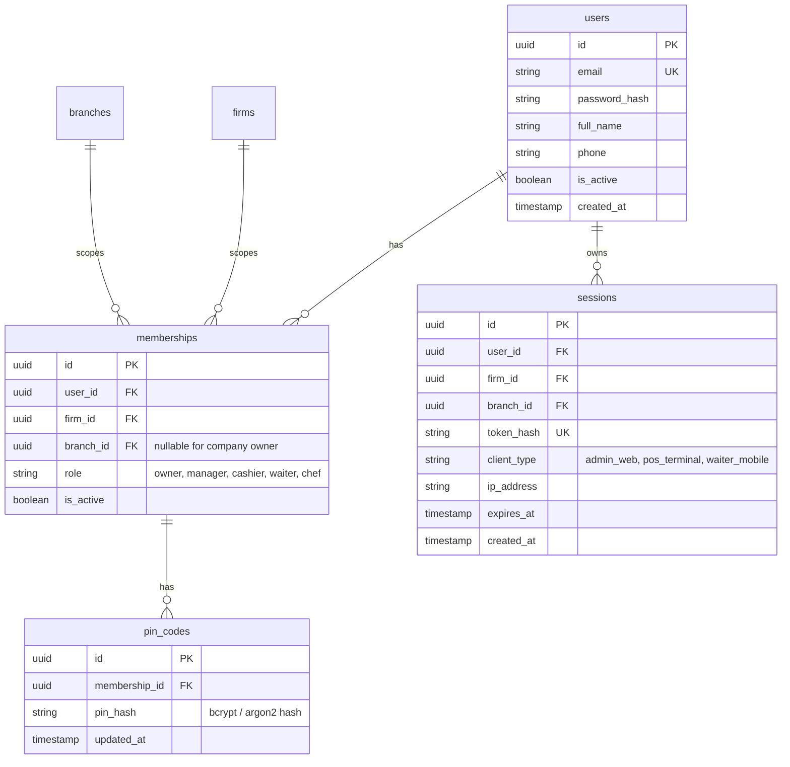

# HIPOS — Kimlik, Oturum ve Yetkilendirme (Auth & Multi-Tenancy) Kılavuzu

> **Durum:** Öncelikli Geliştirme Alanı · Doküman Sürümü: v1.0
> **İlgili Mimari Referanslar:** [Teknik Mimari](TEKNIK_MIMARI.md) · [Backend Mimarisi ve Şemalar](BACKEND_MIMARISI_VE_MODUL_BAGIMLILIKLARI.md) · [Ana Devir Rehberi](../00-devir-rehberi/DEVIR_REHBERI.md)

> **Dokümantasyon Hiyerarşisi:**
> * **Güncel kod durumu için:** [docs/01-mimari-ve-altyapi/BACKEND_MIMARISI_VE_MODUL_BAGIMLILIKLARI.md](BACKEND_MIMARISI_VE_MODUL_BAGIMLILIKLARI.md)
> * **Güncel teslim ve yol haritası için:** [docs/00-devir-rehberi/DURUM_VE_YOL_HARITASI.md](../00-devir-rehberi/DURUM_VE_YOL_HARITASI.md)
> * **Devir ve onboarding için:** [docs/00-devir-rehberi/DEVIR_REHBERI.md](../00-devir-rehberi/DEVIR_REHBERI.md)
> * **Tarihsel kararlar için:** [docs/05-gecmis-ve-arsiv/](../05-gecmis-ve-arsiv/)

---

> [!WARNING]
> ### ⚠️ Üretim ve Güvenlik Sınırı
> * **Gerçek auth uygulanmadı.**
> * **`X-Demo-Actor` yalnızca Development test aktörüdür.**
> * **Production ortamında güvenlik sağlamaz.**

---

## 1. Problem Tanımı ve Mevcut Kod Durumu

Şu anki HIPOS kod tabanında **gerçek bir kimlik doğrulama, şifre saklama veya oturum kontrolü bulunmamaktadır**.
* Tüm API istekleri, HTTP başlığındaki `X-Demo-Actor: manager-single` veya `pos-single` gibi serbest metinlerle yetkilendirilir.
* İstemci bu başlığı dilediği gibi taklit edebilir.
* Veritabanında kullanıcı tablosu, rol modeli, şifre hash'i veya oturum yaşam döngüsü yoktur.
* Sistem bu haliyle çok kullanıcılı bir restoran ortamına veya müşteri trafiğine **kesinlikle açılamaz**.

---

## 2. Hedeflenen İş Mantığı ve Rol Modeli

Restoranda iki farklı giriş akışı vardır:
1. **Yönetim Paneli Girişi (E-posta + Şifre):** Şirket sahibi ve şube müdürleri tarayıcıdan e-posta ve şifreleriyle girer. İki faktörlü doğrulama (2FA) opsiyoneldir.
2. **Kasa & POS İstasyon Girişi (Hızlı 4 Haneli PIN):** Garson ve kasiyerler yoğun servis sırasında uzun şifre yazmaz. Personel listesinden adını seçer veya kartını okutur, 4 haneli PIN kodunu girerek 1 saniyede işlem yapmaya başlar.

### Rol ve Yetki Matrisi (RBAC)

| Yetki / Rol | Şirket Sahibi (Owner) | Şube Müdürü (Manager) | Kasiyer (Cashier) | Garson (Waiter) | Mutfak Şefi (Chef) |
|---|:---:|:---:|:---:|:---:|:---:|
| Şube & Modül Ayarları | ✅ | ❌ | ❌ | ❌ | ❌ |
| Fiyat & Ürün Tanımlama | ✅ | ✅ | ❌ | ❌ | ❌ |
| Kasa Açma / Kapatma (Z-Raporu) | ✅ | ✅ | ✅ (Kendi kasası) | ❌ | ❌ |
| Kasaya Avans Ekleme / Teslim Alma | ✅ | ✅ | ❌ | ❌ | ❌ |
| Tedarikçiye Kasadan Ödeme | ✅ | ✅ | ❌ | ❌ | ❌ |
| İptal / İkram / İndirim Onayı | ✅ | ✅ (Şifresiyle) | ❌ | ❌ | ❌ |
| Masaya Sipariş Girme | ✅ | ✅ | ✅ | ✅ | ❌ |
| KDS Mutfak Hazırlık Durumu | ✅ | ✅ | ❌ | ❌ | ✅ |

---

## 3. Mimari ve Veritabanı Modeli (`auth` Şeması)

PostgreSQL üzerinde yeni bir `auth` şeması kurulmalı ve EF Core için `AuthDbContext` tanımlanmalıdır:



---

## 4. Adım Adım Uygulama Yol Haritası

### Adım 1: EF Core `AuthDbContext` ve Tabloların Oluşturulması
* `apps/api/Hipos.Api/Auth` klasörü altında `User`, `Membership`, `Session`, `PinCode` entity modelleri yazılmalı.
* Şifre hash'leme için `BCrypt.Net-Next` veya `Microsoft.AspNetCore.Identity.PasswordHasher` kullanılmalı (asla düz metin saklanamaz).
* `AuthDbContext` tanımlanıp `__EFMigrationsHistory` tablosu `auth` şemasına yönlendirilmeli:
  ```bash
  dotnet ef migrations add InitAuth --context AuthDbContext
  dotnet ef database update --context AuthDbContext
  ```

### Adım 2: API Uç Noktalarının (Endpoints) Kodlanması
* `POST /api/v1/auth/login`: E-posta ve şifre doğrulaması. Başarılı ise HttpOnly cookie veya JWT token (`accessToken` + `refreshToken`) döner.
* `POST /api/v1/auth/pin-login`: Terminal için şube bazlı 4 haneli PIN girişi. `{ branchId, userId, pin }` -> Hızlı kasiyer oturumu.
* `POST /api/v1/auth/logout`: Aktif oturumu sonlandırır (`sessions` tablosundan siler/iptal eder).
* `GET /api/v1/auth/me`: Aktif oturumdaki kullanıcının kimlik, rol, atanmış kasa ve şube bilgilerini döner.

### Adım 3: `CurrentActorMiddleware` ve Güvenlik Filtresi
* API'ye gelen her istekte `Authorization: Bearer <token>` veya `hipos_session` cookie okunur.
* İstek yapılan URL'deki `firmId` ve `branchId` ile kullanıcının oturum token'ındaki yetki eşleştirilir.
* Token yoksa ➡️ `401 Unauthorized`.
* Kullanıcı başka firmanın/şubenin verisine erişmeye çalışıyorsa ➡️ `403 Forbidden`.
* `X-Demo-Actor` header desteği tamamen silinmeli veya yalnızca `ASPNETCORE_ENVIRONMENT=Testing` için izole edilmelidir.

### Adım 4: Frontend Entegrasyonu (`apps/admin` ve `apps/pos`)
* `apps/admin`: Giriş yapılmamışsa doğrudan `/login` ekranına yönlendirme (React Router Auth Guard).
* `apps/pos`: Terminal kilit ekranı ve 4 haneli dokunmatik PIN tuş takımı bileşeni (`PinPad.tsx`).
* Ekranın üst çubuğunda anlık kullanıcı rozeti: `👤 [Personel Adı] · [Rolü] · [Çıkış Yap]`.

---

## 5. Kabul Kriterleri (Devir Doğrulama Testi)

1. Giriş yapmamış bir istemci `/api/v1/firms/.../catalog/products` çağırdığında HTTP `401` almalı.
2. Kadıköy şubesi kasiyeri, Moda şubesinin kasasını veya satışını sorguladığında HTTP `403` almalı.
3. Kasiyer PIN pad'den doğru PIN girdiğinde 500 ms içinde terminal açılmalı; 3 kez yanlış girildiğinde hesap 5 dakika kilitlenmeli.
4. Yapılan tüm kasa ve sipariş hareketlerinin veritabanındaki `actor` kolonuna gerçek `user_id` ve `full_name` yazılmalı.
