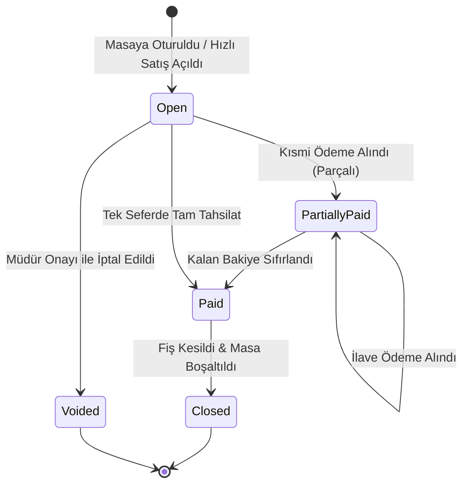

# HIPOS — Adisyon, Sipariş ve Masa Yaşam Döngüsü Kılavuzu

> **Durum:** Öncelikli Geliştirme Alanı · Doküman Sürümü: v1.0
> **İlgili Mimari Referanslar:** [Ortak Adisyon Sözleşmesi](ORTAK_ADISYON_SOZLESMESI.md) · [Backend Mimarisi ve Şemalar](../01-mimari-ve-altyapi/BACKEND_MIMARISI_VE_MODUL_BAGIMLILIKLARI.md) · [Ana Devir Rehberi](../00-devir-rehberi/DEVIR_REHBERI.md)

---

## 1. Problem Tanımı ve Mevcut Kod Durumu

Şu anki HIPOS sisteminde [`sales.checks`](../../apps/api/Hipos.Api/Sales/SalesDbContext.cs) tablosunda bir adisyon açılabilmekte ve içerisine sipariş eklenebilmektedir. Ancak:
* Adisyon kapatma (`closed`) iş akışı kodlanmamıştır. Masadaki hesap ödendikten sonra masa boşaltılamamaktadır.
* **Masa Taşıma, Birleştirme ve Adisyon Bölme** endpoint'leri bulunmamaktadır.
* Masaya yanlışlıkla girilen bir ürünün **iptali**, **müşteriye ikram edilmesi** veya **masaya indirim yapılması** mekanizması yoktur.
* Sipariş kalemlerinde "Az pişmiş", "Buzsuz", "Acı soslu" gibi **ürün seçenekleri ve servis notları (modifiers)** saklanamamaktadır.

---

## 2. Adisyon ve Sipariş Durum Makinesi (State Machine)



---

## 3. Mimari ve Veritabanı Modeli (`sales` Şeması Genişletmesi)

Mevcut `sales.checks` ve `sales.orders` tablolarına eklenecek alanlar ve yeni tablolar:

```sql
-- Adisyon tablosuna indirim ve durum alanları
ALTER TABLE sales.checks
ADD COLUMN status VARCHAR(30) NOT NULL DEFAULT 'open', -- open, partially_paid, paid, closed, voided
ADD COLUMN discount_minor INT NOT NULL DEFAULT 0,
ADD COLUMN discount_type VARCHAR(20) NULL, -- percentage, fixed_amount
ADD COLUMN discount_reason VARCHAR(255) NULL,
ADD COLUMN discount_authorized_by UUID NULL,
ADD COLUMN closed_at TIMESTAMPTZ NULL,
ADD COLUMN closed_by UUID NULL;

-- Sipariş kalemleri için opsiyonlar ve servis notları
CREATE TABLE sales.order_line_modifiers (
    id UUID PRIMARY KEY DEFAULT gen_random_uuid(),
    order_line_id UUID NOT NULL REFERENCES sales.order_lines(id) ON DELETE CASCADE,
    name VARCHAR(100) NOT NULL, -- örn. "Pişme Derecesi", "Ekstra Malzeme"
    option_value VARCHAR(100) NOT NULL, -- örn. "Orta-İyi", "Ekstra Duble Peynir"
    price_delta_minor INT NOT NULL DEFAULT 0 -- ilave fiyat farkı
);

-- İptal, İade ve İkram Denetim Kayıtları (Audit)
CREATE TABLE sales.check_voids (
    id UUID PRIMARY KEY DEFAULT gen_random_uuid(),
    check_id UUID NOT NULL REFERENCES sales.checks(id),
    order_line_id UUID NULL REFERENCES sales.order_lines(id),
    type VARCHAR(30) NOT NULL, -- item_void, full_check_void, complimentary (ikram)
    amount_minor INT NOT NULL,
    reason VARCHAR(500) NOT NULL,
    authorized_by UUID NOT NULL, -- yetki veren müdür
    created_at TIMESTAMPTZ NOT NULL DEFAULT clock_timestamp()
);
```

---

## 4. Adım Adım Uygulama Yol Haritası

### Adım 1: Masa Operasyonları API'lerinin Yazılması (`apps/api/Hipos.Api/Service`)
1. **Masa Taşıma (`POST /api/v1/firms/{firmId}/branches/{branchId}/service/tables/{sourceTableId}/transfer`):**
   * Kaynak masadaki aktif `check_id` hedef masaya bağlanır.
   * Hedef masada açık hesap varsa çakışma hatası (`409 TABLE_ALREADY_OCCUPIED`) döner.
   * `service.tables` üzerinde kaynak masa `idle`, hedef masa `occupied` yapılır.
2. **Masa Birleştirme (`POST /.../service/tables/{targetTableId}/merge`):**
   * Gövde: `{ sourceTableIds: [uuid, uuid] }`.
   * Kaynak masalardaki siparişler hedef masanın adisyonuna transfer edilir, kaynak masalar kapatılıp boşaltılır.
3. **Adisyon Bölme (`POST /.../sales/checks/{checkId}/split`):**
   * Gövde: `{ itemIds: [uuid, uuid] }`.
   * Seçilen ürünler yeni bir `check` oluşturularak oraya aktarılır.

### Adım 2: İptal, İkram ve İskonto Mekanizması
* `POST /api/v1/.../sales/checks/{checkId}/discount`: Masaya yüzde veya sabit TL indirim uygular. Müdür PIN'i zorunludur.
* `POST /api/v1/.../sales/checks/{checkId}/lines/{lineId}/void`: Siparişteki ürünü iptal eder veya ikrama çevirir.
  * Eğer ürün mutfağa gönderilmişse mutfak ekranına otomatik **"İPTAL EDİLDİ"** uyarısı düşer.
  * İptal gerekçesi (`Müşteri Vazgeçti`, `Hatalı Sipariş`, `Kalite Şikayeti`) seçilmesi zorunludur.

### Adım 3: Adisyon Kapatma ve Masa Boşaltma
* Adisyondaki tüm ödemelerin toplamı (`payments_total_minor`) adisyon tutarını (`total_minor - discount_minor`) karşıladığında:
  * `status = 'closed'` yapılır.
  * Bağlı masa `service.tables` tablosunda `status = 'idle'` durumuna getirilir.
  * Mutfak ve garson ekranlarında masanın kapandığı anlık yansıtılır.

### Adım 4: Kullanıcı Arayüzü (Masa Planı ve Adisyon İşlemleri)
* `apps/admin` (veya Dokunmatik POS): Masa üzerine tıklandığında açılan işlem menüsü:
  * `[ Masayı Taşı ]` ➡️ Boş masa seçici açılır.
  * `[ Masaları Birleştir ]` ➡️ Masalar çoklu seçilir.
  * `[ İndirim / İskonto ]` ➡️ Müdür onay modalı açılır.
  * `[ Kalem İptali / İkram ]` ➡️ Gerekçe listesi açılır.

---

## 5. Kabul Kriterleri (Devir Doğrulama Testi)

1. Masa 4'teki 850 TL'lik adisyon Masa 9'a taşındığında, garson ve mutfak ekranında siparişler artık Masa 9 altında görünmeli.
2. Mutfakta hazırlanmakta olan bir pizza iptal edildiğinde, mutfak KDS ekranında o pizza kırmızı çizgi ve "İPTAL" rozetiyle işaretlenmeli.
3. Kasiyer yetkisiz bir kullanıcıyla %20 indirim yapmaya kalktığında sistem müdür şifresi sormalı; şifresiz indirim kaydedilememeli.
4. Parçalı veya tek seferde tam ödemesi alınan adisyon kapandığında masa otomatik olarak boş (yeşil) renge dönmeli.
