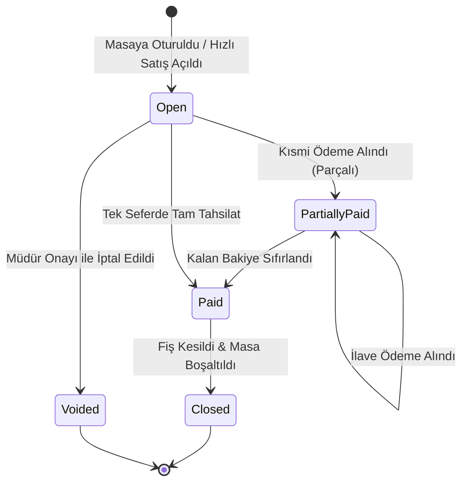

# HIPOS — Adisyon, Sipariş ve Masa Yaşam Döngüsü Kılavuzu

> **Durum:** Öncelikli Geliştirme Alanı · Doküman Sürümü: v1.0
> **İlgili Mimari Referanslar:** [Ortak Adisyon Sözleşmesi](ORTAK_ADISYON_SOZLESMESI.md) · [Backend Mimarisi ve Şemalar](../01-mimari-ve-altyapi/BACKEND_MIMARISI_VE_MODUL_BAGIMLILIKLARI.md) · [Ana Devir Rehberi](../00-devir-rehberi/DEVIR_REHBERI.md)

---

## 1. Problem Tanımı ve Mevcut Kod Durumu

Şu anki HIPOS sisteminde [`sales.checks`](../../apps/api/Hipos.Api/Sales/SalesDbContext.cs) tablosunda bir adisyon açılabilmekte ve içerisine sipariş eklenebilmektedir. Development simüle tahsilat akışında:
* Tahsilat toplamı adisyonun indirim/ikram/iptal sonrası ödenecek tutarına ulaştığında adisyon `closed` yapılır.
* Aynı masa veya fiziksel masa grubunda başka açık adisyon varsa masa/grup bağlantıları korunur. Son açık adisyon da kapanınca aktif garson atamaları kapatılır, masa üyeleri boş duruma alınır ve fiziksel grup kapatılır.
* Bu davranış gerçek kasa/POS tahsilatı değildir; simüle ödeme hareketi kasa kaydı oluşturmaz. `CloseChecksAfterPayment` Sales migration'ı veritabanına uygulanıp API yeniden başlatılmalıdır.
Ancak:
* Masa taşıma, ödeme girişimi olmayan açık adisyonları birleştirme ve açık adisyonu kalem/miktar bazında bölme API'leri uygulanmıştır.
* Garson ekranında gerekçeli ürün iptali/ikramı ve yüzde/sabit indirim API'si vardır. Yönetici onayı yalnızca Development test ortamında atlanır; diğer ortamlarda onaysız kayıt reddedilir. Gerçek yönetici kimliği/PIN onayı henüz yoktur.
* Sipariş kaleminde serbest ürün notu ve demo hazırlama tercihleri saklanabilir; ancak ücret etkili katalog modifier seçenekleri Modül 4 API'sine henüz bağlı değildir.

---

## 2. Adisyon ve Sipariş Durum Makinesi (State Machine)



---

## 3. Mimari ve Veritabanı Modeli (`sales` Şeması Genişletmesi)

Mevcut `sales.checks` ve `sales.orders` tablolarına eklenecek alanlar ve yeni tablolar:

```sql
-- Adisyon tablosuna indirim ve durum alanları
ALTER TABLE sales.checks
ADD COLUMN status VARCHAR(30) NOT NULL DEFAULT 'open', -- open, partially_paid, paid, closed, voided
ADD COLUMN discount_minor INT NOT NULL DEFAULT 0,
ADD COLUMN discount_type VARCHAR(20) NULL, -- percentage, fixed_amount
ADD COLUMN discount_reason VARCHAR(255) NULL,
ADD COLUMN discount_authorized_by UUID NULL,
ADD COLUMN closed_at TIMESTAMPTZ NULL,
ADD COLUMN closed_by UUID NULL;

-- Sipariş kalemleri için opsiyonlar ve servis notları
CREATE TABLE sales.order_line_modifiers (
    id UUID PRIMARY KEY DEFAULT gen_random_uuid(),
    order_line_id UUID NOT NULL REFERENCES sales.order_lines(id) ON DELETE CASCADE,
    name VARCHAR(100) NOT NULL, -- örn. "Pişme Derecesi", "Ekstra Malzeme"
    option_value VARCHAR(100) NOT NULL, -- örn. "Orta-İyi", "Ekstra Duble Peynir"
    price_delta_minor INT NOT NULL DEFAULT 0 -- ilave fiyat farkı
);

-- İptal, İade ve İkram Denetim Kayıtları (Audit)
CREATE TABLE sales.check_voids (
    id UUID PRIMARY KEY DEFAULT gen_random_uuid(),
    check_id UUID NOT NULL REFERENCES sales.checks(id),
    order_line_id UUID NULL REFERENCES sales.order_lines(id),
    type VARCHAR(30) NOT NULL, -- item_void, full_check_void, complimentary (ikram)
    amount_minor INT NOT NULL,
    reason VARCHAR(500) NOT NULL,
    authorized_by UUID NOT NULL, -- yetki veren müdür
    created_at TIMESTAMPTZ NOT NULL DEFAULT clock_timestamp()
);
```

---

## 4. Adım Adım Uygulama Yol Haritası

### Adım 1: Masa Operasyonları API'lerinin Yazılması (`apps/api/Hipos.Api/Service`)
1. **Masa Taşıma (`POST /api/v1/firms/{firmId}/branches/{branchId}/service/tables/{sourceTableId}/transfer`) — API uygulandı:**
   * Kaynak masadaki aktif `check_id` hedef masaya bağlanır.
   * Hedef masada açık hesap varsa çakışma hatası (`409 TABLE_ALREADY_OCCUPIED`) döner.
   * `service.tables` üzerinde kaynak masa `idle`, hedef masa `occupied` yapılır.
2. **Masa Birleştirme (`POST /.../service/tables/{targetTableId}/merge`) — API uygulandı:**
   * Gövde: `{ sourceTableIds: [uuid, uuid] }`.
   * Kaynak masalardaki siparişler hedef masanın adisyonuna transfer edilir, kaynak masalar kapatılıp boşaltılır.
3. **Adisyon Bölme (`POST /api/v1/firms/{firmId}/branches/{branchId}/sales/checks/{checkId}/split`) — API uygulandı:**
   * Gövde: `{ requestId, expectedVersion, items: [{ orderLineId, quantity }] }`. `orderLineId`, sipariş kaleminin sayısal kimliğidir; tüm miktar seçilirse kalemin tamamı, daha azı seçilirse yalnız seçilen miktar taşınır.
   * Seçilen miktarlar aynı masa, garson ve müşteri bağlamıyla yeni bir açık adisyona ayrılır. Tamamı seçilen sipariş silinmeden, kimliği ve kalemleri korunarak yeni adisyona bağlanır; yalnızca kısmen ayrılan kalemler için yeni bir bölme siparişi oluşturulur. Masa bağlantısının ilk sipariş kimliği korunur. Kaynak adisyonda en az bir kalem kalmalıdır. Ödeme girişimi bulunan adisyon bölünmez.
   * İstek kimliği tekrar denemeyi güvenli kılar; farklı içerikle aynı kimlik kullanılırsa çakışma döner. Adisyon sürümü eskiyse işlem reddedilir.
   * Serbest tutarlı kısmi ödemeler bölme işlemi değildir: aynı adisyonda birden fazla ödeme girişimi olarak kaydedilir.
   * Mutfak hazırlık içeriği sipariş ilk gönderildiğinde ayrı bir anlık görüntü olarak saklanır. Adisyon bölme yalnızca hesap kalemlerini dağıtır; bu mutfak görüntüsünün miktarını değiştirmez ve yeni bir mutfak bileti oluşturmaz.

### Adım 2: İptal, İkram ve İskonto Mekanizması (Development test akışı uygulandı)
* `POST /api/v1/firms/{firmId}/branches/{branchId}/sales/checks/{checkId}/adjustments`: Yüzde/sabit adisyon indirimi veya ürün kalemine miktar bazlı ikram/iptal kaydeder. Gerekçe zorunludur; aktör, zaman ve `development_bypass` onay modu denetim kaydında tutulur.
* Gerçek yönetici onayı henüz uygulanmadığından onaysız istekler Development dışındaki ortamlarda `MANAGER_APPROVAL_REQUIRED` ile reddedilir.
  * İptal kaydı adisyon toplamını düşürür. Mutfak ekranında otomatik **"İPTAL EDİLDİ"** uyarısı ayrıca doğrulanmalıdır.
  * İptal gerekçesi (`Müşteri Vazgeçti`, `Hatalı Sipariş`, `Kalite Şikayeti`) seçilmesi zorunludur.

### Adım 3: Adisyon Kapatma ve Masa Boşaltma
* Development simüle ödemeleri toplamı, indirim/ikram/iptal sonrası adisyon bakiyesini karşıladığında adisyon `closed` olur. Tahsilat ve kapanış aynı transaction içindedir.
* Masa veya fiziksel masa grubunda başka açık adisyon kalmışsa masa/atamalar/grup açık tutulur. Son açık adisyon kapanınca aktif garson atamaları kapatılır, masa üyeleri `idle` yapılır ve varsa grup kapatılır.
* Salon görünümü Service API'sinden masanın güncel durumunu alır; garson ödeme almaz. Gerçek kasa/POS tahsilatının bu akışa bağlanması ve migration'ın veritabanına uygulanması beklenmektedir.

### Adım 4: Kullanıcı Arayüzü (Garson Ekranı)
* `/waiter` masa detayında `[ Masayı Taşı ]`, `[ Masaları Birleştir ]`, `[ Adisyon Böl ]` ve `[ İndirim / İkram ]` akışları bulunur.
* İndirim/ikram kaydı Development ortamında etkin; üretim kullanımı gerçek yönetici onay/kimlik altyapısı tamamlanana kadar engellenir.

---

## 5. Kabul Kriterleri (Devir Doğrulama Testi)

1. Masa 4'teki 850 TL'lik adisyon Masa 9'a taşındığında, garson ve mutfak ekranında siparişler artık Masa 9 altında görünmeli.
2. Mutfakta hazırlanmakta olan bir pizza iptal edildiğinde, mutfak KDS ekranında o pizza kırmızı çizgi ve "İPTAL" rozetiyle işaretlenmeli.
3. Kasiyer yetkisiz bir kullanıcıyla %20 indirim yapmaya kalktığında sistem müdür şifresi sormalı; şifresiz indirim kaydedilememeli.
4. Parçalı veya tek seferde tam ödemesi alınan adisyon kapandığında masa otomatik olarak boş (yeşil) renge dönmeli.

## Fiziksel masa grubu (23 Ekim 2026)

Kalabalık misafirler için bir ana masa ve boş ek masalar kalıcı `service.table_groups` kaydıyla birlikte kullanımda tutulur. Hesap ve siparişler ana masaya bağlıdır; her üye aynı açık adisyon görünümünü verir. Ek masada ayrı hesap açılması reddedilir. Grup, adisyonların konsolidasyonundan ayrıdır: mevcut adisyon birleştirme kaynak masayı boşaltır. Dolu ek masaların hesapları önce birleştirilir, sonra grup oluşturulur. Grup ayırma ek masaları serbest bırakır, hesapları ana masada korur; ödeme veya adisyon kapatma yapmaz. Aktif grup üzerinde taşıma/birleştirme/silme reddedilir; adisyon bölme desteklenir. Ayrıntılar ve uçlar [Modül 2 sözleşmesindedir](../00-devir-rehberi/MODUL_02_MASA_VE_ADISYON.md).
