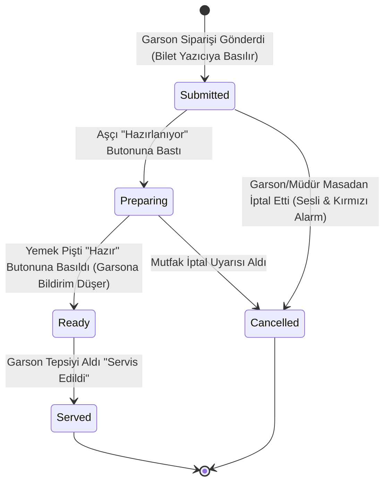

# HIPOS — Mutfak Ekranı (KDS) ve Termal Yazıcı Altyapısı Kılavuzu

> **Durum:** Öncelikli Geliştirme Alanı · Doküman Sürümü: v1.0
> **İlgili Mimari Referanslar:** [Kasa/POS Operasyon Sözleşmesi](KASA_POS_VE_OPERASYON_SOZLESMESI.md) · [Backend Mimarisi](../01-mimari-ve-altyapi/BACKEND_MIMARISI_VE_MODUL_BAGIMLILIKLARI.md) · [Ana Devir Rehberi](../00-devir-rehberi/DEVIR_REHBERI.md)

---

## 1. Problem Tanımı ve Mevcut Kod Durumu

Şu anki HIPOS mutfak arayüzü ([`OperationalApps.tsx`](../../apps/pos/src/OperationalApps.tsx)):
* `GET /sales/orders` endpoint'ini 3 saniyede bir çağıran **tamamen pasif ve salt-okunur** bir listedir.
* Mutfak personeli siparişin hazırlandığını veya piştiğini işaretleyemez (`Hazırlanıyor`, `Hazır`, `Servis Edildi` butonları yoktur).
* **İstasyon Ayrımı Yoktur:** Sıcak mutfak yemeği, meze, taş fırın pidesi ve bar içecekleri tek bir karmaşık listeye düşer.
* **Yazıcı Altyapısı Yoktur:** Garson sipariş girdiğinde mutfaktaki termal bilet yazıcısından (ESC/POS) otomatik kağıt fiş basılamaz.

---

## 2. Mutfak ve Hazırlık Durum Makinesi (KDS State Machine)



---

## 3. Mimari ve Veritabanı Modeli (`kitchen` Şeması)

Mutfak operasyonlarını ve yazıcı kuyruğunu yönetmek için:

```sql
CREATE SCHEMA IF NOT EXISTS kitchen;

-- Mutfak Hazırlık İstasyonları (Sıcak, Soğuk, Fırın, Bar)
CREATE TABLE kitchen.stations (
    id UUID PRIMARY KEY DEFAULT gen_random_uuid(),
    branch_id UUID NOT NULL,
    name VARCHAR(100) NOT NULL, -- örn. "Sıcak Mutfak", "Taş Fırın", "Bar"
    printer_ip VARCHAR(50) NULL, -- Termal yazıcı IP adresi (örn. 192.168.1.200)
    printer_port INT NOT NULL DEFAULT 9100,
    is_active BOOLEAN NOT NULL DEFAULT true
);

-- Hangi ürün kategorisinin hangi istasyona gideceği
CREATE TABLE kitchen.station_categories (
    station_id UUID NOT NULL REFERENCES kitchen.stations(id) ON DELETE CASCADE,
    category_id UUID NOT NULL,
    PRIMARY KEY(station_id, category_id)
);

-- KDS Mutfak Görevleri (Kalem bazlı hazırlık takibi)
CREATE TABLE kitchen.tasks (
    id UUID PRIMARY KEY DEFAULT gen_random_uuid(),
    branch_id UUID NOT NULL,
    order_id UUID NOT NULL REFERENCES sales.orders(id),
    order_line_id UUID NOT NULL REFERENCES sales.order_lines(id),
    station_id UUID NOT NULL REFERENCES kitchen.stations(id),
    table_name VARCHAR(50) NOT NULL,
    product_name VARCHAR(150) NOT NULL,
    quantity INT NOT NULL,
    notes TEXT NULL,
    status VARCHAR(30) NOT NULL DEFAULT 'submitted', -- submitted, preparing, ready, served, cancelled
    submitted_at TIMESTAMPTZ NOT NULL DEFAULT clock_timestamp(),
    prepared_at TIMESTAMPTZ NULL,
    ready_at TIMESTAMPTZ NULL,
    served_at TIMESTAMPTZ NULL
);
```

---

## 4. Adım Adım Uygulama Yol Haritası

### Adım 1: KDS API Endpoint'lerinin Yazılması
* `GET /api/v1/.../kitchen/stations/{stationId}/tasks?status=active`: O istasyonun hazırlayacağı aktif siparişleri döner.
* `POST /api/v1/.../kitchen/tasks/{taskId}/status`: Aşçının dokunmatik ekrandan bastığı durum güncellemesi:
  * Gövde: `{ nextStatus: "preparing" | "ready" | "served" }`.
* Sipariş `ready` olduğunda SignalR veya SSE (Server-Sent Events) ile garson ekranına anlık uyarı düşer (`"Masa 5'in Pizzası Hazır!"`).

### Adım 2: Termal Fiş Yazıcı Servisi (ESC/POS Network Printing)
Restoranlarda standart olarak ağ üzerinden (Ethernet/Wi-Fi) haberleşen 80mm termal yazıcılar kullanılır:
1. `apps/api` projesine `EscPos.Net` kütüphanesi entegre edilir.
2. Sipariş masadan onaylandığında:
   * Siparişteki ürünler istasyonlarına göre ayrıştırılır.
   * Her istasyonun bilet yazıcısına TCP socket bağlantısı (port 9100) açılarak termal fiş çıktısı basılır:
     ```text
     ================================
     MASA: 12      SAAT: 19:45
     GARSON: Ali   ADİSYON: #1042
     --------------------------------
     2x  Kaşarlı Pide
         [Not: Çıtır olsun]
     1x  Kıymalı Pide
     ================================
     ```
3. Yazıcı çevrimdışıysa sipariş kaybolmaz; KDS ekranında *"Yazıcıya Ulaşılamadı"* uyarısı verir ve ekranda hazırlık sürer.

### Adım 3: Dokunmatik KDS Ekranı Tasarımı (`apps/pos`)
* KDS arayüzünde aşçıların eldivenle rahatça basabileceği **büyük dokunmatik sipariş kartları** tasarlanır.
* Süre Sayacı: Sipariş geldiğinden beri geçen süreye göre kartın rengi değişir:
  * 0–10 dakika: 🟢 Yeşil
  * 10–20 dakika: 🟡 Sarı
  * 20+ dakika: 🔴 Kırmızı (Acil / Geciken Sipariş Alarmı)
* Tek tıkla `[HAZIR]` butonuna basıldığında kart ekrandan uçar.

---

## 5. Kabul Kriterleri (Devir Doğrulama Testi)

1. Garson Masaya 1 Adana Kebap (Sıcak Mutfak) ve 1 Kola (Bar) girdiğinde:
   * Mutfak ekranına sadece Adana Kebap düşmeli; Bar ekranına sadece Kola düşmeli.
2. Mutfaktaki aşçı "Hazır" butonuna bastığı anda garsonun ekranında bildirim zili çalmalı.
3. Ağ kablosu takılı bir termal yazıcıya test fişi basıldığında Türkçe karakterler düzgün çıkmalı ve kağıt otomatik kesilmelidir.
