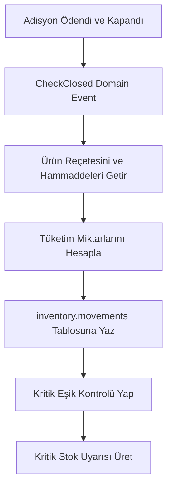

# HIPOS — Reçeteli Satıştan Stok Düşümü ve Satın Alma Kılavuzu

> **Durum:** Öncelikli Geliştirme Alanı · Doküman Sürümü: v1.0
> **İlgili Mimari Referanslar:** [Envanter ve Stok Sözleşmesi](ENVANTER_STOK_SATINALMA_SOZLESMESI.md) · [Backend Mimarisi](../01-mimari-ve-altyapi/BACKEND_MIMARISI_VE_MODUL_BAGIMLILIKLARI.md) · [Ana Devir Rehberi](../00-devir-rehberi/DEVIR_REHBERI.md)

> **Dokümantasyon Hiyerarşisi:**
> * **Güncel kod durumu için:** [docs/01-mimari-ve-altyapi/BACKEND_MIMARISI_VE_MODUL_BAGIMLILIKLARI.md](../01-mimari-ve-altyapi/BACKEND_MIMARISI_VE_MODUL_BAGIMLILIKLARI.md)
> * **Güncel teslim ve yol haritası için:** [docs/00-devir-rehberi/DURUM_VE_YOL_HARITASI.md](../00-devir-rehberi/DURUM_VE_YOL_HARITASI.md)
> * **Devir ve onboarding için:** [docs/00-devir-rehberi/DEVIR_REHBERI.md](../00-devir-rehberi/DEVIR_REHBERI.md)
> * **Tarihsel kararlar için:** [docs/05-gecmis-ve-arsiv/](../05-gecmis-ve-arsiv/)

---

### 📌 Gerçeklik ve Uygulama Durumu Özeti

| Alan / Özellik | Durum | Açıklama |
| :--- | :--- | :--- |
| **Reçete sürümü** | **Çalışıyor** | Ürün bazlı hammadde gramajları ve sürümleme kalıcıdır |
| **Stok hareketi** | **Çalışıyor** | `inventory.movements` manuel giriş/çıkış ve bakiye hesabı çalışır |
| **Sayım ve düzeltme** | **Çalışıyor** | Taslak sayım, fark analizi ve tekil düzeltme hareketi çalışır |
| **Satıştan otomatik tüketim** | **Yok** | Adisyon kapanışında reçete patlatıp stok düşme henüz bağlanmadı |
| **Satın alma / mal kabul** | **Çalışıyor** | Taslak ve onay ile tedarikçiye iade kalıcıdır; eksik teslim düzeltmesinin backend/geçmişi korunur, yeni form panelde yoktur |
| **Fire kaydı** | **Çalışıyor** | Gerekçeli hammadde fire/zayi kaydı ve bağlı stok çıkışı kalıcıdır; gerçek PIN ve reçeteli ürün zayisi eksiktir |
| **Maliyet hesabı** | **Ertelendi** | Fiyatlandırma ve stok maliyeti ayrı modülde tasarlanacaktır |

---

## 1. Problem Tanımı ve Mevcut Kod Durumu

Şu anki HIPOS sisteminde [`InventoryDbContext`](../../apps/api/Hipos.Api/Inventory/InventoryDbContext.cs) içinde depolar, hammaddeler, reçeteler ve fiziksel sayım tabloları bulunmaktadır. Ancak:
* Satışlar (`sales`) ile Stok (`inventory`) arasında **hiçbir otomatik bağlantı yoktur**.
* POS'ta veya masada 100 porsiyon Pizza satılsa bile, depodaki un, domates sosu veya mozzarella stoğu **1 gram bile azalmamaktadır**.
* Mal kabul ve tedarikçiye iade kodlanmıştır. Eksik teslim düzeltmesinin backend ve geçmiş kayıtları korunur ancak yeni düzeltme formu panelden kaldırılmıştır. Satın alma siparişi ve mal kabulün siparişle eşleştirilmesi henüz yoktur.
* Fire ve zayi stoktan düşülebilir; gerçek şef PIN onayı yoktur. Fiyatlandırma, stok maliyeti ve parasal kayıp raporu ayrı modüle ertelenmiştir.

---

## 2. Reçeteli Otomatik Tüketim Mekanizması (Reçete Patlatma)

Restoranda bir porsiyon satıldığında arka planda çalışan hammadde düşüm mimarisi:



#### Örnek Tüketim Tablosu:
> **Satılan:** 2x Margherita Pizza
> **Reçete (1 Porsiyon):** 200g Hamur (Un), 80g Domates Sosu, 120g Mozzarella
> **Stoktan Düşülecek:** 400g Un, 160g Sos, 240g Mozzarella ➡️ `inventory.movements` tablosuna `kind: recipe_consumption` olarak yazılır.

---

## 3. Mimari ve Veritabanı Modeli (`inventory` Şeması Genişletmesi)

Mevcut şemaya eklenecek satın alma ve tüketim tabloları:

```sql
-- Mal Kabul ve Satın Alma Faturaları
CREATE TABLE inventory.purchases (
    id UUID PRIMARY KEY DEFAULT gen_random_uuid(),
    firm_id UUID NOT NULL,
    branch_id UUID NOT NULL,
    warehouse_id UUID NOT NULL REFERENCES inventory.warehouses(id),
    supplier_cari_id UUID NOT NULL, -- Cari modülündeki tedarikçi
    invoice_number VARCHAR(100) NOT NULL,
    invoice_date DATE NOT NULL,
    total_minor INT NOT NULL,
    created_at TIMESTAMPTZ NOT NULL DEFAULT clock_timestamp()
);

CREATE TABLE inventory.purchase_lines (
    id UUID PRIMARY KEY DEFAULT gen_random_uuid(),
    purchase_id UUID NOT NULL REFERENCES inventory.purchases(id) ON DELETE CASCADE,
    item_id UUID NOT NULL REFERENCES inventory.items(id), -- hammadde
    quantity_base_unit INT NOT NULL, -- gram, ml, adet baz biriminde
    unit_price_minor INT NOT NULL
);

-- inventory.movements tablosuna satış ve fatura referansı
ALTER TABLE inventory.movements
ADD COLUMN sales_check_id UUID NULL,
ADD COLUMN purchase_id UUID NULL;
```

---

## 4. Adım Adım Uygulama Yol Haritası

### Adım 1: Adisyon Kapandığında Stok Tüketim Handler'ı (Event Listener)
1. `apps/api/Hipos.Api/Sales` içinde adisyon kapandığında (`status = 'closed'`):
   * `IStockDeductionService.DeductForCheckAsync(checkId)` çağrılır.
2. Adisyondaki tüm `order_lines` taranır.
3. Her ürünün `catalog.products` -> `inventory.recipes` eşleşmesi bulunur.
4. Reçetedeki her hammadde için:
   * `Tüketim = Kalem Adedi * Reçete Miktarı`
   * `inventory.movements` tablosuna negatif hareket (`manual_out` benzeri `kind: recipe_consumption`) basılır.
5. Eğer bir hammadde kritik eşiğin altına düşerse (`onHand < criticalBelow`):
   * Dashboard'a kırmızı "Kritik Stok Uyarısı" üretilir.

### Adım 2: Mal Kabul ve Satın Alma Girişi (Tedarikçiden Alım)
* `POST /api/v1/.../inventory/purchases`: Toptancıdan gelen irsaliye/faturanın kaydı.
* Gövde:
  ```json
  {
    "supplierCariId": "kasap-ahmet-uuid",
    "invoiceNumber": "GIB2026000124",
    "items": [
      { "itemId": "dana-kiymasi-uuid", "quantity": 10000, "unitPriceMinor": 45000 }
    ]
  }
  ```
* Bu işlem atomik olarak:
  1. Depoya 10 kg kıyma stoğu ekler (`kind: purchase_receipt`).
  2. Cari modülünde Kasap Ahmet'in borç bakiyesini otomatik artırır (`supplier_debt`).

### Adım 3: Fire ve Zayi Girişi
* `POST /api/v1/.../inventory/waste`: Bozulma, son kullanma tarihi geçme veya mutfakta dökülme durumları.
* Zorunlu alanlar: `Hammadde, Miktar, Gerekçe (Döküldü, Bozuldu, Kalite Kontrol)`.

---

## 5. Kabul Kriterleri (Devir Doğrulama Testi)

1. Depoda 5.000 gram Mozzarella varken, masada 10 adet Margherita Pizza satılıp adisyon kapatıldığında depodaki Mozzarella stoğu anında 3.800 grama düşmeli.
2. Reçetesi tanımlanmamış bir ürün satıldığında adisyon kapanışı hata vermemeli, log'a *"Reçete Tanımsız: [Ürün Adı]"* uyarısı atmalı.
3. Toptancıdan 50 kg un girişi yapıldığında hem depodaki un miktarı 50 kg artmalı hem de Tedarikçinin cari ekstresine fatura bedeli borç olarak işlenmelidir.
