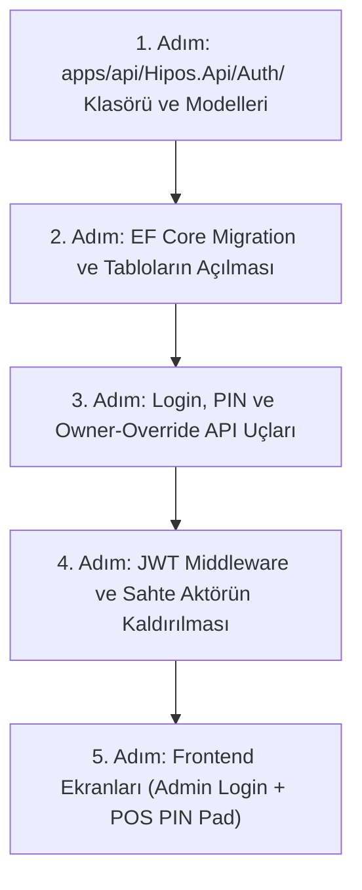

# HIPOS — Kapsamlı Sistem Analizi ve Büşra Auth Uygulama Yol Haritası

> **Doküman Durumu:** Canlı Çalışma Belgesi (Büşra Branch: `busra_login`)  
> **Hazırlanma Tarihi:** 28 Ekim 2026  
> **Sorumlu:** Büşra (Kimlik, PIN ve Auth Mimarisi)  
> **Özel Mimari Kural:** Manager (Müdür) rolü kaldırılmıştır. Sistemde tek üst yetkili **Owner** (Şirket Sahibi / Patron) olup, toplam 4 rol (`owner`, `cashier`, `waiter`, `chef`) yer alır.

---

## İÇİNDEKİLER
1. [Bölüm 1: Genel Proje Analizi ve Büyük Resim](#bölüm-1-genel-proje-analizi-ve-büyük-resim)
2. [Bölüm 2: Devir Rehberindeki Modüllerin Analizi (Modül 1 - 7)](#bölüm-2-devir-rehberindeki-modüllerin-analizi-modül-1---7)
3. [Bölüm 3: Mimari, Operasyon ve İş Alanları Belgelerinin Analizi](#bölüm-3-mimari-operasyon-ve-iş-alanları-belgelerinin-analizi)
4. [Bölüm 4: Manager'sız 4 Rollü RBAC Yetki ve Onay Modeli](#bölüm-4-managersız-4-rollü-rbac-yetki-ve-onay-modeli)
5. [Bölüm 5: Büşra İçin Adım Adım Auth Uygulama Planı (Nereden ve Nasıl Başlanacak?)](#bölüm-5-büşra-için-adım-adım-auth-uygulama-planı)
6. [Bölüm 6: Auth Tamamlandıktan Sonra Sistemin Devam Sırası](#bölüm-6-auth-tamamlandıktan-sonra-sistemin-devam-sırası)

---

# Bölüm 1: Genel Proje Analizi ve Büyük Resim

### 1. Proje Nedir ve Genel Amacı Ne?
**HIPOS**, modern restoran, kafe ve barların tüm yönetim, finans, mutfak, servis ve kasa süreçlerini tek bir merkezde toplayan **yeni nesil Restoran Yönetim ve Operasyon Platformudur (ERP + POS + KDS + Garson)**.

Geleneksel restoran yazılımlarındaki parçalı yapıyı (garsonun ayrı cihaza girmesi, kasanın ayrı yazarkasadan nakit kesmesi, mutfağın bağımsız fiş basması, akşam patronun excel defterine veya harici programa elle veri girmesi) bitirir. "Çift defter" karmaşasını ortadan kaldırarak şu zinciri kurar:
* **Garson (`/waiter`):** Masaya oturmuş müşteriden siparişi alır, PostgreSQL'deki ortak adisyona kaydeder.
* **Mutfak (`/kitchen` - KDS):** Sipariş onaylandığı saniyede mutfak tabletine düşer, istasyonlara (Fırın, Bar, Sıcak Mutfak) ayrılır ve ağdaki termal bilet yazıcısından (ESC/POS 9100) fiş çıkar. Aşçı hazırlık durumunu günceller.
* **Kasa (`apps/pos`):** Müşteri hesabı kapatırken Nakit, Kredi Kartı Banka POS'u, Yemek Kartı ve Cari (Veresiye) arasında hesabı parçalar. Tahsilat tamamlandığı an masa otomatik olarak yeşile (boş) döner, para çekmecesi fırlar ve nakit tutar **ayrıca elle deftere girilmeden otomatik olarak kasa hareketlerine (`cash.movements`) yansır**.
* **Stok & Reçete (`inventory`):** Adisyon kapandığı milisaniyede arka plan servisi satılan ürünün reçetesini patlatır (Örn: 1 Margherita Pizza = 150 gr un, 100 gr mozzarella, 80 gr sos) ve hammaddeyi depodan otomatik düşer.
* **Cari & Tediye (`cari`):** Masadan veresiye kapatılan hesaplar müşterinin cari bakiyesine borç yazılır; kasadan toptancıya nakit tediye ödendiğinde hem kasanın parası düşer hem toptancının borcu kapanır.
* **İnternet Kesintisi Güvencesi (LAN Hub):** Restoranın interneti kopsa dahi operasyon yerel ağdaki Mini PC üzerinden sıfır kesintiyle sürer; internet geldiğinde merkezi buluta eşitlenir.

---

### 2. Teknoloji Yığını (Tech Stack)

| Katman | Teknoloji / Araç | Sınırları ve Görevi |
|---|---|---|
| **Backend API** | **C# / .NET 10 (ASP.NET Core 10)** | Modüler Monolit mimari. Tüm iş alanlarını tek bir HTTP API servisinde modül sınırlarıyla yönetir. |
| **Veri Tabanı & ORM** | **PostgreSQL (Docker) + EF Core 10 (Npgsql 10.0.3)** | PostgreSQL üzerinde 8 domain şeması + eklenecek `auth` şeması. Her modül kendi DbContext'ine ve bağımsız Migration geçmişine sahiptir. |
| **Yönetim Paneli (Admin)** | **TypeScript + React 19 + Vite 8 + React Router 7** | Ofis/Patron ekranı. Ürün, menü, stok, cari, gider, personel ve kasa raporlama ekranları. |
| **Operasyon Terminali (POS)** | **TypeScript + React 19 + Vite 8** | Dokunmatik Kasa, Garson Masaları (`/waiter`) ve Mutfak KDS (`/kitchen`) ekranları. |
| **Tasarım Sistemi** | **Vanilla CSS + Tasarım Değişkenleri (CSS Tokens)** | Dış ağır UI kütüphaneleri yerine yüksek performanslı özel CSS değişkenleri (`operational.css`). |
| **Otomatik Testler** | **Node.js `node:test`, Vitest 5, Playwright 1.63** | Birim, API HTTP senaryoları ve geçici izole PostgreSQL entegrasyon testleri (`npm run test:db`). |

---

### 3. Projenin Bugünkü Gerçeklik Durumu

* ✅ **Bugün Kodda Çalışan Kalıcı MVP Parçaları:**
  1. **Katalog & Menü (`catalog`):** Ürün kartları, alerjenler, fiyat sürümleme, menü bölümleri ve ürün sıralama.
  2. **Cari Hesaplar (`cari`):** Müşteri ve tedarikçi kartları, borç/alacak hareket defteri ve tarih aralıklı ekstre.
  3. **Stok & Reçete (`inventory`):** Hammaddeler, kritik stok eşikleri, reçete editörü, sayım taslağı ve onay kilitli düzeltme hareketi.
  4. **Manuel Kasa (`cash`):** Tek şubede varsayılan `MAIN` kasasında elle vardiya açma, nakit avans girişi (`manual_in`), harcama çıkışı (`manual_out`), ters kayıt (`reversal`) ve vardiya kapama.
  5. **Giderler (`finance`):** Firma gider kategorileri ve şube gider defteri.
  6. **Ortak Adisyon Çekirdeği (`sales`):** Masaya sipariş girildiğinde siparişlerin PostgreSQL'e yazılması.
  7. **Personel Kartları (`service`):** Çalışan kartları ve bölüm/görev tanımları.

* 🚧 **Eksik Olan / Geliştirilecek Kritik Parçalar:**
  1. **Gerçek Auth (Büşra'nın Yapacağı Kısım):** Kodda kullanıcı şifresi hash'leme, login ve 4 haneli PIN doğrulama yoktur; sahte `X-Demo-Actor` aktör middleware'i kullanılmaktadır.
  2. **Otomatik Satış-Kasa Akışı:** Masadaki tahsilat kasaya otomatik akmamaktadır (çift defter durumu sürmektedir); parçalı ödeme (`sales.check_payments`) yoktur.
  3. **Masa Yaşam Döngüsü:** Masa taşıma, masa birleştirme, adisyon bölme ve hesap kapanınca masayı otomatik yeşile (boş) çevirme yoktur.
  4. **Satıştan Stok Tüketimi:** Adisyon kapandığında reçetedeki gramajları stoktan otomatik düşen arka plan servisi yoktur.
  5. **Operasyonel KDS & Yazıcı:** Mutfak ekranı salt-okunur polling'dir; butonlar, süre alarmları ve ESC/POS 9100 ağ yazıcısı servisi yoktur.
  6. **Gerçek Ödeme & Donanım:** Banka POS cihazları ve Beko/Token ÖKC mali cihaz entegrasyonu yoktur.
  7. **Offline Sync:** Çevrimdışı işlem kuyruğu (`sync.outbox`) ve bulut senkronizasyonu yoktur.

---

# Bölüm 2: Devir Rehberindeki Modüllerin Analizi (Modül 1 - 7)

### [Modül 01] Kasa, POS ve Parçalı Tahsilat Modülü
* **İlgili Şartname:** `docs/00-devir-rehberi/MODUL_01_KASA_VE_POS.md`
* **Mevcut Durum:** Tek kasa (`MAIN`) için manuel vardiya açma/kapatma, elle avans (`manual_in`) ve harcama (`manual_out`) girişi, ters kayıt (`reversal`) zinciri çalışmaktadır.
* **Geliştirilecek Backlog:**
  1. Dokunmatik Parçalı Tahsilat Ekranı (`apps/pos`): Nakit + Banka POS + Sodexo + Cari bölme desteği.
  2. Otomatik Kasa Entegrasyonu: Nakit tahsilatın anında `cash.movements` tablosuna `cash_sale` olarak yazılması.
  3. Kasiyerlerin 4 haneli PIN ile kasa açması.
  4. Avans ekleme (`cash_float_in`), hasılat teslim alma (`safe_drop`) ve toptancıya tediye ödemelerinde **yalnızca Owner PIN onayı**.
  5. Gün sonu açık masa kilidi, kupür sayımı ve Z-Raporu sihirbazı.

### [Modül 02] Masa Servisi ve Ortak Adisyon Modülü
* **İlgili Şartname:** `docs/00-devir-rehberi/MODUL_02_MASA_VE_ADISYON.md`
* **Mevcut Durum:** 24 masa tanımlıdır. Garson `/waiter` ekranından masaya sipariş girip ortak `sales.checks` ve `sales.orders` tablolarına kaydedebilmektedir.
* **Geliştirilecek Backlog:**
  1. Adisyon kapandığında masanın anında `empty` (yeşil) durumuna geçmesi.
  2. Masa Taşıma (`transfer`) ve Masa Birleştirme (`merge`) API ve modalları.
  3. Adisyon Bölme (Split Check) desteği.
  4. Kalem iptali, ikram ve indirimlerde **Owner PIN onayı** zorunluluğu ve `sales.check_voids` kütüğü.

### [Modül 03] Mutfak (KDS) & Servis Kuyruğu Modülü
* **İlgili Şartname:** `docs/00-devir-rehberi/MODUL_03_MUTFAK_VE_KDS.md`
* **Mevcut Durum:** `/kitchen` ekranı 3 saniyede bir polling yapan salt-okunur prototiptir.
* **Geliştirilecek Backlog:**
  1. Dokunmatik Durum Butonları (`pending` -> `preparing` -> `ready` -> `served`).
  2. İstasyon filtreleme (`Sıcak Mutfak`, `Taş Fırın`, `Bar / İçecek`, `Soğuk`).
  3. Gecikme renk sayaçları (Yeşil 0-10 dk, Sarı 10-20 dk, Kırmızı 20+ dk).
  4. ESC/POS 9100 ağ yazıcısı arka plan servisi ile otomatik bilet basımı.

### [Modül 04] Ürün Kataloğu & Menü Yönetimi Modülü
* **İlgili Şartname:** `docs/00-devir-rehberi/MODUL_04_KATALOG_VE_MENU.md`
* **Mevcut Durum:** Ürünler, kategoriler, fiyat sürümleme, şube menüleri ve bölümler API'ye tam bağlıdır.
* **Geliştirilecek Backlog:**
  1. Ürün seçenek grupları (Modifiers: Porsiyon büyüklüğü, soslar, pişme derecesi).
  2. Masalara özel karekodlu QR Menü çıktısı URL üreticisi.

### [Modül 05] Stok, Depo & Reçeteli Üretim Modülü
* **İlgili Şartname:** `docs/00-devir-rehberi/MODUL_05_STOK_VE_RECETE.md`
* **Mevcut Durum:** Depo hammaddeleri, kritik eşikler, reçete editörü, sayım taslağı ve onay kilidi çalışmaktadır.
* **Geliştirilecek Backlog:**
  1. Adisyon kapandığında reçeteyi patlatıp depodan hammadde düşen `recipe_consumption` arka plan motoru.
  2. Mal kabul ve toptancı alış irsaliyesi ekranı.
  3. Gerekçeli Fire / Zayi kaydı (Owner onayı ile).

### [Modül 06] Cari Hesaplar & Gider Yönetimi Modülü
* **İlgili Şartname:** `docs/00-devir-rehberi/MODUL_06_CARI_VE_GIDER.md`
* **Mevcut Durum:** Müşteri/tedarikçi kartları, borç/alacak hareketleri, bakiye hesaplama, ekstre ve şube gider defteri çalışmaktadır.
* **Geliştirilecek Backlog:**
  1. Kasa adisyonundan otomatik veresiye kaydı (`customer_charge`).
  2. Kasadan toptancıya nakit tediye ödemesi (`supplier_payout`) ile kasanın nakdini düşüp toptancının borcunu tek işlemde kapatma.
  3. Kasa nakit çıkışı ile gider modülünün atomik bağlanması.

### [Modül 07] Kimlik, Oturum ve Yetkilendirme Modülü (Auth & Security) — BÜŞRA'NIN ÇALIŞMA ALANI
* **İlgili Şartname:** `docs/00-devir-rehberi/MODUL_07_KIMLIK_VE_AUTH.md`
* **Mevcut Durum:** Projede gerçek auth yoktur; sahte `X-Demo-Actor` aktör middleware'i aktiftir. `apps/api/Hipos.Api/Auth/` klasörü sıfırdan kurulacaktır.

---

# Bölüm 3: Mimari, Operasyon ve İş Alanları Belgelerinin Analizi

* **01-mimari-ve-altyapi:**
  * `TEKNIK_MIMARI.md` & `BACKEND_MIMARISI_VE_MODUL_BAGIMLILIKLARI.md`: 8 şemanın sınırlarını ve monorepo yapısını kurallar altına alır. Modül kapatmanın veri silmek değil, yeni iş alımını durdurmak olduğunu belirtir.
  * `CEVRIMDISI_VE_SENKRONIZASYON.md`: Mini PC, `sync.outbox` tablosu ve bulut eşitleme modelini tarif eder.
  * `DONANIM_VE_MALI_CIHAZLAR.md`: Beko/Token GMP3, ESC/POS TCP 9100 yazıcı ve RJ11 çekmece sinyali protokollerini detaylandırır.
* **02-kasa-ve-operasyon:**
  * `KASA_POS_VE_OPERASYON_SOZLESMESI.md` & `ADISYON_VE_MASA_YASAM_DONGUSU.md`: Parçalı ödeme, masa taşıma, masa birleştirme ve adisyon kapatma kurallarını açıklar.
  * `MUTFAK_KDS_VE_YAZICI.md`: İstasyon ayrımı ve termal bilet basımı kurallarını belirler.
* **03-is-alanlari-ve-yonetim:**
  * `RECETELI_STOK_VE_SATINALMA.md`: Otomatik stok tüketimi ve irsaliye girişlerini kurallar altına alır.
  * `CARI_HESAPLAR_MVP.md` & `GIDER_YONETIMI_MVP.md`: Müşteri veresiye ve toptancı tediye akışlarını açıklar.
* **04-test-ve-rehberler:**
  * `KASA_MANUEL_TEST.md`, `CARI_MANUEL_TEST.md`, `MASA_SERVISI_TEST.md`, `STOK_REÇETE_SAYIM_MANUEL_TEST.md` ve `YARIN_DEMO_KILAVUZU.md` ile tüm sistem adımları doğrulanabilir.

---

# Bölüm 4: Manager'sız 4 Rollü RBAC Yetki ve Onay Modeli

Dokümandaki 5 rollü yapıdan `manager` tamamen kaldırılmıştır. Sistemin nihai yetki matrisi:

| Yetki / İşlem Alanı | Owner (Tek Patron) | Cashier (Kasiyer) | Waiter (Garson) | Chef (Aşçı) |
|---|:---:|:---:|:---:|:---:|
| **Yönetim Paneli Girişi (E-posta + Şifre)** | ✅ | ❌ | ❌ | ❌ |
| **Şube, Modül ve Sistem Ayarları** | ✅ | ❌ | ❌ | ❌ |
| **Fiyat, Ürün ve Menü Tanımlama/Yayınlama** | ✅ | ❌ | ❌ | ❌ |
| **Personel Tanımlama ve 4 Haneli PIN Atama** | ✅ | ❌ | ❌ | ❌ |
| **Depo Sayım Onayı ve Düzeltme Kilidi** | ✅ | ❌ | ❌ | ❌ |
| **Kasa Açma / Kapatma (Z-Raporu)** | ✅ | ✅ (Kendi kasası) | ❌ | ❌ |
| **Kasaya Bozuk Para Avansı Ekleme (`cash_float_in`)** | ✅ | ❌ | ❌ | ❌ |
| **Kasadan Hasılat Teslim Alma (`safe_drop`)** | ✅ | ❌ | ❌ | ❌ |
| **Tedarikçiye Kasadan Nakit Tediye Ödeme** | ✅ | ❌ | ❌ | ❌ |
| **İptal / İkram / İndirim Onayı (PIN ile)** | ✅ (Tek Yetkili) | ❌ | ❌ | ❌ |
| **Masaya Sipariş Girme / Adisyon Açma** | ✅ | ✅ | ✅ | ❌ |
| **Mutfak KDS Hazırlık Durumu Değiştirme** | ✅ | ❌ | ❌ | ✅ |

---

# Bölüm 5: Büşra İçin Adım Adım Auth Uygulama Planı

Geliştirmeye tam olarak aşağıdaki adımlarla başlanacaktır:



### 1. Adım: `Auth` Klasörü ve Entity Sınıfları
`apps/api/Hipos.Api/` altında `Auth` klasörü açılır ve 5 C# dosyası yazılır:
* `UserRow.cs`: Kullanıcı tablosu (`Id`, `Email`, `PasswordHash`, `FullName`, `Phone`, `IsActive`, `CreatedAt`).
* `MembershipRow.cs`: Rol tablosu (`Id`, `UserId`, `FirmId`, `BranchId`, `Role` -> `'owner'`, `'cashier'`, `'waiter'`, `'chef'`).
* `PinCodeRow.cs`: 4 haneli PIN tablosu (`Id`, `MembershipId`, `PinHash`, `IsActive`).
* `SessionRow.cs`: Oturum tablosu (`Id`, `UserId`, `TokenHash`, `ClientType`, `ExpiresAt`).
* `AuthDbContext.cs`: PostgreSQL `auth` şemasını yöneten DbContext.

### 2. Adım: EF Core Migration Komutları
Terminalden şu komutlar verilerek Docker PostgreSQL üzerinde `auth` şeması ve tabloları otomatik oluşturulur:
```bash
dotnet ef migrations add InitAuth --project apps/api/Hipos.Api/Hipos.Api.csproj --context AuthDbContext
dotnet ef database update --project apps/api/Hipos.Api/Hipos.Api.csproj --context AuthDbContext
```

### 3. Adım: API Uç Noktalarının Kodlanması
* `POST /api/v1/auth/login`: Owner için e-posta + şifre girişi (JWT Access Token üretir).
* `POST /api/v1/auth/pin-verify`: Kasiyer, garson ve aşçı için dokunmatik 4 haneli PIN doğrulaması.
* `POST /api/v1/auth/owner-override`: Sahada ikram/indirim/iptal durumlarında Owner PIN onay ucu.
* `POST /api/v1/auth/logout` & `GET /api/v1/auth/me`.

### 4. Adım: Güvenlik ve Sahte Aktörün Kaldırılması
* API'ye JWT Authentication Middleware eklenir.
* `X-Demo-Actor` başlığı okunması kaldırılır; kullanıcı claim'leri doğrudan `HttpContext.User` üzerinden alınır.

### 5. Adım: Frontend Giriş Ekranları
* `apps/admin/src/features/auth/LoginPage.tsx`: Yönetim paneline e-posta/şifre ekranı ve `AuthGuard`.
* `apps/pos/src/components/PinPadModal.tsx`: Terminal kilit ekranı ve dokunmatik PIN tuş takımı.

---

# Bölüm 6: Auth Tamamlandıktan Sonra Sistemin Devam Sırası

Auth modülü tamamlandıktan sonra proje şu sırayla inşa edilecektir:
1. **Adım 6:** Parçalı Tahsilat, Otomatik Kasa Akışı ve Masayı Otomatik Boşaltma (`sales.check_payments`).
2. **Adım 7:** Satıştan Otomatik Reçeteli Stok Tüketim Motoru (`recipe_consumption`).
3. **Adım 8:** Toptancı İrsaliyesi (Mal Kabul) ve Kasadan Tedarikçi Tediye Ödemesi (`supplier_payout`).
4. **Adım 9:** Mutfak KDS Durum Makinesi ve ESC/POS 9100 Termal Ağ Fiş Basımı.
5. **Adım 10:** Çevrimdışı Çalışma (Offline LAN Hub - `sync.outbox`) ve Beko/Token ÖKC Mali Cihaz Bağlantısı.
